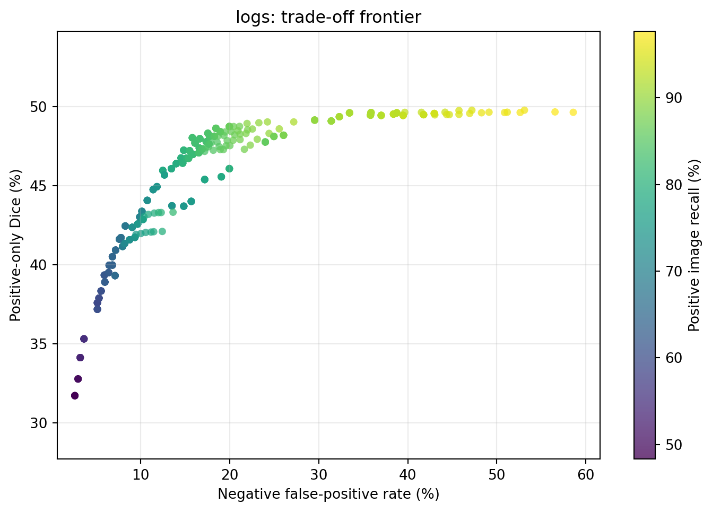
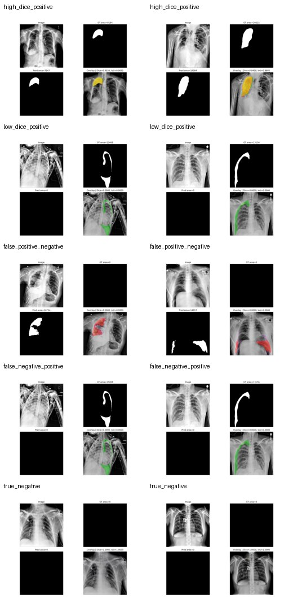

# SIIM-ACR 3 模型融合实验报告

## 1. 实验目的

本实验在 SIIM-ACR Pneumothorax Segmentation 验证集上评估 3 模型融合方案。融合对象按实验目录和当前模型清单记录为：

| 模型 | 来源实验 |
|---|---|
| U-Net++ ResNet34 recall v2 | `outputs/experiments/siim_acr_unetpp_resnet34_recall_v2/20260519_160852` |
| U-Net++ ResNet50 recall v1 | `outputs/experiments/siim_acr_unetpp_resnet50_recall_v1/20260519_171710` |
| DeepLabV3+ ResNet34 v1 | `outputs/experiments/siim_acr_deeplabv3plus_resnet34_v1/20260519_115843` |

实验目标是观察在 2 模型融合基础上加入 DeepLabV3+ ResNet34 后，是否能进一步改善正样本 Dice、阴性误报率和全体验证集 Dice 之间的平衡。

本报告仅基于验证集结果进行分析，尚未包含独立 test 集评估，因此不能表述为最终泛化性能。

## 2. 实验配置

实验输出目录：

```text
outputs/experiments/ensemble_unetpp_r34_r50_deeplab_r34_v1
```

融合与评估设置：

| 配置项 | 数值 |
|---|---:|
| Split | val |
| 输入尺寸 | 512 x 512 |
| 模型数 | 3 |
| 融合方式 | 预测概率平均 |
| TTA | 水平翻转 `hflip` |
| 后处理 | 阈值二值化 + 连通域面积过滤 |
| `keep_largest_component` | False |

主要结果文件：

```text
logs/ensemble_postprocess_sweep_val.csv
visualizations/val_ensemble3_thr0p3_mincomp500_minpred0/summary.json
```

## 3. 主可视化配置结果

当前可视化目录对应的主配置为：

| 参数 | 数值 |
|---|---:|
| Threshold | 0.30 |
| Min component area | 500 |
| Min pred area | 0 |
| Keep largest component | False |
| TTA | hflip |
| Num models | 3 |

验证集结果如下：

| 指标 | 数值 |
|---|---:|
| 验证集样本数 | 2135 |
| 阳性样本数 | 476 |
| 阴性样本数 | 1659 |
| Mean Dice all | 0.7961 |
| Mean Dice positive | 0.4301 |
| Mean IoU positive | 0.3380 |
| Mean Dice negative | 0.9011 |
| Negative FP rate | 9.89% |
| False positive negative | 164 / 1659 |
| Positive image recall | 70.38% |
| False negative positive | 141 / 476 |
| Pixel Dice | 0.5638 |
| Pixel Precision | 0.6090 |
| Pixel Recall | 0.5249 |

与 2 模型融合主配置相比，3 模型主可视化配置的 positive-only Dice 略低，但阴性误报率明显下降：

| 模型与配置 | Positive Dice | Negative FP rate | Mean Dice all | False positive negative |
|---|---:|---:|---:|---:|
| 2 模型融合：R34+R50，thr=0.25, area=500 | 0.4365 | 12.18% | 0.7798 | 202 / 1659 |
| 3 模型融合：+ DeepLabV3+ R34，thr=0.30, area=500 | 0.4301 | 9.89% | 0.7961 | 164 / 1659 |

该配置更偏低误报，适合保留为比 2 模型融合更保守的候选方案。

## 4. 后处理搜索观察

后处理搜索结果来自：

```text
outputs/experiments/ensemble_unetpp_r34_r50_deeplab_r34_v1/logs/ensemble_postprocess_sweep_val.csv
```

按 `mean_dice_all` 排序，最高配置为：

| Threshold | Min component area | Min pred area | Positive Dice | Negative FP rate | Positive recall | Mean Dice all |
|---:|---:|---:|---:|---:|---:|---:|
| 0.40 | 800 | 0 | 0.3412 | 3.19% | 53.15% | 0.8283 |

该配置全体验证集 Dice 最高，但主要来自阴性样本 Dice 提升；正样本 Dice 和阳性图像召回明显下降，不适合作为病灶分割主配置。

在 `negative_fp_rate <= 13%` 的约束下，正样本 Dice 较高的候选配置为：

| Threshold | Min component area | Min pred area | Positive Dice | Negative FP rate | Positive recall | Mean Dice all |
|---:|---:|---:|---:|---:|---:|---:|
| 0.30 | 300 | 0 | 0.4595 | 12.48% | 78.36% | 0.7825 |

该候选比当前可视化主配置更偏召回：positive-only Dice 从 0.4301 提升到 0.4595，但阴性误报率从 9.89% 升至 12.48%。如果后续需要更接近 2 模型融合主配置的误报水平，可以优先复查该配置。

## 5. 可视化与错误分析

可视化结果保存于：

```text
outputs/experiments/ensemble_unetpp_r34_r50_deeplab_r34_v1/visualizations/val_ensemble3_thr0p3_mincomp500_minpred0
```

目录中按以下类别保存代表性样本：

```text
high_dice_positive
low_dice_positive
false_positive_negative
false_negative_positive
true_negative
```

从统计结果看，当前可视化配置仍有 141 个阳性样本漏检，同时有 164 个阴性样本误报。相比 2 模型融合，主要收益是减少阴性误报；主要代价是 positive-only Dice 和阳性图像召回略有下降。

## 6. 结论

3 模型融合在验证集上形成了一个更保守的候选方案。与 2 模型融合主配置相比，它没有提升 positive-only Dice，但把阴性误报率从 12.18% 降到 9.89%，mean Dice all 从 0.7798 提升到 0.7961。

当前建议：

1. 将 `threshold=0.30, min_component_area=500` 作为低误报可视化配置归档。
2. 将 `threshold=0.30, min_component_area=300` 作为更均衡的候选配置继续复查。
3. 不应仅按 `mean_dice_all` 选择 `threshold=0.40, min_component_area=800`，因为该配置对阳性病灶分割过于保守。
4. 若进入 test 集评估，应先在验证集上固定一个配置，不再根据 test 结果调参。

## 图表解读

后处理 trade-off 图以阴性误报率为横轴、positive-only Dice 为纵轴，适合判断候选配置是否只是用误报换召回。



定性示例 contact sheet 汇总了典型高 Dice、低 Dice、误报和漏检样本，用于复查错误模式。


