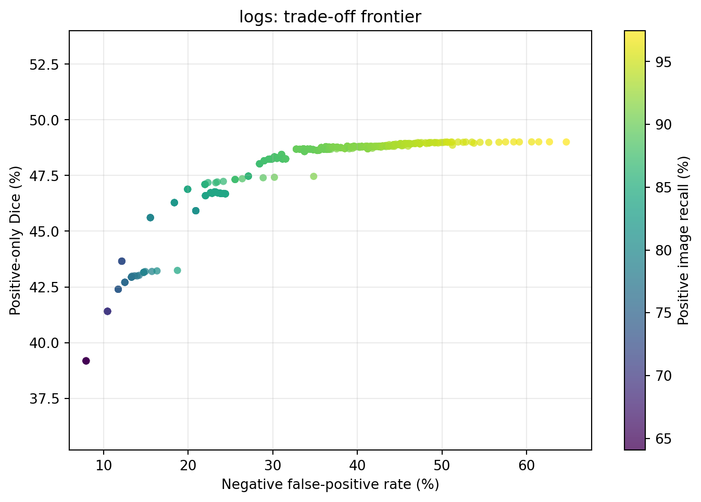
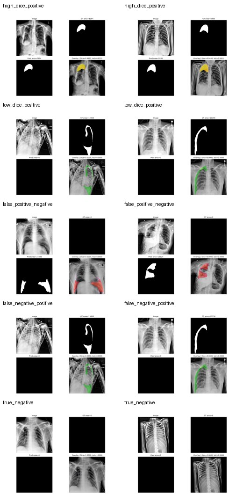
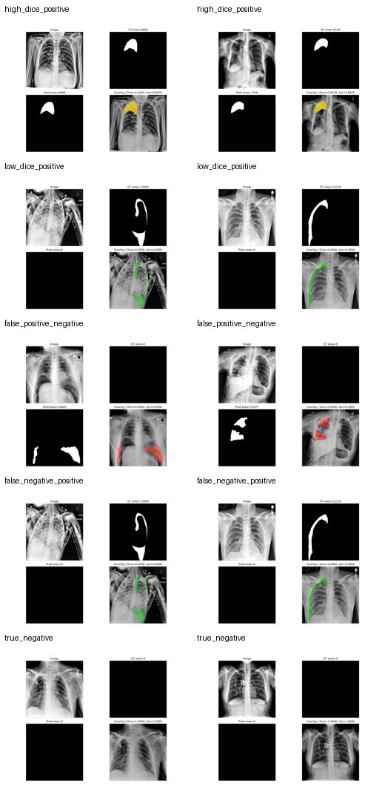

# SIIM-ACR U-Net++ ResNet34 + ResNet50 Ensemble 实验报告

## 1. 实验目的

本实验在 SIIM-ACR Pneumothorax Segmentation 验证集上评估两模型融合方案。融合对象为：

1. `U-Net++ ResNet34 recall v2`
2. `U-Net++ ResNet50 recall v1`

单模型实验中，`U-Net++ ResNet34` 在正样本 Dice 与阴性样本误报率之间表现较为均衡；`U-Net++ ResNet50 recall v1` 在低阈值下显示出更强的正样本召回潜力，但阴性误报偏高。本实验的目标是通过多模型平均、水平翻转 TTA 和连通域面积过滤，观察是否能同时改善正样本分割能力和阴性样本误报控制。

本报告仅基于验证集结果进行分析。当前实验未包含独立 test 集评估，因此以下结果不能表述为最终泛化性能。

## 2. 实验配置

实验输出目录：

```text
outputs/experiments/ensemble_unetpp_r34_r50_recall_v1
```

核心输入模型：

| 模型 | 运行目录 | 说明 |
|---|---|---|
| U-Net++ ResNet34 recall v2 | `outputs/experiments/siim_acr_unetpp_resnet34_recall_v2/20260519_160852` | recall-oriented ResNet34 模型 |
| U-Net++ ResNet50 recall v1 | `outputs/experiments/siim_acr_unetpp_resnet50_recall_v1/20260519_171710` | recall-oriented ResNet50 模型 |

融合与评估设置：

| 配置项 | 数值 |
|---|---:|
| Split | val |
| 输入尺寸 | 512 x 512 |
| 输入通道 | 3 |
| 模型数 | 2 |
| 融合方式 | 预测概率平均 |
| TTA | 水平翻转 `hflip` |
| 后处理 | 阈值二值化 + 连通域面积过滤 |
| `keep_largest_component` | False |
| 评估脚本 | `scripts/evaluate/ensemble_postprocess_sweep_siim_smp.py` |
| 可视化脚本 | `scripts/evaluate/visualize_siim_ensemble_predictions.py` |

主要结果文件：

```text
logs/ensemble_postprocess_sweep_val.csv
visualizations/val_ensemble_thr0p25_mincomp500/summary.json
visualizations/val_ensemble_thr0p30_mincomp200/summary.json
```

## 3. 后处理搜索结果

后处理搜索结果来自：

```text
outputs/experiments/ensemble_unetpp_r34_r50_recall_v1/logs/ensemble_postprocess_sweep_val.csv
```

按 `mean_dice_positive` 排序，低阈值、无面积过滤的配置可以达到最高正样本 Dice，但阴性误报极高：

| Threshold | Min component area | Min pred area | Positive Dice | Negative FP rate | Positive image recall | Mean Dice all |
|---:|---:|---:|---:|---:|---:|---:|
| 0.04 | 0 | 0 | 0.4901 | 62.69% | 97.27% | 0.3992 |
| 0.05 | 0 | 0 | 0.4901 | 61.42% | 96.85% | 0.4090 |
| 0.06 | 0 | 0 | 0.4901 | 60.58% | 96.64% | 0.4156 |
| 0.08 | 0 | 0 | 0.4901 | 58.47% | 96.64% | 0.4320 |

这些配置说明 ensemble 确实能在弱后处理下获得较高的正样本 Dice，但误报率不可接受，因此不能作为主结果。

按 `mean_dice_all` 排序，强连通域过滤能显著降低阴性误报，但会牺牲正样本 Dice：

| Threshold | Min component area | Min pred area | Positive Dice | Negative FP rate | Positive image recall | Mean Dice all |
|---:|---:|---:|---:|---:|---:|---:|
| 0.30 | 500 | 0 | 0.3918 | 7.96% | 64.08% | 0.8026 |
| 0.30 | 300 | 0 | 0.4140 | 10.49% | 69.75% | 0.7879 |
| 0.30 | 200 | 0 | 0.4239 | 11.75% | 74.16% | 0.7802 |

因此，本实验没有直接选取 `mean_dice_positive` 或 `mean_dice_all` 的极值，而是选择一个兼顾正样本 Dice 和阴性误报率的主配置。

## 4. 最终主配置

最终主配置来自：

```text
visualizations/val_ensemble_thr0p25_mincomp500/summary.json
```

参数如下：

| 参数 | 数值 |
|---|---:|
| Threshold | 0.25 |
| Min component area | 500 |
| Min pred area | 0 |
| Keep largest component | False |
| TTA | hflip |
| Num models | 2 |

验证集结果如下：

| 指标 | 数值 |
|---|---:|
| 验证集样本数 | 2135 |
| 阳性样本数 | 476 |
| 阴性样本数 | 1659 |
| Mean Dice all | 0.7798 |
| Mean Dice positive | 0.4365 |
| Mean IoU positive | 0.3407 |
| Mean Dice negative | 0.8782 |
| Negative FP rate | 12.18% |
| False positive negative | 202 / 1659 |
| Positive image recall | 72.90% |
| False negative positive | 129 / 476 |

与单模型 `U-Net++ ResNet34` 后处理 baseline 相比：

| 模型与配置 | Positive Dice | Negative FP rate | Mean Dice all | False positive negative |
|---|---:|---:|---:|---:|
| U-Net++ ResNet34 baseline：threshold=0.08, area=150 | 0.3980 | 13.92% | 0.7576 | 231 / 1659 |
| Ensemble R34+R50 main：threshold=0.25, area=500, hflip | 0.4365 | 12.18% | 0.7798 | 202 / 1659 |

该结果显示，融合方案将验证集正样本 Dice 从约 0.3980 提升至 0.4365，同时将阴性样本误报率从约 13.92% 降至 12.18%。这说明多模型融合能够在一定程度上缓解单模型在病灶召回和正常片误检之间的折中问题。

## 5. 低误报对照配置

另一个可保留的低误报配置来自：

```text
visualizations/val_ensemble_thr0p30_mincomp200/summary.json
```

参数如下：

| 参数 | 数值 |
|---|---:|
| Threshold | 0.30 |
| Min component area | 200 |
| Min pred area | 0 |
| Keep largest component | False |
| TTA | hflip |
| Num models | 2 |

验证集结果如下：

| 指标 | 数值 |
|---|---:|
| Mean Dice all | 0.7802 |
| Mean Dice positive | 0.4239 |
| Mean IoU positive | 0.3292 |
| Mean Dice negative | 0.8825 |
| Negative FP rate | 11.75% |
| False positive negative | 195 / 1659 |
| Positive image recall | 74.16% |
| False negative positive | 123 / 476 |

该配置的阴性误报率略低于主配置，但 positive-only Dice 也下降到 0.4239。它适合作为低误报对照，而不是优先主配置。

## 6. 可视化与逐样本分析

可视化结果保存于：

```text
outputs/experiments/ensemble_unetpp_r34_r50_recall_v1/visualizations/
```

当前包含两组配置：

```text
val_ensemble_thr0p25_mincomp500
val_ensemble_thr0p30_mincomp200
```

每组目录下按以下类别保存代表性样本：

```text
high_dice_positive
low_dice_positive
false_positive_negative
false_negative_positive
true_negative
```

从统计结果看，主配置仍存在 129 个阳性样本预测为空，说明融合虽然提高了 positive-only Dice，但对部分困难阳性样本仍存在漏检。另一方面，阴性误报数降至 202 / 1659，说明融合和面积过滤对正常胸片误检有一定抑制作用。

## 7. 结论

本实验验证了 `U-Net++ ResNet34 + U-Net++ ResNet50` 融合方案在 SIIM-ACR 验证集上的有效性。相较单模型 `U-Net++ ResNet34` baseline，融合模型在主配置下同时提升了 positive-only Dice，并降低了阴性误报率：

| 指标 | 单模型 ResNet34 baseline | Ensemble main | 变化 |
|---|---:|---:|---:|
| Positive Dice | 0.3980 | 0.4365 | +0.0385 |
| Negative FP rate | 13.92% | 12.18% | -1.74 pp |
| Mean Dice all | 0.7576 | 0.7798 | +0.0222 |
| False positive negative | 231 / 1659 | 202 / 1659 | -29 |

结果表明，多模型融合能够在一定程度上缓解单模型在病灶召回和正常片误检之间的折中问题。当前 ensemble main 配置可以作为验证集上的最佳候选方案，用于后续更严格的独立 test 集评估。

需要注意，该结论仍来自验证集，并且主配置经过验证集后处理参数选择。后续若进入 test 集评估，应固定当前配置，不再根据 test 结果调参。

## 8. 后续建议

1. 固定 ensemble main 配置：`threshold=0.25, min_component_area=500, min_pred_area=0, hflip TTA`。
2. 将该配置作为下一步独立 test 集评估候选。
3. 保留 low-FP 配置作为临床偏低误报场景的对照。
4. 对 129 个 false negative positive 样本做集中可视化复查，确认仍漏检的阳性样本类型。
5. 对 202 个 false positive negative 样本做误报来源分析，判断误报是否集中在肺尖、胸膜线、高对比边缘或图像伪影区域。

## 图表解读

后处理 trade-off 图以阴性误报率为横轴、positive-only Dice 为纵轴，适合判断候选配置是否只是用误报换召回。



定性示例 contact sheet 汇总了典型高 Dice、低 Dice、误报和漏检样本，用于复查错误模式。



定性示例 contact sheet 汇总了典型高 Dice、低 Dice、误报和漏检样本，用于复查错误模式。


