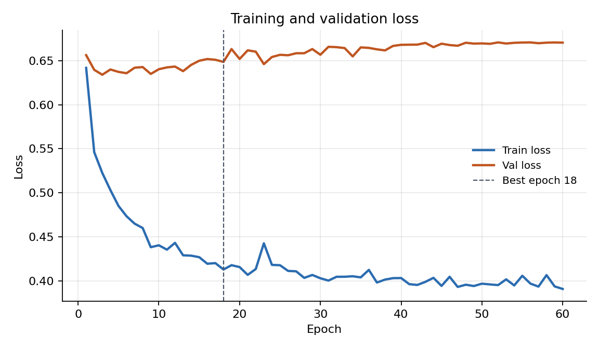
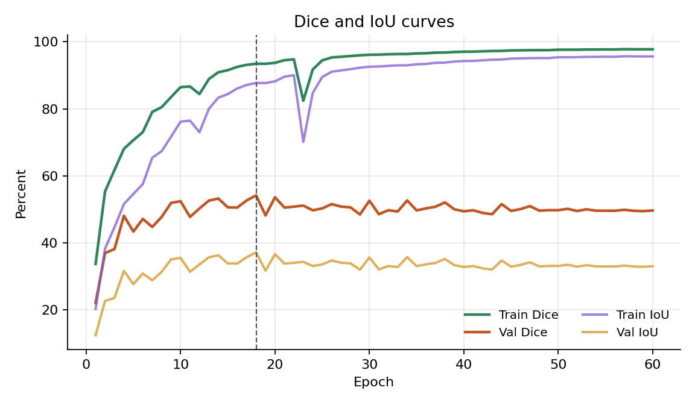
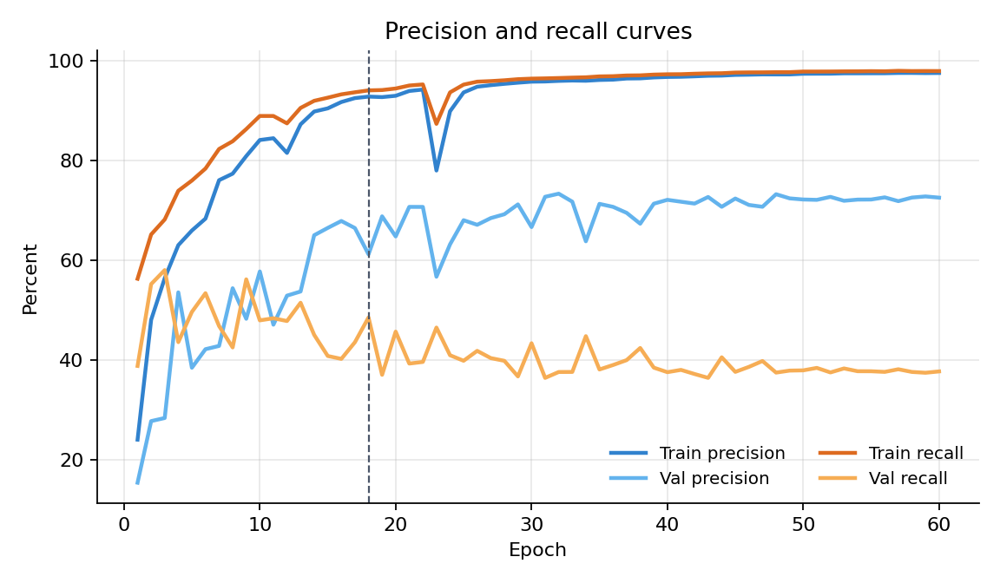
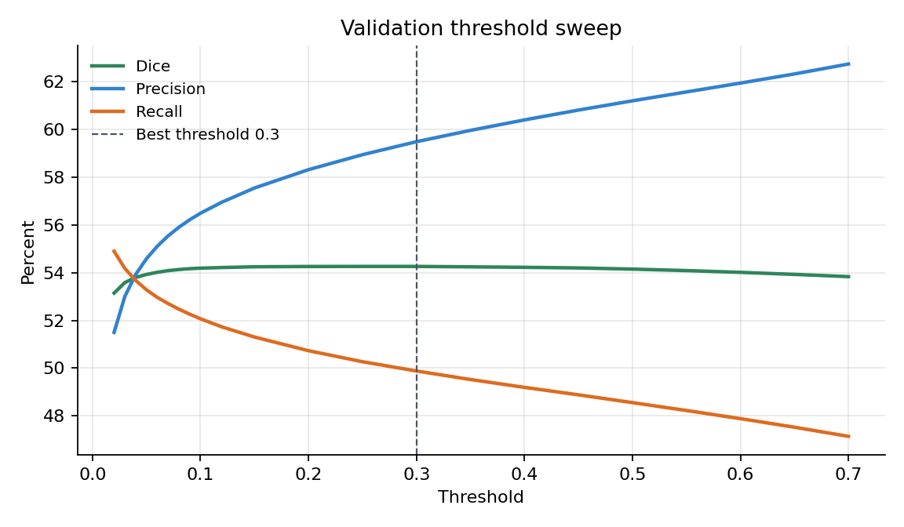
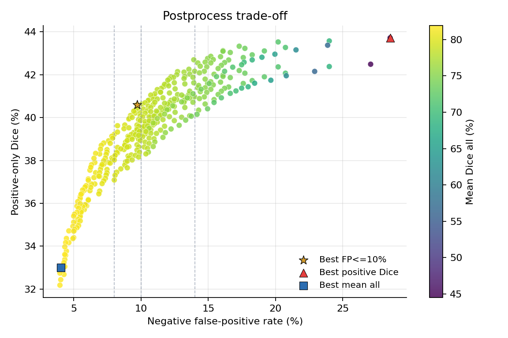

# SIIM-ACR Enterprise DeepLabV3+ ResNet50 512 v2 实验报告

## 1. 实验目的

本实验在 SIIM-ACR Pneumothorax Segmentation 验证集上评估 `DeepLabV3+ + ResNet50 encoder` 的 512 输入尺寸企业候选配置。目标是作为 U-Net++ 系列之外的横向架构对照，观察 DeepLabV3+ 是否能在 positive-only Dice、阴性误报率和 mean Dice all 之间形成更好的企业落地折中。

本报告仅基于验证集结果进行分析，尚未包含独立 test 集评估，因此不能表述为最终泛化性能。

## 2. 实验配置

实验输出目录：

```text
outputs/experiments/enterprise_deeplabv3plus_resnet50_512_v2/20260525_171830
```

主要配置来自 `config.json`：

| 配置项 | 数值 |
|---|---:|
| 数据集 | SIIM-ACR Pneumothorax Segmentation |
| 模型 | DeepLabV3+ |
| Encoder | ResNet50 |
| Encoder 预训练 | ImageNet |
| 输入尺寸 | 512 x 512 |
| 输入通道 | 3 |
| 训练轮数 | 60 |
| Batch size | 24 |
| 初始学习率 | 0.0002 |
| Weight decay | 0.0003 |
| Loss | BCE + Dice |
| BCE 权重 | 0.30 |
| Dice 权重 | 0.70 |
| BCE `pos_weight` | 2.0 |
| 默认二值化阈值 | 0.50 |
| Balanced sampling | 是 |
| 正样本采样比例 | 0.45 |
| 随机种子 | 42 |
| 设备 | CUDA |
| AMP | 开启 |

## 3. 训练结果

训练日志来自 `logs/metrics.csv`。模型在第 18 轮取得最佳验证集 Dice。第 18 轮之后，训练集 Dice 持续上升，但验证集 Dice 和 Recall 明显下降，说明后期模型开始过拟合，并在验证集上变得更保守。

关键 epoch 指标如下：

| Epoch | Train Dice | Train Precision | Train Recall | Val Dice | Val IoU | Val Precision | Val Recall | Val Loss |
|---:|---:|---:|---:|---:|---:|---:|---:|---:|
| 1 | 0.3371 | 0.2405 | 0.5632 | 0.2208 | 0.1241 | 0.1542 | 0.3884 | 0.6564 |
| 2 | 0.5534 | 0.4808 | 0.6520 | 0.3696 | 0.2267 | 0.2777 | 0.5525 | 0.6397 |
| 3 | 0.6176 | 0.5643 | 0.6821 | 0.3814 | 0.2356 | 0.2839 | 0.5805 | 0.6341 |
| 10 | 0.8648 | 0.8414 | 0.8896 | 0.5242 | 0.3552 | 0.5779 | 0.4797 | 0.6404 |
| 14 | 0.9091 | 0.8984 | 0.9199 | 0.5324 | 0.3628 | 0.6504 | 0.4507 | 0.6453 |
| 18 | 0.9346 | 0.9284 | 0.9409 | 0.5415 | 0.3713 | 0.6122 | 0.4855 | 0.6487 |
| 20 | 0.9373 | 0.9300 | 0.9446 | 0.5361 | 0.3662 | 0.6480 | 0.4572 | 0.6520 |
| 60 | 0.9777 | 0.9758 | 0.9796 | 0.4965 | 0.3303 | 0.7258 | 0.3773 | 0.6706 |

最佳验证集结果：

| 指标 | 数值 |
|---|---:|
| Best epoch | 18 |
| Train loss | 0.4128 |
| Train Dice | 0.9346 |
| Train IoU | 0.8772 |
| Train Precision | 0.9284 |
| Train Recall | 0.9409 |
| Val loss | 0.6487 |
| Val Dice | 0.5415 |
| Val IoU | 0.3713 |
| Val Precision | 0.6122 |
| Val Recall | 0.4855 |
| Val Specificity | 0.9991 |

最后一轮结果：

| 指标 | 数值 |
|---|---:|
| Epoch | 60 |
| Train loss | 0.3907 |
| Train Dice | 0.9777 |
| Train IoU | 0.9563 |
| Train Precision | 0.9758 |
| Train Recall | 0.9796 |
| Val loss | 0.6706 |
| Val Dice | 0.4965 |
| Val IoU | 0.3303 |
| Val Precision | 0.7258 |
| Val Recall | 0.3773 |
| Val Specificity | 0.9996 |

从最佳 epoch 到最后一轮，验证集 Recall 从 0.4855 降到 0.3773，Precision 从 0.6122 升到 0.7258，说明后期预测更保守，漏检风险增加。

## 4. Threshold Sweep 结果

`threshold_sweep_val.csv` 记录了对 best checkpoint 的验证集阈值扫描。按全局像素级 Dice 排序，最佳阈值为 0.30：

| Threshold | Dice | IoU | Precision | Recall | Specificity |
|---:|---:|---:|---:|---:|---:|
| 0.30 | 0.5426 | 0.3723 | 0.5949 | 0.4988 | 0.9990 |
| 0.25 | 0.5426 | 0.3723 | 0.5895 | 0.5027 | 0.9989 |
| 0.20 | 0.5426 | 0.3723 | 0.5832 | 0.5073 | 0.9989 |
| 0.15 | 0.5425 | 0.3722 | 0.5755 | 0.5130 | 0.9989 |
| 0.35 | 0.5424 | 0.3722 | 0.5996 | 0.4952 | 0.9990 |
| 0.40 | 0.5422 | 0.3720 | 0.6040 | 0.4919 | 0.9990 |
| 0.10 | 0.5419 | 0.3716 | 0.5649 | 0.5207 | 0.9988 |

Threshold sweep 最佳 Dice 为 0.5426，仅略高于训练期默认阈值下的 0.5415，说明阈值调整对全局像素级 Dice 的提升有限。

## 5. 后处理参数搜索结果

后处理搜索结果来自 `postprocess_sweep_val.csv`。验证集包含 2135 张图像，其中阳性 476 张，阴性 1659 张。

| 设置 | Threshold | Min component area | Keep largest | Positive Dice | Positive IoU | Negative FP rate | False positive negative | Mean Dice all | 结论 |
|---|---:|---:|---:|---:|---:|---:|---:|---:|---|
| Best positive Dice | 0.02 | 0 | False | 0.4372 | 0.3349 | 28.51% | 473 / 1659 | 0.4478 | 正样本最高，但误报过高 |
| FP <= 14% 最佳 positive | 0.02 | 300 | False | 0.4270 | 0.3296 | 13.92% | 231 / 1659 | 0.7640 | recall 取向候选，但弱于 EfficientNet-B3 |
| FP <= 10% 最佳 positive | 0.05 | 500 | False | 0.4059 | 0.3159 | 9.70% | 161 / 1659 | 0.7921 | 误报可控，但 positive Dice 偏低 |
| Best mean Dice all | 0.65 | 1000 | False | 0.3300 | 0.2606 | 4.04% | 67 / 1659 | 0.8192 | 过于保守，不适合作为主分割候选 |

### 5.1 Best positive Dice

`threshold=0.02, min_component_area=0` 时 positive-only Dice 为 0.4372，但 negative FP rate 达到 28.51%。该配置主要依靠低阈值换取正样本覆盖，阴性误报不可接受。

### 5.2 误报约束下的表现

在 `negative_fp_rate <= 14%` 约束下，最佳 positive-only Dice 为 0.4270；在 `negative_fp_rate <= 10%` 约束下，最佳 positive-only Dice 降到 0.4059。说明 DeepLabV3+ ResNet50 512 在控制误报后，阳性分割能力明显不足。

### 5.3 Best mean-all 配置

`threshold=0.65, min_component_area=1000` 时 mean Dice all 为 0.8192，negative FP rate 为 4.04%，但 positive-only Dice 只有 0.3300。该配置主要依靠阴性样本真阴性拉高平均值，漏检风险较高，不适合作为企业主候选。

## 6. 与现有候选对比

| 模型与设置 | Positive Dice | Negative FP rate | Mean Dice all | 判断 |
|---|---:|---:|---:|---|
| EfficientNet-B3 512 Candidate B：thr=0.04, area=500 | 0.4604 | 9.95% | 0.8024 | 当前企业平衡候选 |
| EfficientNet-B3 512 Candidate C：thr=0.30, area=500 | 0.4464 | 7.96% | 0.8147 | 当前低误报候选 |
| DeepLabV3+ ResNet50 512 FP<=14%：thr=0.02, area=300 | 0.4270 | 13.92% | 0.7640 | 正样本和整体均弱于 EfficientNet-B3 |
| DeepLabV3+ ResNet50 512 FP<=10%：thr=0.05, area=500 | 0.4059 | 9.70% | 0.7921 | 误报接近，但 positive Dice 明显偏低 |

DeepLabV3+ ResNet50 512 没有超过 EfficientNet-B3 512 的企业平衡和低误报配置，也没有形成比旧企业候选更好的综合取舍。

## 7. 结论

`enterprise_deeplabv3plus_resnet50_512_v2` 的训练期最佳 Val Dice 为 0.5415，threshold sweep 最佳 Dice 为 0.5426。该模型可以作为 DeepLabV3+ 架构横向对照，但不建议作为当前企业主候选。

主要原因是：在低阈值下 positive-only Dice 最高只有 0.4372，且 negative FP rate 达到 28.51%；在接近 10% 阴性误报约束下，positive-only Dice 只有 0.4059，明显低于 EfficientNet-B3 512 Candidate B 的 0.4604。

## 8. 后续建议

1. 本实验保留为 DeepLabV3+ ResNet50 横向架构对照，不替换当前 EfficientNet-B3 512 候选。
2. 若后续加入 ensemble，应谨慎评估 DeepLabV3+ 是否会稀释更强单模型的 positive Dice。
3. 不建议基于本实验单独开展 test 集评估，除非作为模型族对照进入固定候选列表。

## 图表解读

训练 loss 曲线用于观察收敛速度和验证集 loss 是否后期回升。



Dice/IoU 曲线已统一为百分比，便于观察训练集与验证集之间的泛化差距。



Precision/Recall 曲线用于判断模型后期是否变得更保守。



阈值扫描曲线将 Dice、Precision 和 Recall 统一到百分比尺度下，辅助选择验证集阈值。



后处理 trade-off 图以阴性误报率为横轴、positive-only Dice 为纵轴，颜色表示 mean Dice all，适合判断候选配置是否只是用误报换取正样本 Dice。


