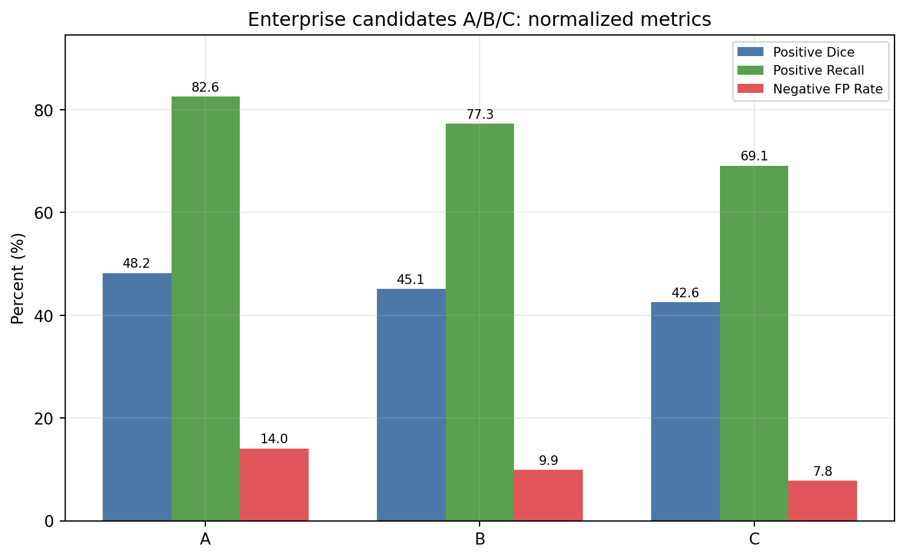
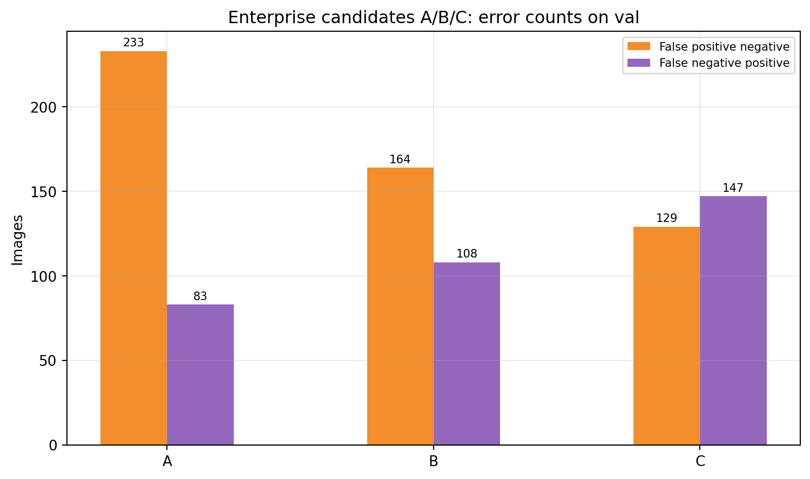
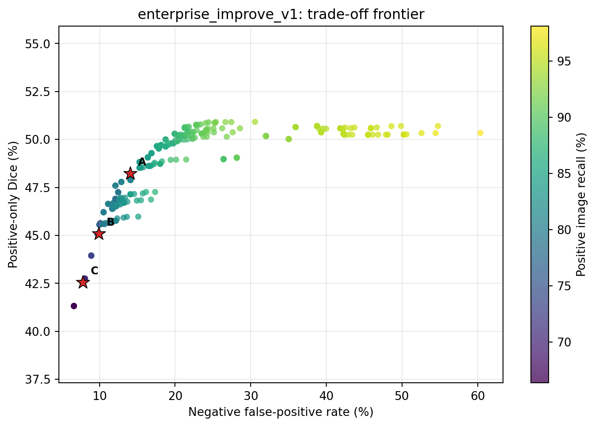
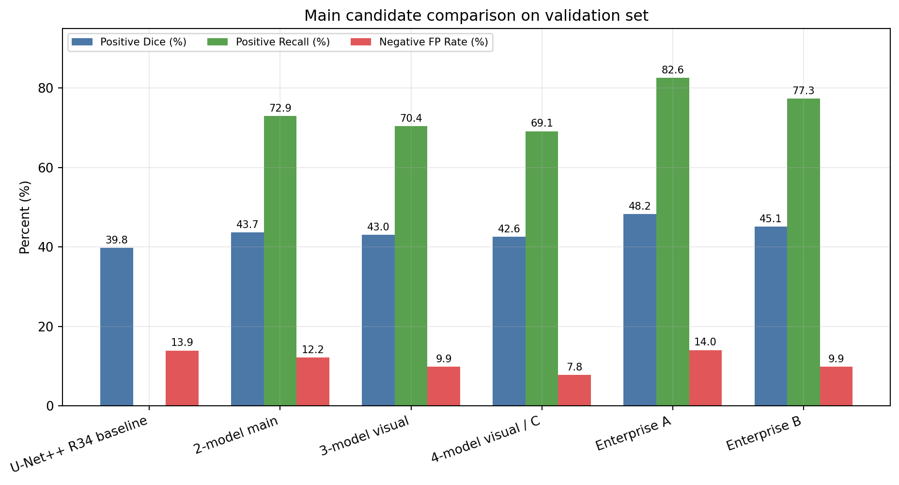
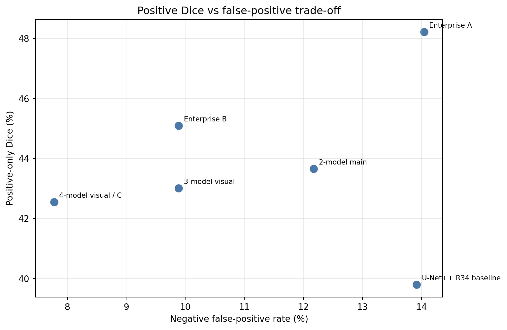
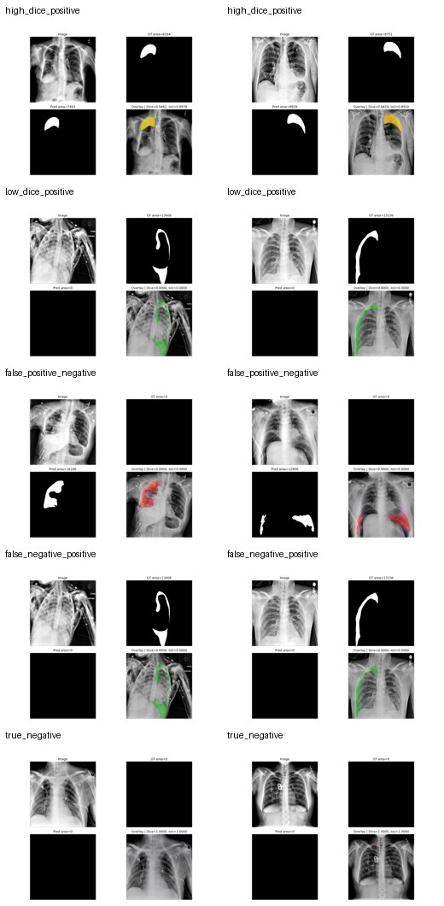

# SIIM-ACR Enterprise Improve v1 实验报告

## 1. 实验目的

本实验在 SIIM-ACR Pneumothorax Segmentation 验证集上，对前一阶段 2 模型与 4 模型融合方案进行更面向应用落地的 focused sweep。目标不是单纯追求 `mean_dice_all`，而是固定几组可解释、可部署的候选配置，用于在正样本召回和阴性误报之间做取舍。

本报告仅基于验证集结果进行分析，尚未包含独立 test 集评估，因此不能表述为最终泛化性能。

## 2. 实验配置

实验输出目录：

```text
outputs/experiments/enterprise_improve_v1
```

主要结果文件：

```text
ensemble_2model_focused_sweep.csv
ensemble_4model_focused_sweep.csv
logs/ensemble_2model_focused_sweep.log
logs/ensemble_4model_focused_sweep.log
```

验证集与评估设置：

| 配置项 | 数值 |
|---|---:|
| Split | val |
| 验证集样本数 | 2135 |
| 阳性样本数 | 476 |
| 阴性样本数 | 1659 |
| 输入尺寸 | 512 x 512 |
| 输入通道 | 3 |
| TTA | 水平翻转 `hflip` |
| 后处理 | 阈值二值化 + 连通域面积过滤 |
| `keep_largest_component` | False |

4 模型 focused sweep 使用以下 checkpoint：

| 模型 | Checkpoint | Epoch | 训练期 best score |
|---|---|---:|---:|
| U-Net++ ResNet34 recall v2 | `outputs/experiments/siim_acr_unetpp_resnet34_recall_v2/20260519_160852/checkpoints/best_model.pth` | 21 | 0.5229 |
| U-Net++ ResNet50 recall v1 | `outputs/experiments/siim_acr_unetpp_resnet50_recall_v1/20260519_171710/checkpoints/best_model.pth` | 19 | 0.4967 |
| DeepLabV3+ ResNet34 v1 | `outputs/experiments/siim_acr_deeplabv3plus_resnet34_v1/20260519_115843/checkpoints/best_model.pth` | 25 | 0.5218 |
| SMP U-Net ResNet34 v1 | `outputs/experiments/siim_acr_smp_unet_resnet34_v1/20260519_141839/checkpoints/best_model.pth` | 25 | 0.5195 |

## 3. 企业候选配置

本实验保留 3 个主要候选，均来自：

```text
outputs/experiments/enterprise_improve_v1/ensemble_4model_focused_sweep.csv
```

| Candidate | 定位 | Threshold | Min component area | Min pred area | Positive Dice | Positive recall | Negative FP rate | Mean Dice all | False positive negative | False negative positive |
|---|---|---:|---:|---:|---:|---:|---:|---:|---:|---:|
| A | balanced / recall-first | 0.25 | 200 | 0 | 0.4822 | 82.56% | 14.04% | 0.7754 | 233 / 1659 | 83 / 476 |
| B | low false-positive mode | 0.35 | 200 | 0 | 0.4509 | 77.31% | 9.89% | 0.8008 | 164 / 1659 | 108 / 476 |
| C | very low false-positive visual mode | 0.30 | 500 | 0 | 0.4255 | 69.12% | 7.78% | 0.8115 | 129 / 1659 | 147 / 476 |

补充像素级指标如下：

| Candidate | Pixel Dice | Pixel Precision | Pixel Recall | Mean IoU positive | Mean Dice negative |
|---|---:|---:|---:|---:|---:|
| A | 0.5723 | 0.5915 | 0.5543 | 0.3756 | 0.8596 |
| B | 0.5688 | 0.6550 | 0.5027 | 0.3516 | 0.9011 |
| C | 0.5694 | 0.6487 | 0.5075 | 0.3346 | 0.9222 |

### 3.1 A/B/C 候选图表解读

下图将 Candidate A/B/C 的核心指标统一换算为百分比，避免 positive Dice、recall 和 false-positive rate 混在不同量纲下比较。A 的召回最高，但误报率也最高；B 在保持较高 positive Dice 和 recall 的同时，将误报控制在 10% 左右；C 的误报最低，但召回损失最明显。



下图直接展示 A/B/C 在验证集上的两类错误数量。A 的 false negative 最少，但 false positive 最多；C 的 false positive 最少，但 false negative 最多；B 位于两者之间，是当前更适合企业平衡模式的候选。



下图是 4 模型 focused sweep 的整体 trade-off。红色星标为 A/B/C，可以看到 B 位于误报控制和正样本 Dice 的折中区域，而不是单纯追求任一极值。




## 4. 候选配置解读

### 4.1 Candidate A：enterprise balanced / recall-first

配置：

```text
threshold=0.25
min_component_area=200
min_pred_area=0
tta=hflip
num_models=4
```

Candidate A 是当前 focused sweep 中更适合作为企业版 recall-first 主候选的配置。它将 positive-only Dice 提升到 0.4822，阳性图像召回达到 82.56%，false negative positive 降至 83 / 476。

代价是阴性误报率升至 14.04%，略高于单模型 U-Net++ ResNet34 baseline 的 13.92%，也高于 2 模型融合主配置的 12.18%。因此，A 适合病灶漏检成本更高、允许一定人工复核误报的场景；如果业务目标要求严格压低正常片误报，则不应单独采用 A。

### 4.2 Candidate B：low false-positive mode

配置：

```text
threshold=0.35
min_component_area=200
min_pred_area=0
tta=hflip
num_models=4
```

Candidate B 是当前更稳妥的低误报生产候选。相比 A，B 将 negative FP rate 从 14.04% 降到 9.89%，false positive negative 从 233 降到 164；同时仍保持 0.4509 的 positive-only Dice 和 77.31% 的阳性图像召回。

如果需要在企业演示、部署试运行或人工复核成本之间取得平衡，B 比 A 更保守，也比 C 保留更多阳性召回。

### 4.3 Candidate C：very low false-positive visual mode

配置：

```text
threshold=0.30
min_component_area=500
min_pred_area=0
tta=hflip
num_models=4
```

Candidate C 是极低误报可视化模式，与前一阶段 4 模型主可视化配置一致。它将 negative FP rate 压到 7.78%，false positive negative 为 129 / 1659，mean Dice all 达到 0.8115。

该配置的主要问题是阳性召回明显下降：positive-only Dice 为 0.4255，positive image recall 为 69.12%，false negative positive 为 147 / 476。它适合展示误报控制能力或低误报场景，不适合作为优先减少漏检的主候选。

## 5. 与上一阶段候选对比

| 模型与配置 | Positive Dice | Positive recall | Negative FP rate | Mean Dice all | False positive negative |
|---|---:|---:|---:|---:|---:|
| U-Net++ ResNet34 baseline：thr=0.08, area=150 | 0.3980 | 未汇总 | 13.92% | 0.7576 | 231 / 1659 |
| 2 模型融合 main：thr=0.25, area=500 | 0.4365 | 72.90% | 12.18% | 0.7798 | 202 / 1659 |
| 4 模型 Candidate A：thr=0.25, area=200 | 0.4822 | 82.56% | 14.04% | 0.7754 | 233 / 1659 |
| 4 模型 Candidate B：thr=0.35, area=200 | 0.4509 | 77.31% | 9.89% | 0.8008 | 164 / 1659 |
| 4 模型 Candidate C：thr=0.30, area=500 | 0.4255 | 69.12% | 7.78% | 0.8115 | 129 / 1659 |

相较 2 模型融合 main：

| Candidate | Positive Dice 变化 | Positive recall 变化 | Negative FP rate 变化 | 结论 |
|---|---:|---:|---:|---|
| A | +0.0456 | +9.66 pp | +1.86 pp | 明显提高正样本能力，但误报回升 |
| B | +0.0144 | +4.41 pp | -2.29 pp | 同时改善正样本 Dice、召回和误报，是更均衡的企业候选 |
| C | -0.0110 | -3.78 pp | -4.40 pp | 主要用于极低误报，不适合作为 recall-first 主候选 |

### 5.1 跨实验对比图

下图把单模型 baseline、2/3/4 模型融合和 Enterprise 候选放到同一尺度下比较。它更直观地说明：Enterprise B 相比 2 模型 main 同时改善 positive Dice、positive recall 和 negative FP rate；Enterprise A 主要换取召回；Candidate C 主要换取低误报。



下图只保留 positive Dice 与 negative FP rate 两个维度。越靠左表示误报越低，越靠上表示阳性分割越好；B 相比 2 模型 main 更靠左且更靠上，因此是当前更清晰的企业平衡候选。




## 6. 结论

`enterprise_improve_v1` 的核心价值是把前一阶段 4 模型融合从“实验对比”推进到“候选配置选择”。当前建议如下：

1. Candidate A 作为 recall-first 候选：适合漏检代价更高、允许更多人工复核的场景。
2. Candidate B 作为推荐企业平衡候选：在提升 positive-only Dice 和阳性召回的同时，把 negative FP rate 控制在 10% 左右。
3. Candidate C 作为极低误报/可视化候选：适合展示误报控制能力，但不适合作为减少漏检的主配置。

后续如果进入独立 test 集评估，应先固定 A/B/C 中的一个或多个候选配置，不再根据 test 集结果调整阈值或后处理参数。

## 7. 定性示例

Candidate C 与前一阶段 4 模型主可视化配置一致，下面的 contact sheet 汇总了高 Dice 阳性、低 Dice 阳性、阴性误报、阳性漏检和真阴性示例。A/B 的完整逐样本可视化尚未在当前 CPU 环境下生成，后续建议在 GPU 环境补齐。


