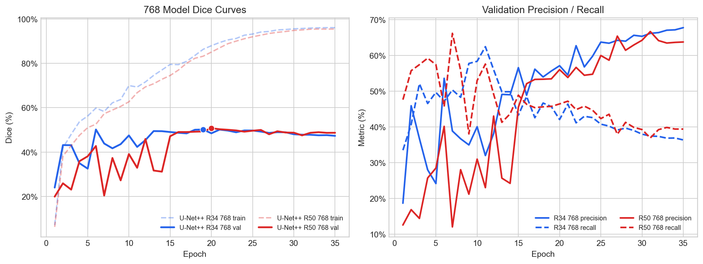
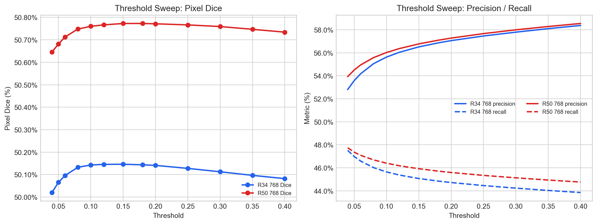
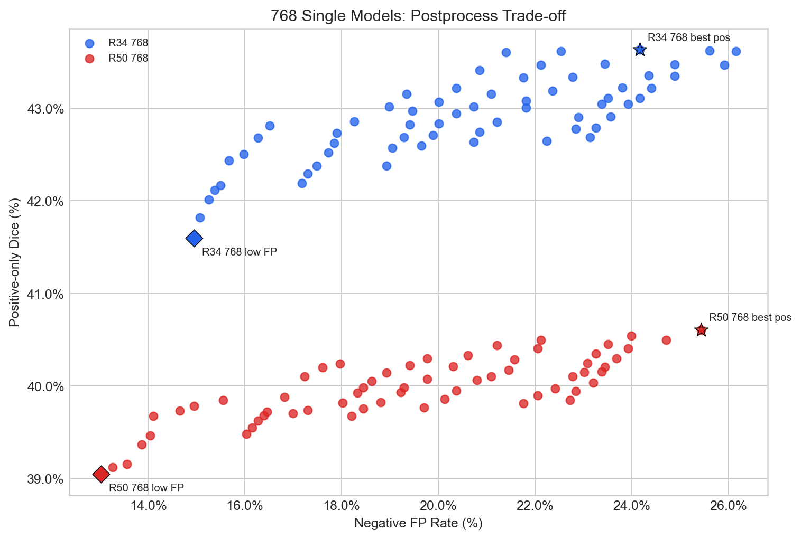
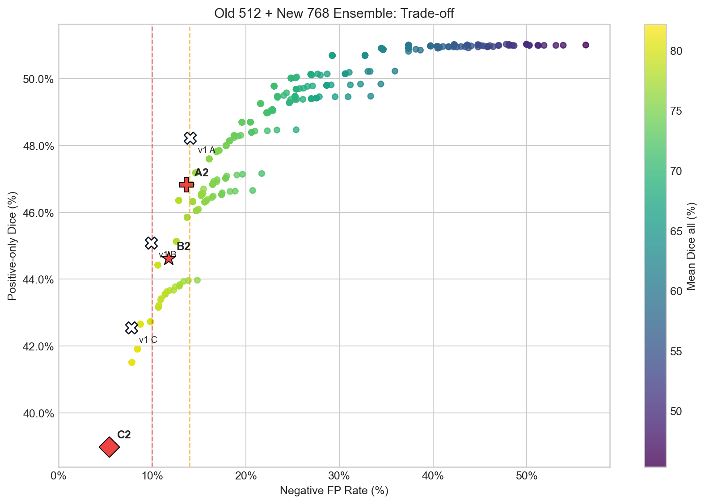
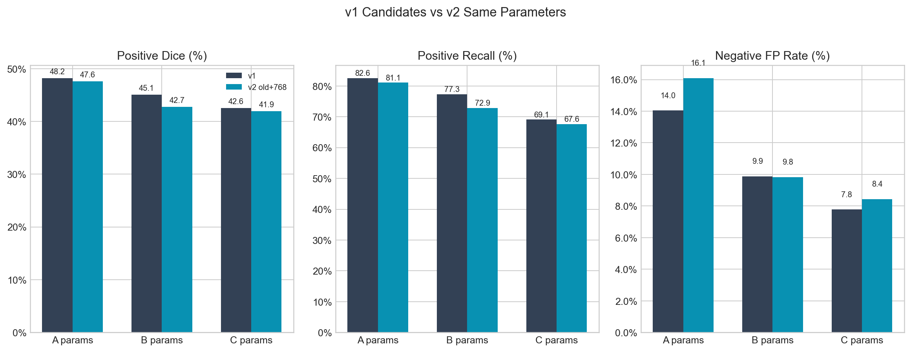
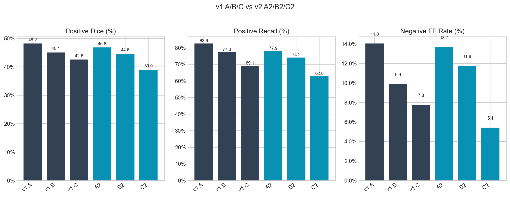

# SIIM-ACR Enterprise Improve v2 实验报告

## 1. 实验目的

本实验在 `enterprise_improve_v1` 的 4 模型企业候选基础上，新增两个 768 输入尺寸的 U-Net++ 模型，并尝试把旧 512 模型与新 768 模型做 6 模型融合，观察更高输入分辨率是否能改善气胸小病灶识别、positive-only Dice 和企业场景下的误报/漏检折中。

本报告仅基于 SIIM-ACR 验证集结果进行分析，尚未包含独立 test 集评估，因此不能表述为最终泛化性能。

## 2. 实验配置

实验输出目录：

```text
outputs/experiments/enterprise_improve_v2
```

主要结果文件：

```text
new_768_rundirs.txt
fixed_candidates.txt
logs/run_enterprise_768_v1.log
sweeps/enterprise_unetpp_resnet34_768_v1__20260521_115828_threshold_sweep.csv
sweeps/enterprise_unetpp_resnet34_768_v1__20260521_115828_postprocess_sweep.csv
sweeps/enterprise_unetpp_resnet50_768_v1__20260521_145112_threshold_sweep.csv
sweeps/enterprise_unetpp_resnet50_768_v1__20260521_145112_postprocess_sweep.csv
ensemble_old_plus_768_sweep.csv
```

验证集与评估设置：

| 配置项 | 数值 |
|---|---:|
| Split | val |
| 验证集样本数 | 2135 |
| 阳性样本数 | 476 |
| 阴性样本数 | 1659 |
| 768 单模型输入尺寸 | 768 x 768 |
| old + 768 ensemble 评估输入尺寸 | 512 x 512 |
| 输入通道 | 3 |
| TTA | 水平翻转 `hflip` |
| 后处理 | 阈值二值化 + 连通域面积过滤 + `min_pred_area` |
| `keep_largest_component` | False |

需要注意：`old + 768 ensemble` 阶段日志显示 6 模型融合时数据集评估尺寸为 512，同时两个新增模型的配置为 768，因此日志中出现了 `image_size: 768 vs 512` 的 warning。当前结果可以作为多分辨率融合探索，但不应直接视为已经完成严格的 native 768 ensemble 评估。

## 3. 新增 768 单模型训练

新增两个运行目录：

```text
outputs/experiments/enterprise_unetpp_resnet34_768_v1/20260521_115828
outputs/experiments/enterprise_unetpp_resnet50_768_v1/20260521_145112
```

训练配置：

| 模型 | Image size | Batch size | Epochs | LR | Weight decay | BCE weight | Dice weight | `pos_weight` | Balanced sampling | Positive sample ratio |
|---|---:|---:|---:|---:|---:|---:|---:|---:|---|---:|
| U-Net++ ResNet34 768 | 768 | 8 | 35 | 0.0002 | 0.0005 | 0.35 | 0.65 | 2.0 | True | 0.4 |
| U-Net++ ResNet50 768 | 768 | 6 | 35 | 0.0002 | 0.0005 | 0.35 | 0.65 | 2.0 | True | 0.4 |

训练期最佳结果：

| 模型 | Best epoch | Best Val Dice | Val IoU | Val precision | Val recall | Last epoch Val Dice |
|---|---:|---:|---:|---:|---:|---:|
| U-Net++ ResNet34 768 | 19 | 0.5016 | 0.3347 | 0.5562 | 0.4567 | 0.4731 |
| U-Net++ ResNet50 768 | 20 | 0.5076 | 0.3401 | 0.5599 | 0.4641 | 0.4869 |

观察：

1. ResNet50 768 的训练期最佳 Val Dice 略高于 ResNet34 768。
2. 两个 768 模型在 19-20 epoch 左右达到最佳，之后训练集 Dice 继续升高，但验证集 Dice 下降，仍存在明显后期过拟合。
3. 单看训练期全局 Dice，768 模型没有明显超过旧的 512 SMP 主力模型。

下图对比了两个 768 模型的 Dice、Precision 和 Recall 训练过程。两个模型都在中期达到验证集最佳，后期 train Dice 继续升高而 val Dice 回落。



## 4. 768 单模型阈值与后处理扫描

### 4.1 Threshold sweep

| 模型 | 最佳 threshold | Pixel Dice | Pixel IoU | Pixel precision | Pixel recall |
|---|---:|---:|---:|---:|---:|
| U-Net++ ResNet34 768 | 0.15 | 0.5015 | 0.3346 | 0.5652 | 0.4507 |
| U-Net++ ResNet50 768 | 0.18 | 0.5077 | 0.3402 | 0.5710 | 0.4571 |

两个 768 模型在 `threshold=0.04` 到 `0.40` 的 pixel Dice 变化很小，说明 pixel-level 全局指标对阈值不敏感。但这不能替代样本级误报/漏检分析，因为 SIIM-ACR 中阴性图像多，且小面积误报会显著影响企业应用体验。



### 4.2 Postprocess sweep

| 模型与配置 | Positive Dice | Negative FP rate | Mean Dice all | False positive negative |
|---|---:|---:|---:|---:|
| R34 768 best positive：thr=0.08, area=100 | 0.4363 | 24.17% | 0.6865 | 401 / 1659 |
| R34 768 low-FP/best-all：thr=0.35, area=500 | 0.4160 | 14.95% | 0.7536 | 248 / 1659 |
| R50 768 best positive：thr=0.08, area=0 | 0.4061 | 25.44% | 0.6512 | 422 / 1659 |
| R50 768 low-FP/best-all：thr=0.35, area=500 | 0.3905 | 13.02% | 0.7629 | 216 / 1659 |

结论：单个 768 模型并没有形成更好的企业候选。它们在 best-positive 配置下误报率超过 24%，在低误报配置下 positive-only Dice 又低于 v1 的企业候选。

下图展示了两个 768 单模型在后处理扫描中的 positive-only Dice 与阴性误报率 trade-off。星标为各自 best-positive 配置，菱形为各自最低误报配置。



## 5. 旧模型 + 768 模型融合

`ensemble_old_plus_768_sweep.csv` 使用 6 个模型：

| 模型 | Checkpoint | Epoch | 训练期 best score |
|---|---|---:|---:|
| U-Net++ ResNet34 recall v2 | `outputs/experiments/siim_acr_unetpp_resnet34_recall_v2/20260519_160852/checkpoints/best_model.pth` | 21 | 0.5229 |
| U-Net++ ResNet50 recall v1 | `outputs/experiments/siim_acr_unetpp_resnet50_recall_v1/20260519_171710/checkpoints/best_model.pth` | 19 | 0.4967 |
| DeepLabV3+ ResNet34 v1 | `outputs/experiments/siim_acr_deeplabv3plus_resnet34_v1/20260519_115843/checkpoints/best_model.pth` | 25 | 0.5218 |
| SMP U-Net ResNet34 v1 | `outputs/experiments/siim_acr_smp_unet_resnet34_v1/20260519_141839/checkpoints/best_model.pth` | 25 | 0.5195 |
| U-Net++ ResNet34 768 | `outputs/experiments/enterprise_unetpp_resnet34_768_v1/20260521_115828/checkpoints/best_model.pth` | 19 | 0.5016 |
| U-Net++ ResNet50 768 | `outputs/experiments/enterprise_unetpp_resnet50_768_v1/20260521_145112/checkpoints/best_model.pth` | 20 | 0.5076 |

关键扫描结果：

| 定位 | Threshold | Min component area | Min pred area | Positive Dice | Positive recall | Negative FP rate | Mean Dice all | FP negative | FN positive |
|---|---:|---:|---:|---:|---:|---:|---:|---:|---:|
| best positive，不适合部署 | 0.10 | 50 | 30 | 0.5102 | 96.22% | 49.97% | 0.5025 | 829 / 1659 | 18 / 476 |
| FP <= 14% best positive | 0.20 | 500 | 0 | 0.4682 | 77.94% | 13.68% | 0.7751 | 227 / 1659 | 105 / 476 |
| FP <= 12% best positive | 0.30 | 300 | 50 | 0.4462 | 74.16% | 11.75% | 0.7852 | 195 / 1659 | 123 / 476 |
| FP <= 10% best positive | 0.35 | 200 | 0 | 0.4273 | 72.90% | 9.83% | 0.7960 | 163 / 1659 | 129 / 476 |
| lowest-FP / best mean-all | 0.35 | 500 | 0 | 0.3899 | 62.82% | 5.42% | 0.8218 | 90 / 1659 | 177 / 476 |
| best pixel Dice | 0.25 | 500 | 80 | 0.4442 | 72.27% | 10.61% | 0.7937 | 176 / 1659 | 132 / 476 |

6 模型融合可以在极低阈值下把 positive-only Dice 推高到 0.5102，但阴性误报率接近 50%，不适合作为企业候选。进入 `negative_fp_rate <= 10%`、`<= 12%` 或 `<= 14%` 的可用区间后，positive-only Dice 与 recall 都没有超过 v1 的推荐候选。

下图给出 6 模型融合完整扫描的 trade-off。颜色表示 `mean_dice_all`，红色标记为 v2 A2/B2/C2，白色 X 标记为 v1 A/B/C。可以看到 v2 在极低误报区间能继续降低 false positive，但正样本 Dice 同时下降。



## 6. 与 enterprise_improve_v1 候选对比

### 6.1 沿用 v1 A/B/C 参数的结果

| 配置 | Threshold | Min component area | Positive Dice | Positive recall | Negative FP rate | Mean Dice all | FP negative | FN positive |
|---|---:|---:|---:|---:|---:|---:|---:|---:|
| v1 Candidate A | 0.25 | 200 | 0.4822 | 82.56% | 14.04% | 0.7754 | 233 / 1659 | 83 / 476 |
| v2 same A params | 0.25 | 200 | 0.4760 | 81.09% | 16.09% | 0.7581 | 267 / 1659 | 90 / 476 |
| v1 Candidate B | 0.35 | 200 | 0.4509 | 77.31% | 9.89% | 0.8008 | 164 / 1659 | 108 / 476 |
| v2 same B params | 0.35 | 200 | 0.4273 | 72.90% | 9.83% | 0.7960 | 163 / 1659 | 129 / 476 |
| v1 Candidate C | 0.30 | 500 | 0.4255 | 69.12% | 7.78% | 0.8115 | 129 / 1659 | 147 / 476 |
| v2 same C params | 0.30 | 500 | 0.4191 | 67.65% | 8.44% | 0.8049 | 140 / 1659 | 154 / 476 |

沿用 v1 参数时，加入 768 模型后的 6 模型融合没有改善 A/B/C：

1. A 参数下 positive Dice 和 positive recall 下降，阴性误报率从 14.04% 升至 16.09%。
2. B 参数下误报率基本持平，但 positive Dice 从 0.4509 降至 0.4273，false negative 从 108 增至 129。
3. C 参数下 positive Dice、positive recall、negative FP rate 和 mean Dice all 都弱于 v1 Candidate C。

下图将 v1 A/B/C 与 v2 在相同参数下的结果并列比较。v2 old+768 在 A/B/C 三组参数下没有形成稳定提升。



### 6.2 v2 自身可用候选

如果只在 v2 的 6 模型结果中重新挑选，可以得到以下候选：

| Candidate | 定位 | Threshold | Min component area | Min pred area | Positive Dice | Positive recall | Negative FP rate | Mean Dice all |
|---|---|---:|---:|---:|---:|---:|---:|---:|
| A2 | recall-first under FP <= 14% | 0.20 | 500 | 0 | 0.4682 | 77.94% | 13.68% | 0.7751 |
| B2 | balanced under FP <= 12% | 0.30 | 300 | 50 | 0.4462 | 74.16% | 11.75% | 0.7852 |
| C2 | very low false-positive | 0.35 | 500 | 0 | 0.3899 | 62.82% | 5.42% | 0.8218 |

这些候选的定位清楚，但当前不建议替代 v1：

1. A2 的误报率接近 v1 A，但 positive Dice 和 recall 都低于 v1 A。
2. B2 的 positive Dice 接近 v1 B，但误报率高于 v1 B，recall 低于 v1 B。
3. C2 能把阴性误报率降到 5.42%，但 positive Dice 和阳性召回损失较大，更像极低误报探索，不适合作为主企业候选。

下图把 v1 A/B/C 和 v2 A2/B2/C2 的核心指标放在同一尺度下。v2 C2 的误报最低，但 positive Dice 和 positive recall 的损失也最明显。



## 7. 当前结论

`enterprise_improve_v2` 的核心结论是：新增 768 单模型和 6 模型融合没有在当前验证集上超过 `enterprise_improve_v1` 的 A/B/C 企业候选。

当前推荐保持不变：

| 推荐用途 | 推荐配置来源 | 理由 |
|---|---|---|
| Recall-first | `enterprise_improve_v1` Candidate A | positive Dice 0.4822，positive recall 82.56%，仍优于 v2 A2 |
| 企业平衡候选 | `enterprise_improve_v1` Candidate B | positive Dice 0.4509，positive recall 77.31%，negative FP rate 9.89%，综合优于 v2 B/B2 |
| 低误报可视化候选 | `enterprise_improve_v1` Candidate C | negative FP rate 7.78%，且 positive Dice/recall 优于 v2 same C |
| 极低误报探索 | `enterprise_improve_v2` C2 | negative FP rate 5.42%，但漏检明显增加，不作为主候选 |

本轮 768 实验仍有价值：它说明更高输入尺寸并不会自动改善企业候选，且直接把 768 模型加入旧 512 ensemble 可能改变融合概率分布，导致原有 A/B/C 参数不再稳定。

## 8. 后续建议

1. 不建议直接用 `enterprise_improve_v2` 替换 `enterprise_improve_v1` 的企业候选。
2. 若继续探索 768，应优先做 native 多分辨率评估：每个模型按自身训练尺寸推理，再统一 resize 概率图后融合，而不是在 512 评估尺寸下直接混用。
3. 对 768 模型尝试 early stopping、从 512 主模型 fine-tune 到 768、降低学习率或加强泛化约束，重点解决 20 epoch 后验证集回落问题。
4. 评估 weighted ensemble 或模型子集选择，避免较弱 768 模型稀释原 4 模型 ensemble 的稳定性。
5. 若保留 v2 C2 作为极低误报探索，需要补充可视化复查，重点检查 false negative 是否集中在小气胸、低对比度边界或胸膜附近细长区域。
6. 进入独立 test 集评估前，仍应先固定候选配置，不能根据 test 集结果继续调阈值或后处理参数。
