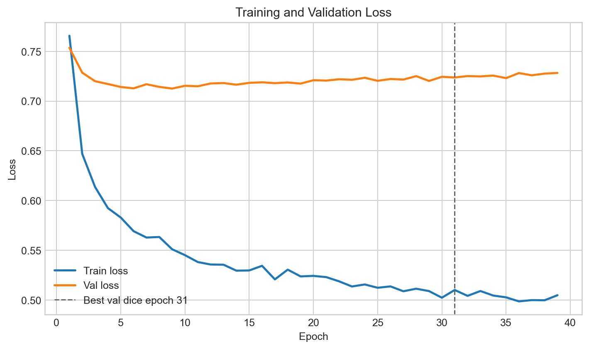
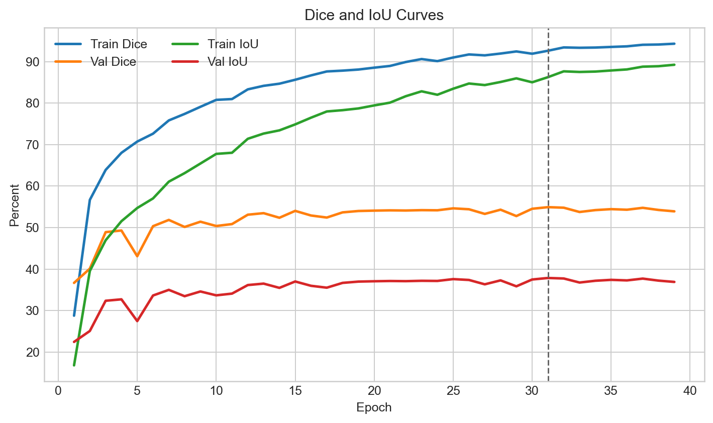
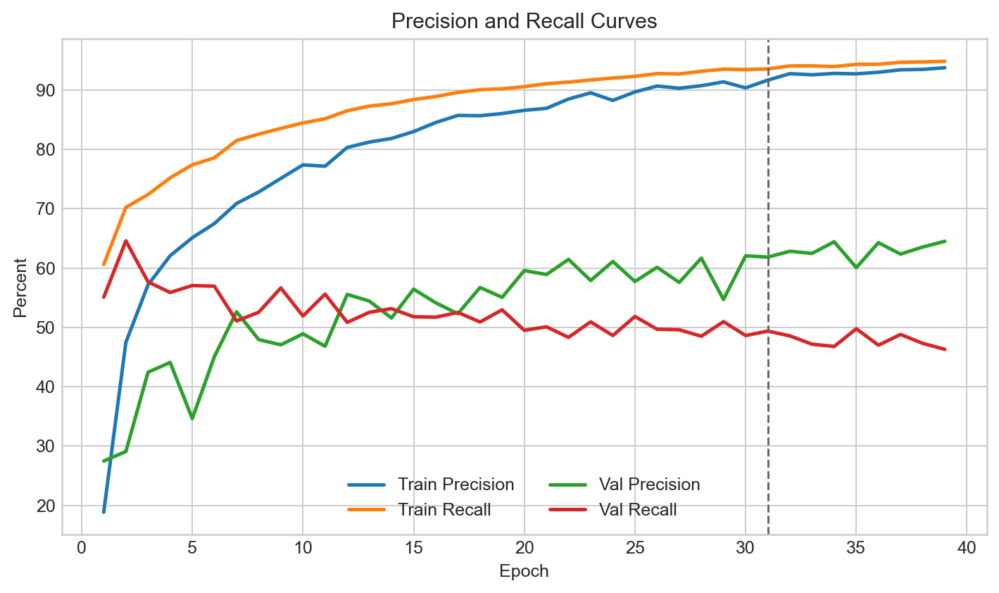
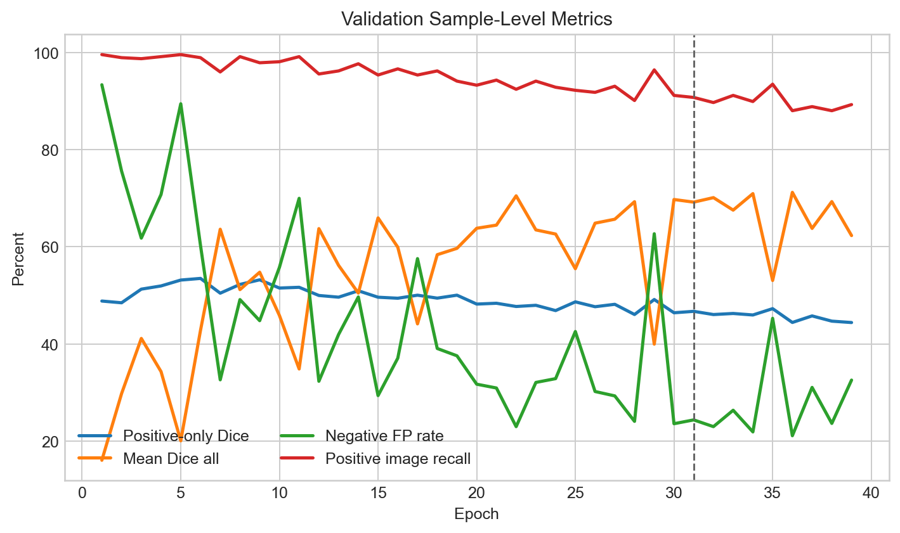
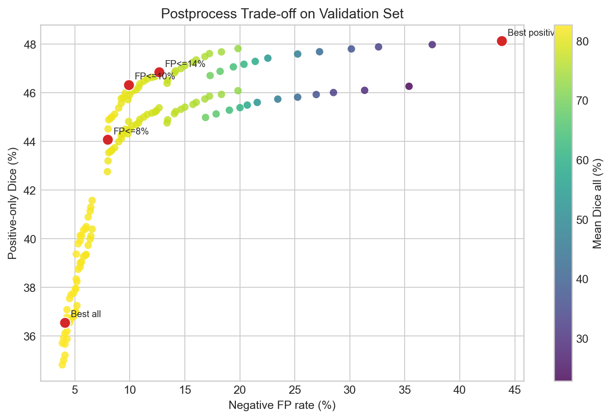
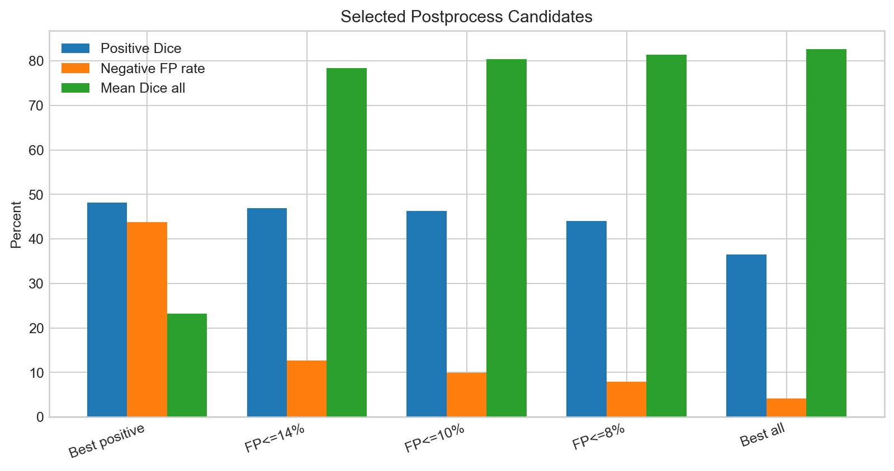

# SIIM-ACR Enterprise U-Net++ EfficientNet-B3 512 BCE-Dice Stable A100 BS48 实验报告

## 1. 实验目的

本实验在 SIIM-ACR Pneumothorax Segmentation 验证集上评估 `U-Net++ + timm-efficientnet-b3 encoder` 的 512 输入尺寸单模型配置。相较 `enterprise_unetpp_effb3_512_v2`，本实验将 batch size 提高到 48，同时将正样本采样比例从 0.45 下调到 0.40，将 BCE `pos_weight` 从 3.0 下调到 2.0，目标是观察更稳定、不过度偏 recall 的 BCE + Dice 配置是否能在企业平衡候选上带来更好的阴性误报控制。

本报告仅基于验证集结果进行分析，尚未包含独立 test 集评估，因此不能表述为最终泛化性能。

## 2. 实验配置

实验输出目录：

```text
outputs/experiments/enterprise_unetpp_effb3_512_bce_dice_stable_a100_bs48/20260526_121028
```

主要配置来自 `config.json`：

| 配置项 | 数值 |
|---|---:|
| 数据集 | SIIM-ACR Pneumothorax Segmentation |
| 模型 | U-Net++ |
| Encoder | timm-efficientnet-b3 |
| Encoder 预训练 | ImageNet |
| 输入尺寸 | 512 x 512 |
| 输入通道 | 3 |
| 计划训练轮数 | 60 |
| 日志实际记录轮数 | 39 |
| Batch size | 48 |
| 初始学习率 | 0.0002 |
| Weight decay | 0.0005 |
| Loss | BCE + Dice |
| BCE 权重 | 0.20 |
| Dice 权重 | 0.80 |
| BCE `pos_weight` | 2.0 |
| 默认二值化阈值 | 0.50 |
| Balanced sampling | 是 |
| 正样本采样比例 | 0.40 |
| Early stopping patience | 12 |
| Monitor | val_dice |
| 随机种子 | 42 |
| 设备 | CUDA |
| AMP | 开启 |

本实验记录了训练指标 `logs/metrics.csv` 和验证集后处理搜索 `postprocess_sweep_val.csv`。目标目录内未发现单独的 `threshold_sweep_val.csv`，因此本报告不单独分析 threshold sweep，只分析默认阈值训练指标与后处理参数搜索结果。

## 3. 训练结果

训练日志来自 `logs/metrics.csv`。日志实际包含 39 个 epoch。模型在第 31 轮取得最高默认阈值验证集 Dice，之后训练集 Dice 继续上升，但验证集 Dice、验证集 Recall 和 positive-only Dice 均回落，说明继续训练未带来验证集收益。

关键 epoch 指标如下：

| Epoch | Train Dice | Train Precision | Train Recall | Val Dice | Val IoU | Val Precision | Val Recall | Val Positive Dice | Val Negative FP rate |
|---:|---:|---:|---:|---:|---:|---:|---:|---:|---:|
| 1 | 0.2878 | 0.1887 | 0.6063 | 0.3668 | 0.2246 | 0.2749 | 0.5510 | 0.4883 | 93.37% |
| 7 | 0.7583 | 0.7090 | 0.8151 | 0.5185 | 0.3500 | 0.5264 | 0.5109 | 0.5045 | 32.61% |
| 14 | 0.8468 | 0.8186 | 0.8771 | 0.5238 | 0.3548 | 0.5160 | 0.5317 | 0.5094 | 49.67% |
| 20 | 0.8855 | 0.8660 | 0.9059 | 0.5409 | 0.3707 | 0.5959 | 0.4952 | 0.4820 | 31.71% |
| 24 | 0.9012 | 0.8827 | 0.9204 | 0.5417 | 0.3715 | 0.6113 | 0.4864 | 0.4686 | 32.85% |
| 31 | 0.9262 | 0.9169 | 0.9357 | 0.5493 | 0.3786 | 0.6186 | 0.4939 | 0.4671 | 24.35% |
| 35 | 0.9354 | 0.9274 | 0.9435 | 0.5445 | 0.3741 | 0.6009 | 0.4978 | 0.4726 | 45.27% |
| 39 | 0.9432 | 0.9378 | 0.9487 | 0.5392 | 0.3691 | 0.6452 | 0.4631 | 0.4440 | 32.55% |

最佳默认阈值验证集结果：

| 指标 | 数值 |
|---|---:|
| Best epoch | 31 |
| Train loss | 0.5101 |
| Train Dice | 0.9262 |
| Train IoU | 0.8626 |
| Train Precision | 0.9169 |
| Train Recall | 0.9357 |
| Val loss | 0.7237 |
| Val Dice | 0.5493 |
| Val IoU | 0.3786 |
| Val Precision | 0.6186 |
| Val Recall | 0.4939 |
| Val Specificity | 0.9991 |
| Val mean Dice all | 0.6920 |
| Val positive-only Dice | 0.4671 |
| Val negative FP rate | 24.35% |
| Val positive image recall | 90.76% |

最后一轮结果：

| 指标 | 数值 |
|---|---:|
| Epoch | 39 |
| Train loss | 0.5048 |
| Train Dice | 0.9432 |
| Train IoU | 0.8925 |
| Train Precision | 0.9378 |
| Train Recall | 0.9487 |
| Val loss | 0.7282 |
| Val Dice | 0.5392 |
| Val IoU | 0.3691 |
| Val Precision | 0.6452 |
| Val Recall | 0.4631 |
| Val Specificity | 0.9992 |
| Val mean Dice all | 0.6231 |
| Val positive-only Dice | 0.4440 |
| Val negative FP rate | 32.55% |
| Val positive image recall | 89.29% |

从第 31 轮到第 39 轮，训练集 Dice 从 0.9262 升至 0.9432，但验证集 Dice 从 0.5493 降至 0.5392，验证集 Recall 从 0.4939 降至 0.4631。该结果支持后续继续使用最佳 checkpoint，而不是最后一轮 checkpoint。

## 4. 后处理参数搜索结果

后处理搜索结果来自 `postprocess_sweep_val.csv`。验证集包含 2135 张图像，其中阳性 476 张，阴性 1659 张。搜索维度包括 `threshold`、`min_component_area` 和 `keep_largest_component`。

关键候选如下：

| 设置 | Threshold | Min component area | Keep largest | Positive Dice | Positive IoU | Negative FP rate | False positive negative | Mean Dice all | 结论 |
|---|---:|---:|---:|---:|---:|---:|---:|---:|---|
| Best positive Dice | 0.03 | 0 | False | 0.4813 | 0.3699 | 43.82% | 727 / 1659 | 0.2324 | 正样本最高，但误报不可接受 |
| FP <= 14% 最佳 positive | 0.03 | 300 | False | 0.4684 | 0.3626 | 12.66% | 210 / 1659 | 0.7831 | recall-first / balanced 候选 |
| FP <= 10% 最佳 positive | 0.03 | 500 | False | 0.4632 | 0.3598 | 9.89% | 164 / 1659 | 0.8035 | 当前企业平衡候选 |
| FP <= 8% 最佳 positive | 0.50 | 500 | False | 0.4407 | 0.3424 | 7.96% | 132 / 1659 | 0.8135 | 低误报候选 |
| FP <= 6% 最佳 positive | 0.10 | 800 | False | 0.4041 | 0.3169 | 5.97% | 99 / 1659 | 0.8208 | 更保守低误报候选 |
| Best mean Dice all | 0.25 | 1000 | False | 0.3655 | 0.2887 | 4.10% | 68 / 1659 | 0.8267 | 过于保守，不适合作为主分割候选 |

### 4.1 Best positive Dice

`threshold=0.03, min_component_area=0` 时 positive-only Dice 达到 0.4813，是本实验中最高的阳性样本分割结果。但该配置的 negative FP rate 为 43.82%，阴性图像误报过高，不能作为企业落地候选。

### 4.2 企业平衡候选

`threshold=0.03, min_component_area=500` 时 positive-only Dice 为 0.4632，negative FP rate 为 9.89%，mean Dice all 为 0.8035。该配置在 10% 阴性误报约束内保留了较高 positive-only Dice，是本实验最值得保留的企业平衡候选。

### 4.3 Recall-first / balanced 候选

`threshold=0.03, min_component_area=300` 时 positive-only Dice 为 0.4684，negative FP rate 为 12.66%，mean Dice all 为 0.7831。该配置适合更重视阳性病灶分割的场景，但相比 10% FP 约束候选，多出的 positive-only Dice 增益只有 0.0052，换来 46 张额外阴性误报。

### 4.4 低误报候选

`threshold=0.50, min_component_area=500` 时 negative FP rate 为 7.96%，positive-only Dice 为 0.4407，mean Dice all 为 0.8135。该配置适合低误报场景，但相比企业平衡候选会损失约 0.0225 positive-only Dice。

### 4.5 Best mean-all 配置

`threshold=0.25, min_component_area=1000` 时 mean Dice all 达到 0.8267，negative FP rate 仅 4.10%。但 positive-only Dice 只有 0.3655，说明该配置主要依靠大量阴性样本真阴性拉高整体均值，明显过于保守，不应作为主分割候选。

## 5. 与 EfficientNet-B3 512 v2 对比

本实验与 `enterprise_unetpp_effb3_512_v2` 使用相同模型结构和输入尺寸，但 batch size、正样本采样比例和 `pos_weight` 不同。对比重点是企业后处理约束下的 positive-only Dice 与阴性误报率。

| 模型与设置 | Positive Dice | Negative FP rate | Mean Dice all | 判断 |
|---|---:|---:|---:|---|
| EffB3 512 v2 Candidate A：thr=0.04, area=300 | 0.4751 | 13.20% | 0.7804 | 旧 recall-first 单模型候选 |
| Stable BS48 FP<=14%：thr=0.03, area=300 | 0.4684 | 12.66% | 0.7831 | 误报略低，positive Dice 略低 |
| EffB3 512 v2 Candidate B：thr=0.04, area=500 | 0.4604 | 9.95% | 0.8024 | 旧企业平衡候选 |
| Stable BS48 FP<=10%：thr=0.03, area=500 | 0.4632 | 9.89% | 0.8035 | 新企业平衡候选，略优 |
| EffB3 512 v2 Candidate C：thr=0.30, area=500 | 0.4464 | 7.96% | 0.8147 | 旧低误报候选 |
| Stable BS48 FP<=8%：thr=0.50, area=500 | 0.4407 | 7.96% | 0.8135 | 误报相同，positive Dice 略低 |

对比结果说明：稳定配置并没有全面超过 `enterprise_unetpp_effb3_512_v2`，但在 10% 阴性误报约束下略优，positive-only Dice 从 0.4604 提升到 0.4632，negative FP rate 从 9.95% 降到 9.89%。在 recall-first 和 low-FP 两端，旧 v2 配置仍略有优势。

## 6. 结论

`enterprise_unetpp_effb3_512_bce_dice_stable_a100_bs48` 是一次有效的 EfficientNet-B3 稳定化配置实验。默认阈值训练期最佳 Val Dice 为 0.5493，低于旧 `enterprise_unetpp_effb3_512_v2` 的 0.5583，但后处理后的企业平衡配置略有提升。

建议保留三档候选：

| Candidate | 定位 | Threshold | Min component area | Positive Dice | Negative FP rate | Mean Dice all |
|---|---|---:|---:|---:|---:|---:|
| A | recall-first / balanced | 0.03 | 300 | 0.4684 | 12.66% | 0.7831 |
| B | enterprise balanced | 0.03 | 500 | 0.4632 | 9.89% | 0.8035 |
| C | low false-positive | 0.50 | 500 | 0.4407 | 7.96% | 0.8135 |

当前建议将 Candidate B 作为新的企业平衡候选之一。若目标是更高 positive-only Dice，旧 `enterprise_unetpp_effb3_512_v2` Candidate A 仍更强；若目标是低误报，旧 `enterprise_unetpp_effb3_512_v2` Candidate C 仍略优。

## 7. 后续建议

1. 对 Candidate B 生成验证集预测可视化，重点复查 164 张阴性误报和低 Dice 阳性样本。
2. 对比 `enterprise_unetpp_effb3_512_v2` Candidate B 与本实验 Candidate B 的错误样本重合情况，判断提升是否来自真实互补还是验证集波动。
3. 若继续做 EfficientNet-B3 系列，建议保存多 checkpoint 并按后处理综合指标选点，而不只按默认阈值全局 Val Dice 选点。
4. 若进入独立 test 集评估，应先固定候选配置，避免用 test 集继续选择阈值和连通域面积。
5. 后续报告应补充单独的 `threshold_sweep_val.csv`，便于比较默认阈值、像素级最佳阈值和样本级后处理阈值之间的差异。

## 图表解读

训练 loss 曲线用于观察收敛趋势和验证集 loss 后期是否回升。



Dice/IoU 曲线已统一为百分比，便于观察训练集与验证集之间的泛化差距。



Precision/Recall 曲线用于判断模型后期是否变得更保守。



验证集样本级指标曲线用于同时观察 positive-only Dice、mean Dice all、阴性误报率和阳性图像召回。



后处理 trade-off 图以阴性误报率为横轴、positive-only Dice 为纵轴，颜色表示 mean Dice all，适合判断候选配置是否只是用误报换取正样本 Dice。



候选配置柱状图将 positive-only Dice、negative FP rate 和 mean Dice all 统一到百分比尺度下，便于比较企业平衡与低误报取舍。


