# SIIM-ACR Enterprise U-Net++ EfficientNet-B3 512 BCE-Tversky A100 Safe 实验报告

## 1. 实验目的

本实验在 SIIM-ACR Pneumothorax Segmentation 验证集上评估 `U-Net++ + timm-efficientnet-b3 encoder` 的 512 输入尺寸单模型配置，并将损失函数从 BCE + Dice 改为 BCE + Tversky。目标是观察 Tversky loss 在正负像素不均衡场景下是否能提高气胸阳性样本分割能力，同时保持可接受的阴性误报水平。

本报告仅基于验证集结果进行分析，尚未包含独立 test 集评估，因此不能表述为最终泛化性能。

## 2. 实验配置

实验输出目录：

```text
outputs/experiments/enterprise_unetpp_effb3_512_bce_tversky_a100_safe/20260527_011444
```

主要配置来自 `config.json`：

| 配置项 | 数值 |
|---|---:|
| 数据集 | SIIM-ACR Pneumothorax Segmentation |
| 模型 | U-Net++ |
| Encoder | timm-efficientnet-b3 |
| Encoder 预训练 | ImageNet |
| 输入尺寸 | 512 x 512 |
| 输入通道 | 3 |
| 计划训练轮数 | 60 |
| 日志实际记录轮数 | 33 |
| Batch size | 32 |
| 初始学习率 | 0.0002 |
| Weight decay | 0.0005 |
| Loss | BCE + Tversky |
| BCE 权重 | 0.35 |
| Tversky 权重 | 0.65 |
| BCE `pos_weight` | 2.0 |
| Tversky alpha | 0.5 |
| Tversky beta | 0.5 |
| 默认二值化阈值 | 0.50 |
| Balanced sampling | 是 |
| 正样本采样比例 | 0.40 |
| Early stopping patience | 12 |
| Monitor | val_dice |
| 随机种子 | 44 |
| 设备 | CUDA |
| AMP | 开启 |

本实验记录了训练指标 `logs/metrics.csv`、阈值扫描 `threshold_sweep_val_best_model.csv`，以及两份修正后的快速后处理搜索结果：`postprocess_sweep_val_best_model_fast.csv` 和 `postprocess_sweep_val_best_positive_model_fast.csv`。

## 3. 训练结果

训练日志来自 `logs/metrics.csv`。日志实际包含 33 个 epoch。默认阈值下，模型在第 21 轮取得最高验证集 Dice，之后训练集 Dice 继续上升，但验证集 Dice 和 positive-only Dice 没有同步提升，说明继续训练主要增加训练集拟合程度。

关键 epoch 指标如下：

| Epoch | Train Dice | Train Precision | Train Recall | Val Dice | Val IoU | Val Precision | Val Recall | Val Positive Dice | Val Negative FP rate |
|---:|---:|---:|---:|---:|---:|---:|---:|---:|---:|
| 1 | 0.1429 | 0.0803 | 0.6486 | 0.4596 | 0.2984 | 0.3597 | 0.6365 | 0.4584 | 50.39% |
| 4 | 0.6979 | 0.6383 | 0.7696 | 0.4954 | 0.3293 | 0.4333 | 0.5785 | 0.5256 | 70.83% |
| 8 | 0.8165 | 0.7889 | 0.8462 | 0.5471 | 0.3766 | 0.5491 | 0.5452 | 0.5067 | 47.68% |
| 14 | 0.8798 | 0.8640 | 0.8961 | 0.5384 | 0.3684 | 0.5747 | 0.5064 | 0.4823 | 27.49% |
| 21 | 0.9167 | 0.9059 | 0.9279 | 0.5661 | 0.3948 | 0.6239 | 0.5180 | 0.4712 | 24.53% |
| 25 | 0.9272 | 0.9176 | 0.9370 | 0.5569 | 0.3859 | 0.6427 | 0.4914 | 0.4610 | 20.74% |
| 29 | 0.9430 | 0.9369 | 0.9492 | 0.5569 | 0.3859 | 0.6507 | 0.4867 | 0.4452 | 18.99% |
| 32 | 0.9475 | 0.9426 | 0.9525 | 0.5616 | 0.3905 | 0.6612 | 0.4881 | 0.4515 | 19.23% |
| 33 | 0.9476 | 0.9430 | 0.9522 | 0.5557 | 0.3848 | 0.6647 | 0.4774 | 0.4409 | 18.32% |

最佳默认阈值验证集结果：

| 指标 | 数值 |
|---|---:|
| Best epoch | 21 |
| Train loss | 0.4195 |
| Train Dice | 0.9167 |
| Train IoU | 0.8463 |
| Train Precision | 0.9059 |
| Train Recall | 0.9279 |
| Val loss | 0.5921 |
| Val Dice | 0.5661 |
| Val IoU | 0.3948 |
| Val Precision | 0.6239 |
| Val Recall | 0.5180 |
| Val Specificity | 0.9991 |
| Val mean Dice all | 0.6915 |
| Val positive-only Dice | 0.4712 |
| Val negative FP rate | 24.53% |
| Val positive image recall | 90.34% |

最后一轮结果：

| 指标 | 数值 |
|---|---:|
| Epoch | 33 |
| Train loss | 0.4049 |
| Train Dice | 0.9476 |
| Train IoU | 0.9004 |
| Train Precision | 0.9430 |
| Train Recall | 0.9522 |
| Val loss | 0.5982 |
| Val Dice | 0.5557 |
| Val IoU | 0.3848 |
| Val Precision | 0.6647 |
| Val Recall | 0.4774 |
| Val Specificity | 0.9993 |
| Val mean Dice all | 0.7330 |
| Val positive-only Dice | 0.4409 |
| Val negative FP rate | 18.32% |
| Val positive image recall | 85.50% |

从第 21 轮到第 33 轮，训练集 Dice 从 0.9167 升至 0.9476，但验证集 Dice 从 0.5661 降至 0.5557，positive-only Dice 从 0.4712 降至 0.4409。后期阴性误报率下降，但代价是阳性召回和阳性分割质量下降。

## 4. Threshold sweep 结果

阈值扫描结果来自 `threshold_sweep_val_best_model.csv`。按全局像素级 Dice 排序，最佳阈值为 0.45：

| Threshold | Dice | IoU | Precision | Recall | Specificity | Positive Dice | Negative FP rate | Positive image recall |
|---:|---:|---:|---:|---:|---:|---:|---:|---:|
| 0.45 | 0.5661 | 0.3948 | 0.6211 | 0.5200 | 0.9990 | 0.4724 | 25.32% | 90.97% |
| 0.50 | 0.5661 | 0.3948 | 0.6238 | 0.5181 | 0.9991 | 0.4714 | 24.41% | 90.34% |
| 0.40 | 0.5660 | 0.3947 | 0.6183 | 0.5219 | 0.9990 | 0.4733 | 26.82% | 91.18% |
| 0.55 | 0.5660 | 0.3947 | 0.6265 | 0.5162 | 0.9991 | 0.4703 | 23.81% | 90.13% |
| 0.35 | 0.5660 | 0.3947 | 0.6153 | 0.5240 | 0.9990 | 0.4743 | 28.81% | 91.18% |
| 0.60 | 0.5659 | 0.3946 | 0.6293 | 0.5142 | 0.9991 | 0.4692 | 22.97% | 89.71% |
| 0.65 | 0.5659 | 0.3946 | 0.6321 | 0.5122 | 0.9991 | 0.4682 | 22.24% | 89.50% |
| 0.70 | 0.5657 | 0.3945 | 0.6352 | 0.5100 | 0.9991 | 0.4670 | 21.52% | 89.29% |

阈值扫描显示，0.35 到 0.70 之间的像素级 Dice 非常接近，阈值变化主要改变 Precision/Recall 和阴性误报率。提高阈值可以逐步降低阴性误报，但在已扫描阈值内，negative FP rate 最低仍为 21.52%，明显高于当前企业平衡候选所需的约 10% 水平。

若按 positive-only Dice 排序，低阈值可获得更高阳性分割结果，但阴性误报不可接受：

| Threshold | Positive Dice | Negative FP rate | Mean Dice all | Positive image recall |
|---:|---:|---:|---:|---:|
| 0.01 | 0.4936 | 95.30% | 0.1466 | 99.58% |
| 0.02 | 0.4900 | 79.32% | 0.2699 | 98.95% |
| 0.03 | 0.4879 | 71.19% | 0.3327 | 98.32% |
| 0.04 | 0.4863 | 63.95% | 0.3885 | 97.06% |
| 0.05 | 0.4852 | 59.07% | 0.4262 | 96.01% |

该结果说明 BCE + Tversky 确实能在低阈值下推高阳性样本 Dice 和图像级召回，但主要依靠大量阴性误报换取，不适合直接作为企业候选配置。

## 5. 后处理参数搜索结果

修正后的后处理搜索文件为：

```text
postprocess_sweep_val_best_model_fast.csv
postprocess_sweep_val_best_positive_model_fast.csv
```

两份 fast 文件均包含 1440 组 `threshold`、`min_component_area`、`min_pred_area` 和 `keep_largest_component` 组合，并修复了旧后处理文件中阴性误报统计全为 100% 的问题。

### 5.1 Best model checkpoint

`postprocess_sweep_val_best_model_fast.csv` 基于默认监控指标保存的 `best_model.pth`。关键候选如下：

| 设置 | Threshold | Min component area | Min pred area | Keep largest | Positive Dice | Positive recall | Negative FP rate | False positive negative | Mean Dice all | 结论 |
|---|---:|---:|---:|---:|---:|---:|---:|---:|---:|---|
| Best positive Dice | 0.01 | 0 | 0 | False | 0.4935 | 99.58% | 95.30% | 1581 / 1659 | 0.1466 | 正样本最高，但误报不可接受 |
| FP <= 14% 最佳 positive | 0.04 | 200 | 0 | False | 0.4798 | 84.87% | 13.92% | 231 / 1659 | 0.7758 | recall-first 候选 |
| FP <= 10% 最佳 positive | 0.25 | 300 | 20 | False | 0.4641 | 81.30% | 9.95% | 165 / 1659 | 0.8032 | 企业平衡候选 |
| FP <= 8% 最佳 positive | 0.25 | 500 | 200 | False | 0.4425 | 75.63% | 7.72% | 128 / 1659 | 0.8157 | 低误报候选 |
| FP <= 6% 最佳 positive | 0.07 | 800 | 0 | False | 0.4138 | 68.28% | 5.91% | 98 / 1659 | 0.8234 | 更保守低误报候选 |
| Best mean Dice all | 0.45 | 800 | 0 | False | 0.4028 | 65.34% | 5.12% | 85 / 1659 | 0.8270 | 整体均值最高，但偏保守 |

从 `best_model` 的后处理结果看，BCE/Tversky 在 FP<=14% 约束下 positive-only Dice 可达到 0.4798，高于 Stable BS48 Candidate B，也接近旧 EfficientNet-B3 v2 Candidate A。若进一步限制到 FP<=10%，positive-only Dice 为 0.4641，略高于 Stable BS48 Candidate B 的 0.4632，negative FP rate 为 9.95%。

### 5.2 Best positive checkpoint

`postprocess_sweep_val_best_positive_model_fast.csv` 基于 `best_positive_model.pth`，即训练中 positive-only 指标更高的 checkpoint。关键候选如下：

| 设置 | Threshold | Min component area | Min pred area | Keep largest | Positive Dice | Positive recall | Negative FP rate | False positive negative | Mean Dice all | 结论 |
|---|---:|---:|---:|---:|---:|---:|---:|---:|---:|---|
| Best positive Dice | 0.08 | 200 | 80 | False | 0.5312 | 98.53% | 61.60% | 1022 / 1659 | 0.4168 | 正样本最高，但误报过高 |
| FP <= 14% 最佳 positive | 0.05 | 1500 | 0 | False | 0.3841 | 64.50% | 13.92% | 231 / 1659 | 0.7545 | 误报可控后正样本下降明显 |
| FP <= 10% 最佳 positive | 0.20 | 1500 | 200 | False | 0.3634 | 59.87% | 9.64% | 160 / 1659 | 0.7831 | 弱于 best_model checkpoint |
| FP <= 8% 最佳 positive | 0.40 | 1500 | 0 | False | 0.3432 | 55.88% | 7.84% | 130 / 1659 | 0.7927 | 低误报下分割不足 |
| Best mean Dice all | 0.50 | 1500 | 0 | False | 0.3357 | 54.20% | 6.93% | 115 / 1659 | 0.7980 | 偏保守 |

`best_positive_model` 的低阈值 positive-only Dice 很高，最高达到 0.5312，但需要承受 61.60% 阴性误报率。一旦用大面积过滤把 FP 压到 10% 到 14% 区间，positive-only Dice 下降到 0.3634 到 0.3841，明显弱于 `best_model` checkpoint。因此，本实验后处理候选应优先基于 `best_model_fast`，不建议使用 `best_positive_model_fast` 作为企业候选。

### 5.3 推荐保留配置

基于修正后的 fast 后处理结果，本实验可保留三档候选：

| Candidate | 定位 | Checkpoint | Threshold | Min component area | Min pred area | Positive Dice | Positive recall | Negative FP rate | Mean Dice all |
|---|---|---|---:|---:|---:|---:|---:|---:|---:|
| A | recall-first | best_model | 0.04 | 200 | 0 | 0.4798 | 84.87% | 13.92% | 0.7758 |
| B | enterprise balanced | best_model | 0.25 | 300 | 20 | 0.4641 | 81.30% | 9.95% | 0.8032 |
| C | low false-positive | best_model | 0.25 | 500 | 200 | 0.4425 | 75.63% | 7.72% | 0.8157 |

Candidate A 适合正样本优先场景；Candidate B 可作为企业平衡候选，与 Stable BS48 Candidate B 基本持平且略高 positive-only Dice；Candidate C 适合低误报场景，但 positive-only Dice 略低于 EfficientNet-B3 v2 Candidate C。

## 6. 与现有 EfficientNet-B3 候选对比

| 实验与设置 | Positive Dice | Positive recall | Negative FP rate | Mean Dice all | 判断 |
|---|---:|---:|---:|---:|---|
| EffB3 512 v2 Candidate A：thr=0.04, area=300 | 0.4751 | 未记录 | 13.20% | 0.7804 | 旧 recall-first 单模型候选 |
| BCE-Tversky Candidate A：thr=0.04, area=200 | 0.4798 | 84.87% | 13.92% | 0.7758 | recall-first 略强，但误报略高 |
| Stable BS48 Candidate B：thr=0.03, area=500 | 0.4632 | 未记录 | 9.89% | 0.8035 | 当前企业平衡候选 |
| BCE-Tversky Candidate B：thr=0.25, area=300, min_pred=20 | 0.4641 | 81.30% | 9.95% | 0.8032 | 企业平衡候选，几乎持平 |
| EffB3 512 v2 Candidate C：thr=0.30, area=500 | 0.4464 | 未记录 | 7.96% | 0.8147 | 当前低误报候选 |
| BCE-Tversky Candidate C：thr=0.25, area=500, min_pred=200 | 0.4425 | 75.63% | 7.72% | 0.8157 | 误报略低，positive Dice 略低 |
| BCE-Tversky best positive checkpoint：thr=0.08, area=200 | 0.5312 | 98.53% | 61.60% | 0.4168 | 正样本高，误报不可接受 |

修正后的后处理结果改变了本实验的定位：BCE/Tversky 不再只是像素级 Dice 对照，它在 `best_model` checkpoint 上也能形成可用的企业候选。尤其是 Candidate B 在接近 10% 阴性误报约束下，positive-only Dice 为 0.4641，略高于 Stable BS48 Candidate B 的 0.4632，mean Dice all 基本持平。

不过，该优势幅度很小，且低误报模式下仍略弱于 EfficientNet-B3 v2 Candidate C。因此，当前更合适的结论是：BCE/Tversky Candidate B 可作为新的企业平衡并列候选；低误报默认候选仍保留 EfficientNet-B3 v2 Candidate C。

## 7. 结论

`enterprise_unetpp_effb3_512_bce_tversky_a100_safe` 证明 BCE + Tversky 可以提升默认阈值下的全局像素级 Dice：最佳 Val Dice 达到 0.5661，是当前 EfficientNet-B3 系列中较高的训练期像素级结果。

新增的 fast 后处理结果修复了旧后处理文件的阴性误报统计异常，并显示 BCE/Tversky 在后处理约束下也有实际价值：

| Candidate | 定位 | Checkpoint | Threshold | Min component area | Min pred area | Positive Dice | Negative FP rate | Mean Dice all |
|---|---|---|---:|---:|---:|---:|---:|---:|
| A | recall-first | best_model | 0.04 | 200 | 0 | 0.4798 | 13.92% | 0.7758 |
| B | enterprise balanced | best_model | 0.25 | 300 | 20 | 0.4641 | 9.95% | 0.8032 |
| C | low false-positive | best_model | 0.25 | 500 | 200 | 0.4425 | 7.72% | 0.8157 |

当前建议将 BCE/Tversky Candidate B 纳入企业平衡候选池，与 Stable BS48 Candidate B 并列比较。Candidate A 可作为 recall-first 对照；Candidate C 可作为低误报对照，但默认低误报候选仍优先保留 EfficientNet-B3 v2 Candidate C，因为它在相近误报水平下 positive-only Dice 略高。

`best_positive_model` 虽然能在低阈值下达到 0.5312 positive-only Dice，但阴性误报率高达 61.60%；在 FP<=10% 约束下 positive-only Dice 仅 0.3634。因此不建议使用 `best_positive_model` 作为企业候选 checkpoint。

## 8. 后续建议

1. 对 BCE/Tversky Candidate B 与 Stable BS48 Candidate B 生成同一批验证集预测可视化，比较错误样本是否互补。
2. 优先复查 BCE/Tversky Candidate B 的 165 张阴性误报和 89 张阳性图像漏检，判断是否适合替换或并列当前企业平衡候选。
3. 对 Candidate A 的高 positive recall 配置做可视化回看，确认 13.92% 阴性误报是否可接受。
4. 低误报场景继续以 EfficientNet-B3 v2 Candidate C 为默认候选，BCE/Tversky Candidate C 作为对照。
5. 后续若继续调 Tversky，可围绕 `best_model` checkpoint 的 `threshold=0.20-0.30`、`area=300-500` 区间做更细 sweep。

## 图表解读

训练 loss 曲线用于观察收敛趋势和验证集 loss 后期是否回升。

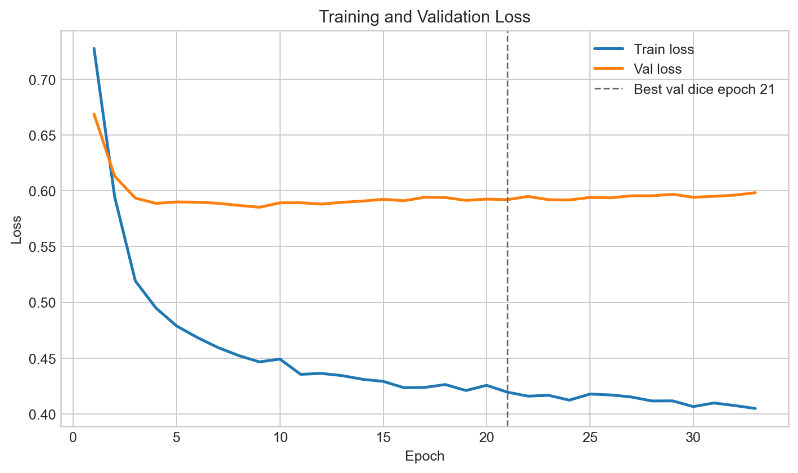

Dice/IoU 曲线已统一为百分比，便于观察训练集与验证集之间的泛化差距。

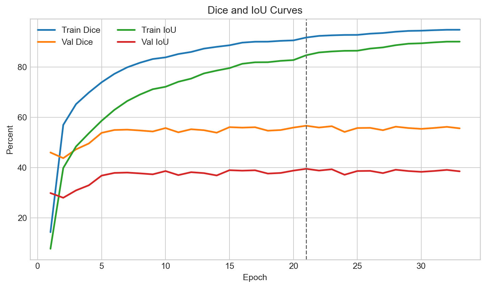

Precision/Recall 曲线用于判断模型后期是否变得更保守。

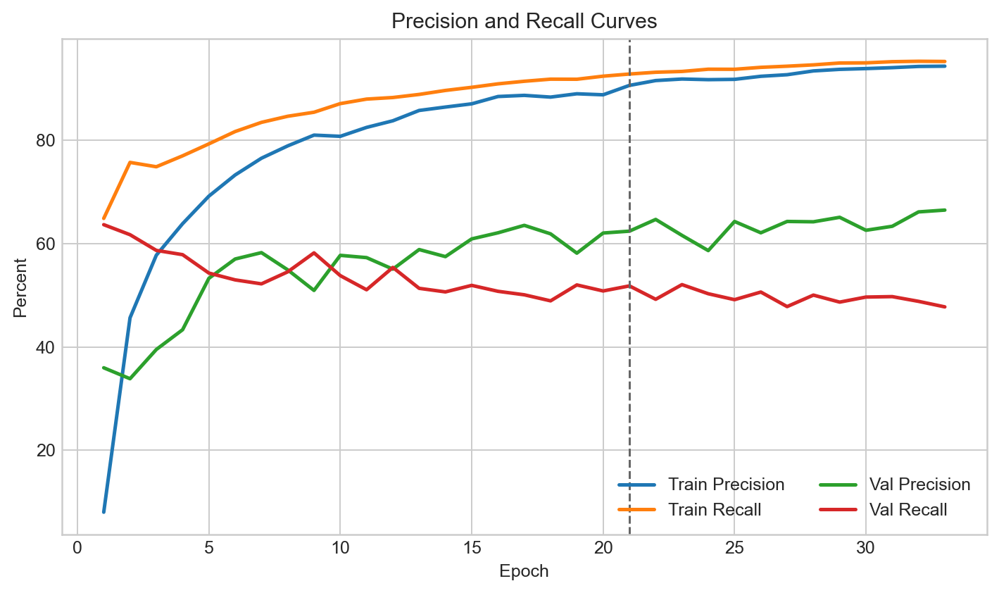

验证集样本级指标曲线用于同时观察 positive-only Dice、mean Dice all、阴性误报率和阳性图像召回。

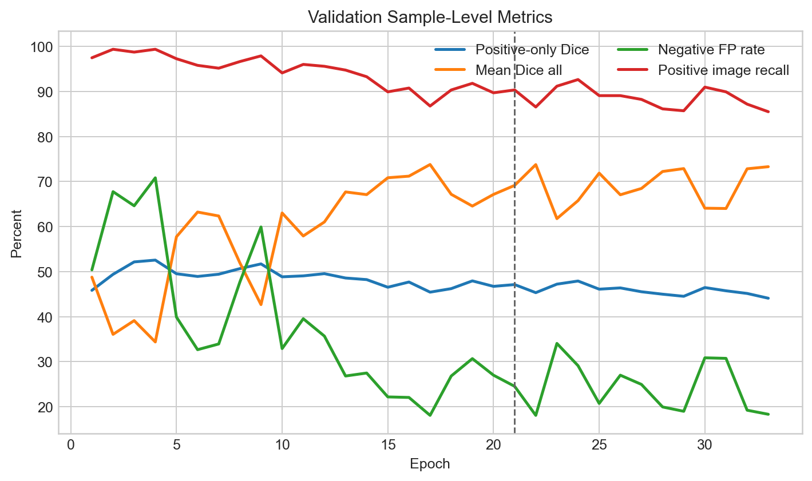

Threshold sweep 像素级曲线用于观察 Dice、Precision 和 Recall 对阈值的敏感性。

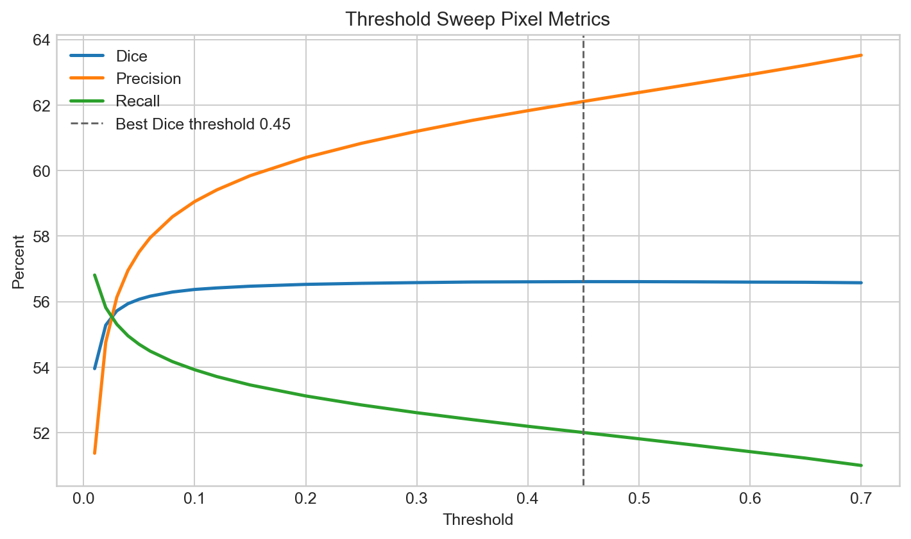

Threshold sweep 样本级曲线展示 positive-only Dice 与 negative FP rate 的冲突。

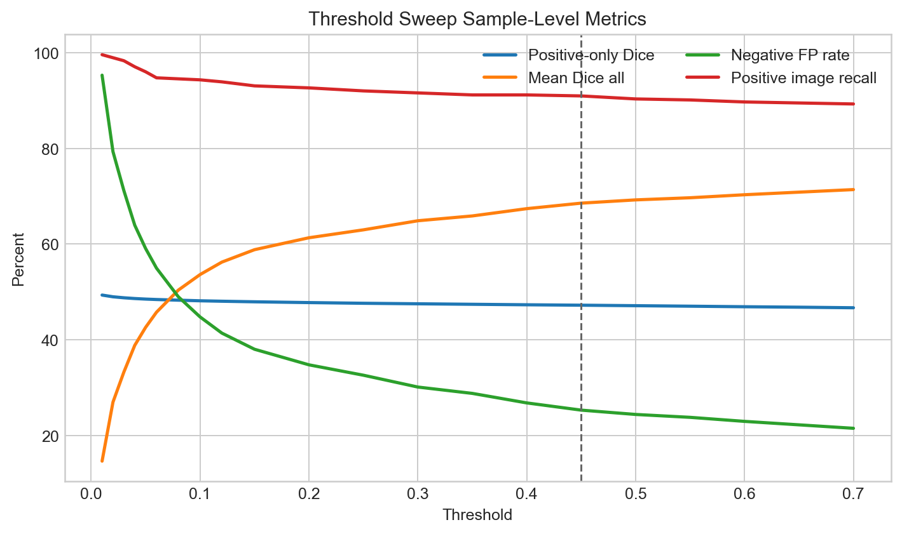

候选阈值柱状图用于比较 positive-only Dice、negative FP rate 和 mean Dice all 的取舍。

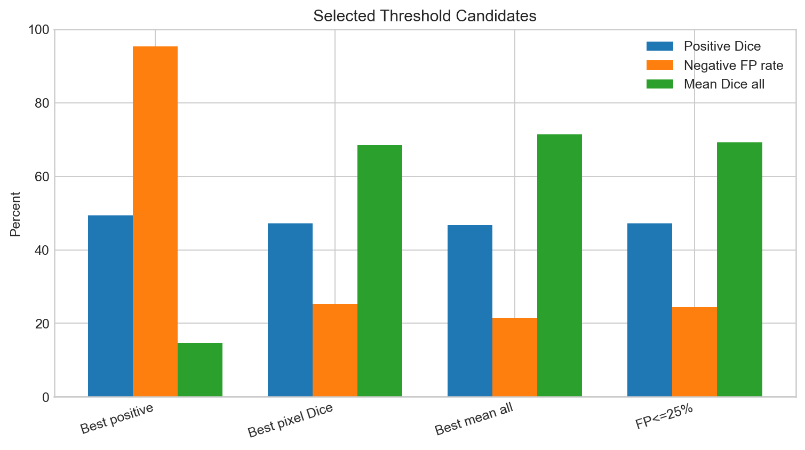

修正后的 `best_model_fast` 后处理 trade-off 图以阴性误报率为横轴、positive-only Dice 为纵轴，用于选择 A/B/C 候选。

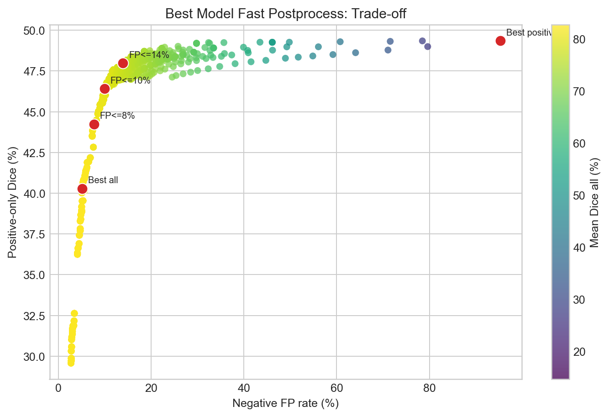

`best_model_fast` 候选柱状图用于比较 recall-first、enterprise balanced、low-FP 和 best-all 配置。

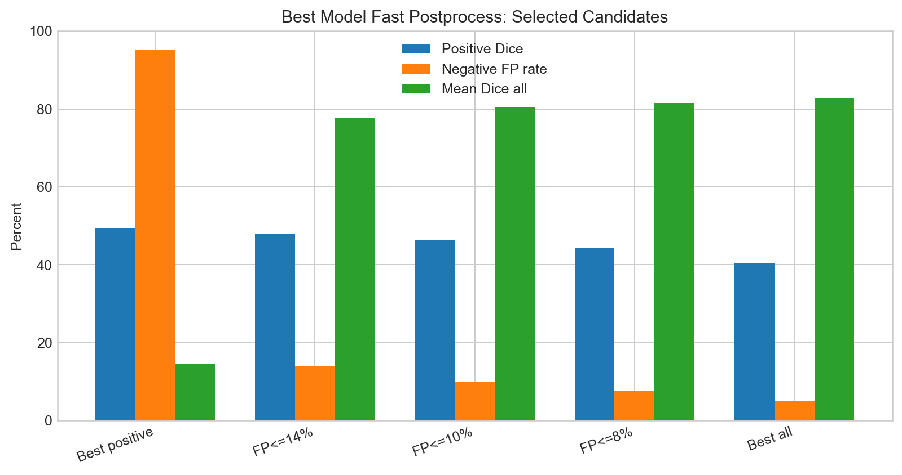

`best_positive_model_fast` 的 trade-off 图显示该 checkpoint 在高 positive Dice 下误报过高，误报受限后 positive Dice 明显下降。

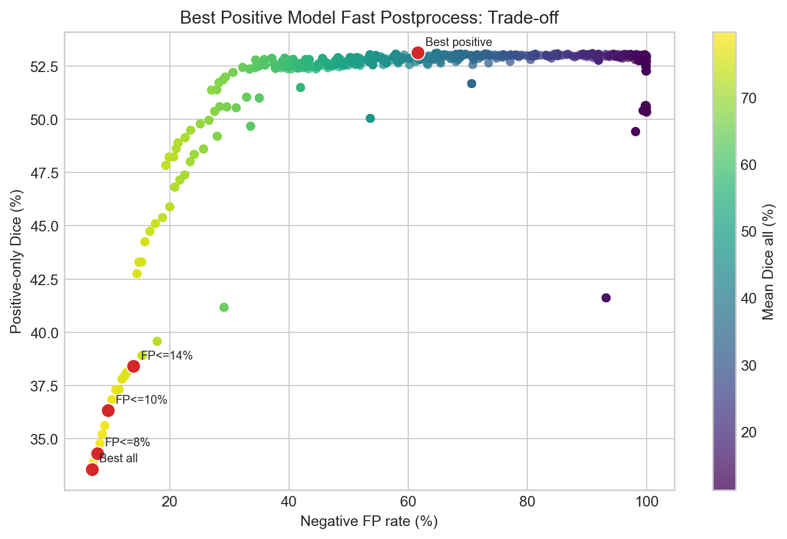

两个 checkpoint 的约束候选对比图用于说明 `best_model` 更适合作为企业候选来源。

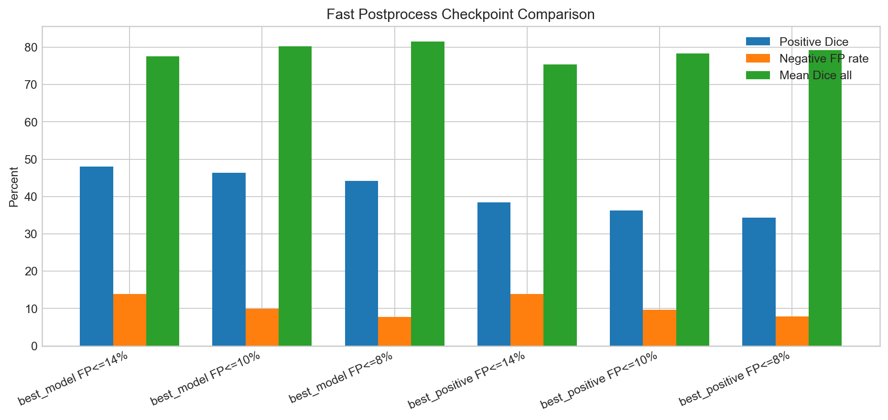
