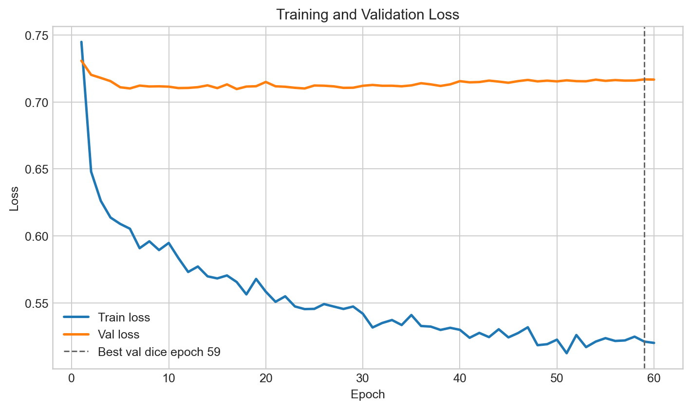
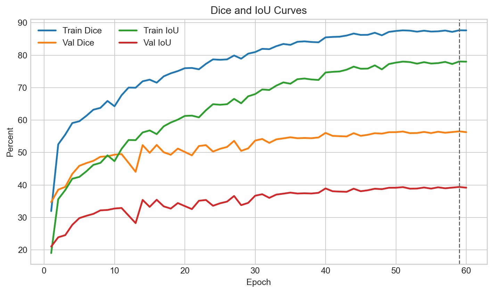
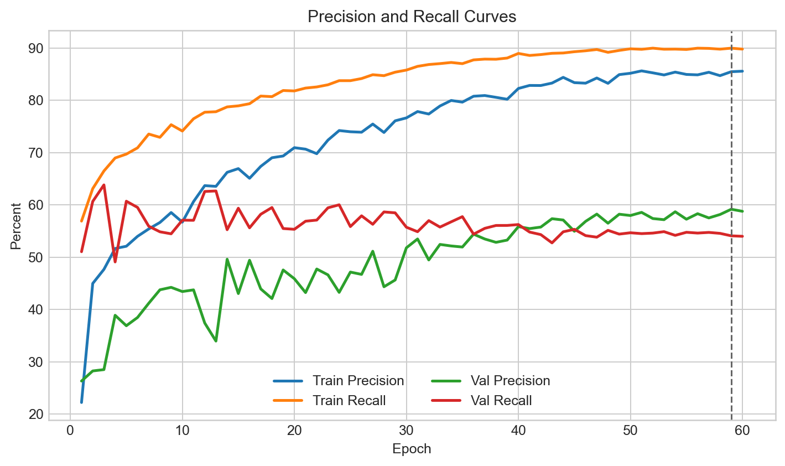
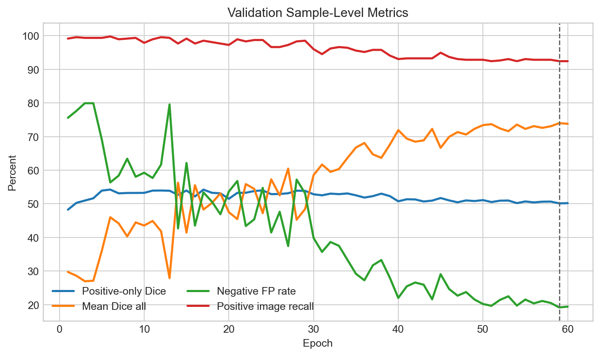
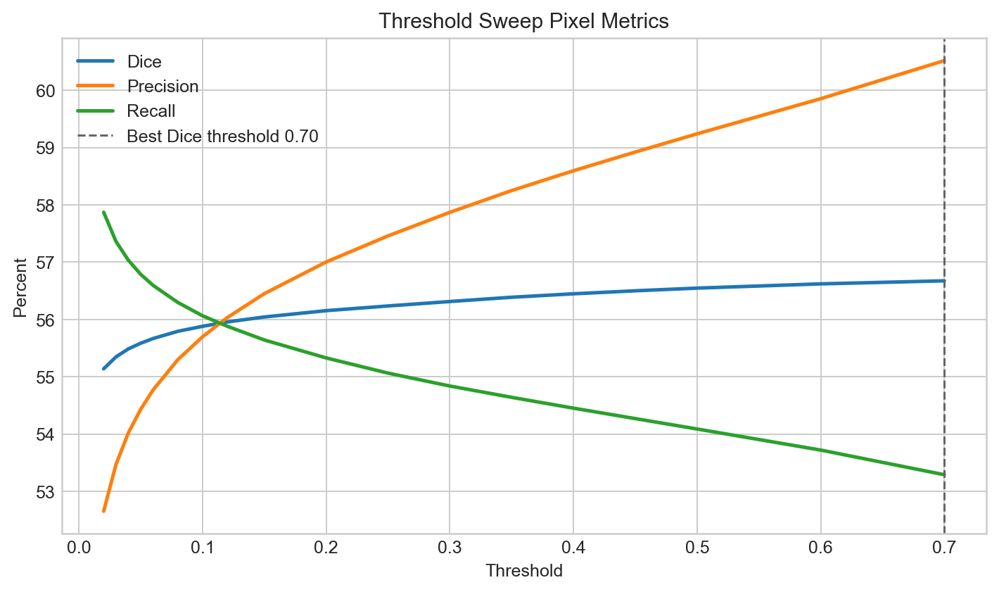
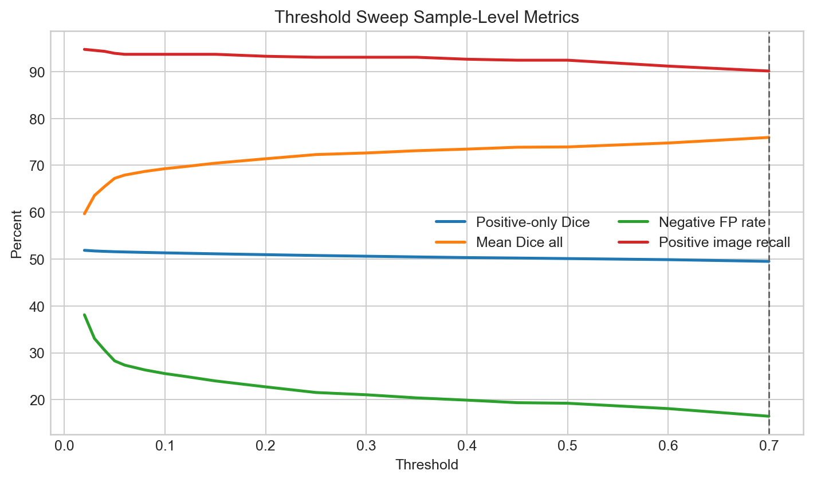
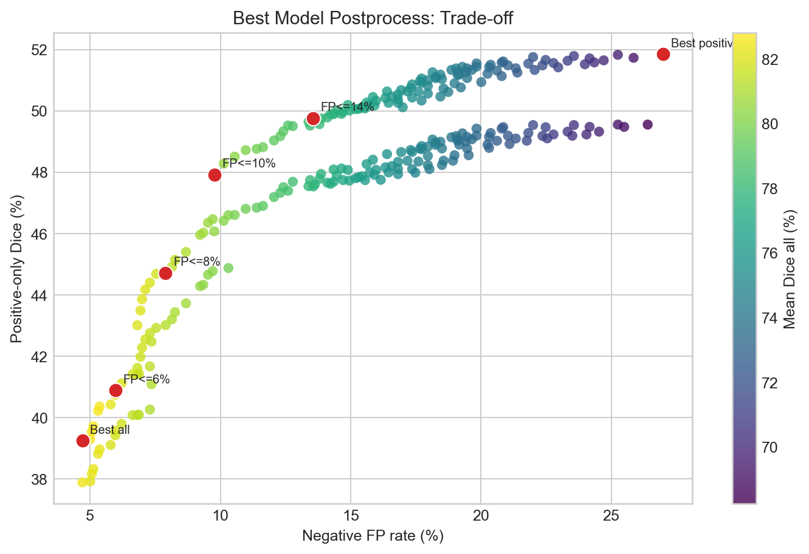
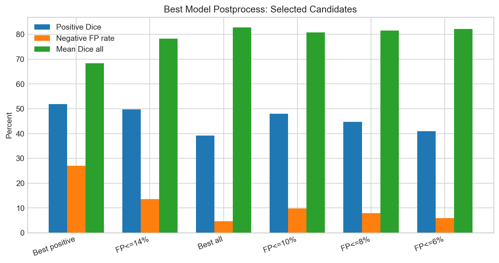
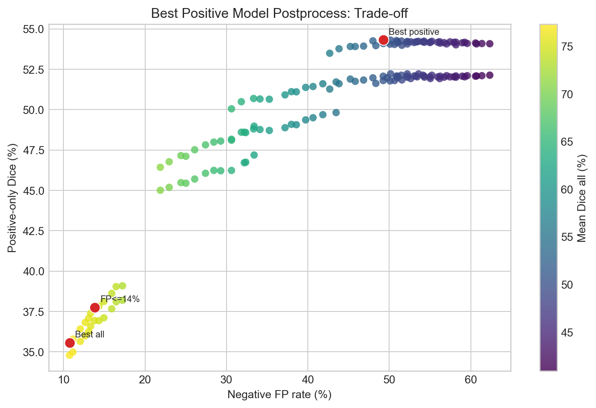
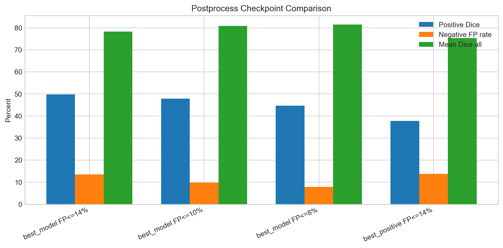

# SIIM-ACR Enterprise U-Net++ EfficientNet-B3 512 SCSE Aug A100 Safe 实验报告

## 1. 实验目的

本实验在 SIIM-ACR Pneumothorax Segmentation 验证集上评估 `U-Net++ + timm-efficientnet-b3 encoder` 的 512 输入尺寸单模型配置，并加入 `scSE` decoder attention 和 light augmentation。目标是观察注意力模块与轻量数据增强是否能在保持阴性误报可控的同时，提高 positive-only Dice 和企业候选配置的稳定性。

本报告仅基于验证集结果进行分析，尚未包含独立 test 集评估，因此不能表述为最终泛化性能。

## 2. 实验配置

实验输出目录：

```text
outputs/experiments/enterprise_unetpp_effb3_512_scse_aug_a100_safe/20260526_155945
```

主要配置来自 `config.json`：

| 配置项 | 数值 |
|---|---:|
| 数据集 | SIIM-ACR Pneumothorax Segmentation |
| 模型 | U-Net++ |
| Encoder | timm-efficientnet-b3 |
| Encoder 预训练 | ImageNet |
| Decoder attention | scSE |
| 输入尺寸 | 512 x 512 |
| 输入通道 | 3 |
| 训练轮数 | 60 |
| Batch size | 32 |
| 初始学习率 | 0.0002 |
| Weight decay | 0.0005 |
| Loss | BCE + Dice |
| BCE 权重 | 0.20 |
| Dice 权重 | 0.80 |
| BCE `pos_weight` | 2.0 |
| 默认二值化阈值 | 0.50 |
| Balanced sampling | 是 |
| 正样本采样比例 | 0.40 |
| Augment | 是 |
| Aug strength | light |
| Early stopping patience | 12 |
| Monitor | val_dice |
| 随机种子 | 43 |
| 设备 | CUDA |
| AMP | 开启 |

本实验记录了训练指标 `logs/metrics.csv`、阈值扫描 `threshold_sweep_val_best_model.csv`，以及两份后处理搜索结果：`postprocess_sweep_val_best_model.csv` 和 `postprocess_sweep_val_best_positive_model.csv`。

## 3. 训练结果

训练日志来自 `logs/metrics.csv`，共 60 个 epoch。默认阈值下，模型在第 59 轮取得最高验证集 Dice。与此前部分 EfficientNet-B3 实验不同，本实验的验证集 Dice 在训练后期仍保持上升或稳定，说明 `scSE + light augmentation` 对后期泛化有一定帮助。

关键 epoch 指标如下：

| Epoch | Train Dice | Train Precision | Train Recall | Val Dice | Val IoU | Val Precision | Val Recall | Val Positive Dice | Val Negative FP rate | Positive image recall |
|---:|---:|---:|---:|---:|---:|---:|---:|---:|---:|---:|
| 1 | 0.3197 | 0.2223 | 0.5692 | 0.3475 | 0.2103 | 0.2633 | 0.5107 | 0.4825 | 75.59% | 99.16% |
| 5 | 0.5964 | 0.5211 | 0.6973 | 0.4591 | 0.2979 | 0.3691 | 0.6072 | 0.5392 | 69.14% | 99.37% |
| 10 | 0.6427 | 0.5672 | 0.7414 | 0.4934 | 0.3275 | 0.4345 | 0.5710 | 0.5326 | 59.25% | 97.90% |
| 20 | 0.7600 | 0.7096 | 0.8181 | 0.5018 | 0.3350 | 0.4590 | 0.5535 | 0.5149 | 53.65% | 97.27% |
| 30 | 0.8097 | 0.7665 | 0.8580 | 0.5371 | 0.3671 | 0.5181 | 0.5575 | 0.5284 | 39.84% | 96.01% |
| 40 | 0.8550 | 0.8228 | 0.8898 | 0.5606 | 0.3894 | 0.5586 | 0.5626 | 0.5074 | 22.00% | 93.07% |
| 50 | 0.8746 | 0.8519 | 0.8987 | 0.5629 | 0.3917 | 0.5798 | 0.5469 | 0.5110 | 20.19% | 92.86% |
| 54 | 0.8755 | 0.8541 | 0.8981 | 0.5636 | 0.3923 | 0.5870 | 0.5419 | 0.5020 | 19.71% | 92.44% |
| 59 | 0.8768 | 0.8549 | 0.8999 | 0.5653 | 0.3940 | 0.5918 | 0.5410 | 0.5012 | 19.17% | 92.44% |
| 60 | 0.8765 | 0.8558 | 0.8981 | 0.5630 | 0.3918 | 0.5879 | 0.5401 | 0.5020 | 19.41% | 92.44% |

最佳默认阈值验证集结果：

| 指标 | 数值 |
|---|---:|
| Best epoch | 59 |
| Train loss | 0.5211 |
| Train Dice | 0.8768 |
| Train IoU | 0.7806 |
| Train Precision | 0.8549 |
| Train Recall | 0.8999 |
| Val loss | 0.7169 |
| Val Dice | 0.5653 |
| Val IoU | 0.3940 |
| Val Precision | 0.5918 |
| Val Recall | 0.5410 |
| Val Specificity | 0.9989 |
| Val mean Dice all | 0.7399 |
| Val positive-only Dice | 0.5012 |
| Val negative FP rate | 19.17% |
| Val positive image recall | 92.44% |

最后一轮结果与最佳点非常接近。第 60 轮 Val Dice 为 0.5630，positive-only Dice 为 0.5020，negative FP rate 为 19.41%。这说明本实验训练后期没有明显崩塌，但默认阈值下阴性误报仍高于企业平衡目标，需要依赖后处理选择候选配置。

## 4. Threshold sweep 结果

阈值扫描结果来自 `threshold_sweep_val_best_model.csv`。按全局像素级 Dice 排序，最佳阈值为 0.70：

| Threshold | Dice | IoU | Precision | Recall | Specificity | Positive Dice | Negative FP rate | Positive image recall |
|---:|---:|---:|---:|---:|---:|---:|---:|---:|
| 0.70 | 0.5667 | 0.3954 | 0.6052 | 0.5329 | 0.9990 | 0.4950 | 16.46% | 90.13% |
| 0.60 | 0.5662 | 0.3949 | 0.5985 | 0.5372 | 0.9989 | 0.4987 | 18.08% | 91.18% |
| 0.50 | 0.5655 | 0.3942 | 0.5924 | 0.5409 | 0.9989 | 0.5010 | 19.23% | 92.44% |
| 0.45 | 0.5650 | 0.3937 | 0.5892 | 0.5427 | 0.9989 | 0.5022 | 19.35% | 92.44% |
| 0.40 | 0.5645 | 0.3932 | 0.5860 | 0.5445 | 0.9988 | 0.5031 | 19.89% | 92.65% |
| 0.35 | 0.5639 | 0.3926 | 0.5825 | 0.5464 | 0.9988 | 0.5046 | 20.37% | 93.07% |
| 0.30 | 0.5631 | 0.3919 | 0.5787 | 0.5484 | 0.9988 | 0.5060 | 21.04% | 93.07% |
| 0.25 | 0.5624 | 0.3912 | 0.5746 | 0.5506 | 0.9988 | 0.5076 | 21.52% | 93.07% |

阈值扫描显示，SCSE+Aug 的像素级 Dice 在高阈值处略高，但阈值从 0.25 到 0.70 的 Dice 差异很小。提高阈值可以降低阴性误报，但不经过连通域过滤时，最低 negative FP rate 仍为 16.46%，未达到 10% 企业平衡约束。

若按 positive-only Dice 排序，低阈值可以进一步提高正样本分割，但误报明显增加：

| Threshold | Positive Dice | Negative FP rate | Mean Dice all | Positive image recall |
|---:|---:|---:|---:|---:|
| 0.02 | 0.5187 | 38.10% | 0.5967 | 94.75% |
| 0.03 | 0.5173 | 33.03% | 0.6357 | 94.54% |
| 0.04 | 0.5164 | 30.56% | 0.6547 | 94.33% |
| 0.05 | 0.5157 | 28.27% | 0.6723 | 93.91% |
| 0.06 | 0.5151 | 27.37% | 0.6793 | 93.70% |

## 5. 后处理参数搜索结果

后处理搜索分别基于 `best_model.pth` 和 `best_positive_model.pth`。验证集包含 2135 张图像，其中阳性 476 张，阴性 1659 张。

### 5.1 Best model checkpoint

`postprocess_sweep_val_best_model.csv` 基于默认监控指标保存的 `best_model.pth`。关键候选如下：

| 设置 | Threshold | Min component area | Min pred area | Keep largest | Positive Dice | Positive recall | Negative FP rate | False positive negative | Mean Dice all | 结论 |
|---|---:|---:|---:|---:|---:|---:|---:|---:|---:|---|
| Best positive Dice | 0.02 | 0 | 30 | False | 0.5184 | 94.33% | 27.00% | 448 / 1659 | 0.6828 | 正样本最高，但误报过高 |
| FP <= 14% 最佳 positive | 0.50 | 200 | 30 | False | 0.4975 | 88.03% | 13.56% | 225 / 1659 | 0.7826 | recall-first 候选 |
| FP <= 10% 最佳 positive | 0.50 | 500 | 30 | False | 0.4792 | 82.35% | 9.76% | 162 / 1659 | 0.8080 | 当前强企业平衡候选 |
| FP <= 8% 最佳 positive | 0.15 | 800 | 30 | False | 0.4471 | 74.37% | 7.90% | 131 / 1659 | 0.8154 | 低误报候选 |
| FP <= 6% 最佳 positive | 0.10 | 1000 | 30 | False | 0.4088 | 66.60% | 5.97% | 99 / 1659 | 0.8218 | 更保守候选 |
| Best mean Dice all | 0.50 | 1000 | 30 | False | 0.3924 | 63.03% | 4.70% | 78 / 1659 | 0.8280 | 整体均值最高，但过于保守 |

`best_model` 的后处理结果是本实验最有价值的部分。FP<=10% 约束下，`threshold=0.50, min_component_area=500, min_pred_area=30` 的 positive-only Dice 为 0.4792，negative FP rate 为 9.76%，mean Dice all 为 0.8080，明显强于 Stable BS48 和 BCE/Tversky 的企业平衡候选。

### 5.2 Best positive checkpoint

`postprocess_sweep_val_best_positive_model.csv` 基于训练中 positive-only 指标更高的 checkpoint。关键候选如下：

| 设置 | Threshold | Min component area | Min pred area | Keep largest | Positive Dice | Positive recall | Negative FP rate | False positive negative | Mean Dice all | 结论 |
|---|---:|---:|---:|---:|---:|---:|---:|---:|---:|---|
| Best positive Dice | 0.40 | 300 | 30 | False | 0.5431 | 99.37% | 49.25% | 817 / 1659 | 0.5155 | 正样本最高，但误报不可接受 |
| FP <= 14% 最佳 positive | 0.12 | 1500 | 30 | False | 0.3774 | 64.92% | 13.80% | 229 / 1659 | 0.7539 | 误报可控后正样本下降明显 |
| Best mean Dice all | 0.50 | 1500 | 30 | False | 0.3556 | 58.82% | 10.73% | 178 / 1659 | 0.7730 | 偏保守，仍未进 10% FP 约束 |

`best_positive_model` 的最高 positive-only Dice 达到 0.5431，但对应 negative FP rate 为 49.25%。一旦通过强面积过滤控制误报，positive-only Dice 下降到 0.3774 左右，明显弱于 `best_model` checkpoint。因此，本实验企业候选应使用 `best_model`，不建议使用 `best_positive_model`。

### 5.3 推荐保留配置

基于后处理结果，本实验建议保留三档 `best_model` 候选：

| Candidate | 定位 | Checkpoint | Threshold | Min component area | Min pred area | Positive Dice | Positive recall | Negative FP rate | Mean Dice all |
|---|---|---|---:|---:|---:|---:|---:|---:|---:|
| A | recall-first | best_model | 0.50 | 200 | 30 | 0.4975 | 88.03% | 13.56% | 0.7826 |
| B | enterprise balanced | best_model | 0.50 | 500 | 30 | 0.4792 | 82.35% | 9.76% | 0.8080 |
| C | low false-positive | best_model | 0.15 | 800 | 30 | 0.4471 | 74.37% | 7.90% | 0.8154 |

Candidate B 是目前最值得关注的企业平衡候选；Candidate A 适合正样本优先场景；Candidate C 可作为低误报对照，但与 EfficientNet-B3 v2 Candidate C 接近。

## 6. 与现有 EfficientNet-B3 候选对比

| 实验与设置 | Positive Dice | Positive recall | Negative FP rate | Mean Dice all | 判断 |
|---|---:|---:|---:|---:|---|
| Enterprise improve v1 Candidate A | 0.4822 | 82.56% | 14.04% | 0.7754 | 旧 recall-first 对照 |
| EffB3 512 v2 Candidate A：thr=0.04, area=300 | 0.4751 | 未记录 | 13.20% | 0.7804 | 旧单模型 recall-first |
| SCSE+Aug Candidate A：thr=0.50, area=200 | 0.4975 | 88.03% | 13.56% | 0.7826 | 新 recall-first 候选 |
| Stable BS48 Candidate B：thr=0.03, area=500 | 0.4632 | 未记录 | 9.89% | 0.8035 | 旧企业平衡候选 |
| BCE/Tversky Candidate B：thr=0.25, area=300 | 0.4641 | 81.30% | 9.95% | 0.8032 | 企业平衡并列候选 |
| SCSE+Aug Candidate B：thr=0.50, area=500 | 0.4792 | 82.35% | 9.76% | 0.8080 | 新企业平衡优先候选 |
| EffB3 512 v2 Candidate C：thr=0.30, area=500 | 0.4464 | 未记录 | 7.96% | 0.8147 | 旧低误报候选 |
| SCSE+Aug Candidate C：thr=0.15, area=800 | 0.4471 | 74.37% | 7.90% | 0.8154 | 新低误报并列候选 |

SCSE+Aug 的优势非常明确：在接近 10% 阴性误报约束下，positive-only Dice 达到 0.4792，明显高于 Stable BS48 Candidate B 和 BCE/Tversky Candidate B；在接近 14% 阴性误报约束下，Candidate A 的 positive-only Dice 达到 0.4975，也高于现有单模型和旧 enterprise improve recall-first 候选。

低误报配置下，SCSE+Aug Candidate C 与 EfficientNet-B3 v2 Candidate C 基本持平，positive Dice 略高、negative FP rate 略低、mean Dice all 略高。因此，SCSE+Aug 也可以作为低误报并列候选。

## 7. 结论

`enterprise_unetpp_effb3_512_scse_aug_a100_safe` 是当前 EfficientNet-B3 系列中非常有价值的单模型改进实验。加入 scSE attention 和 light augmentation 后，模型在训练后期仍能稳定提升验证集 Dice，默认阈值最佳 Val Dice 达到 0.5653，后处理后形成了更强的企业候选。

建议将本实验更新为当前优先企业候选：

| Candidate | 定位 | Threshold | Min component area | Min pred area | Positive Dice | Negative FP rate | Mean Dice all |
|---|---|---:|---:|---:|---:|---:|---:|
| A | recall-first | 0.50 | 200 | 30 | 0.4975 | 13.56% | 0.7826 |
| B | enterprise balanced | 0.50 | 500 | 30 | 0.4792 | 9.76% | 0.8080 |
| C | low false-positive | 0.15 | 800 | 30 | 0.4471 | 7.90% | 0.8154 |

当前建议将 Candidate B 作为新的企业平衡优先候选，将 Candidate A 作为 recall-first 单模型候选，将 Candidate C 作为低误报并列候选。所有结论仍只来自验证集，进入 test 集评估前应先固定候选配置。

## 8. 后续建议

1. 优先对 SCSE+Aug Candidate B 生成验证集预测可视化，复查 162 张阴性误报和 84 张阳性图像漏检。
2. 将 SCSE+Aug Candidate B 与 Stable BS48 Candidate B、BCE/Tversky Candidate B 做同批样本对比，确认提升是否来自真实错误减少。
3. 对 Candidate A 的 13.56% 阴性误报做可视化复查，判断其是否能替代旧 recall-first 候选。
4. 对 Candidate C 与 EfficientNet-B3 v2 Candidate C 做低误报场景对比，决定最终 low-FP 默认候选。
5. 进入独立 test 集评估前，建议固定 Candidate B/C 的阈值、面积过滤和 `min_pred_area`，避免在 test 集继续调参。

## 图表解读

训练 loss 曲线用于观察收敛趋势和验证集 loss 后期是否回升。



Dice/IoU 曲线已统一为百分比，便于观察训练集与验证集之间的泛化差距。



Precision/Recall 曲线用于判断模型后期是否变得更保守。



验证集样本级指标曲线用于同时观察 positive-only Dice、mean Dice all、阴性误报率和阳性图像召回。



Threshold sweep 像素级曲线用于观察 Dice、Precision 和 Recall 对阈值的敏感性。



Threshold sweep 样本级曲线展示 positive-only Dice 与 negative FP rate 的冲突。



`best_model` 后处理 trade-off 图以阴性误报率为横轴、positive-only Dice 为纵轴，用于选择 A/B/C 候选。



`best_model` 候选柱状图用于比较 recall-first、enterprise balanced、low-FP 和 best-all 配置。



`best_positive_model` 的 trade-off 图显示该 checkpoint 在高 positive Dice 下误报过高，误报受限后 positive Dice 明显下降。



两个 checkpoint 的约束候选对比图用于说明 `best_model` 更适合作为企业候选来源。


