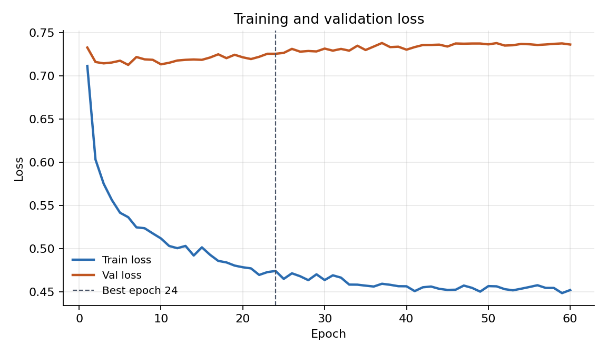
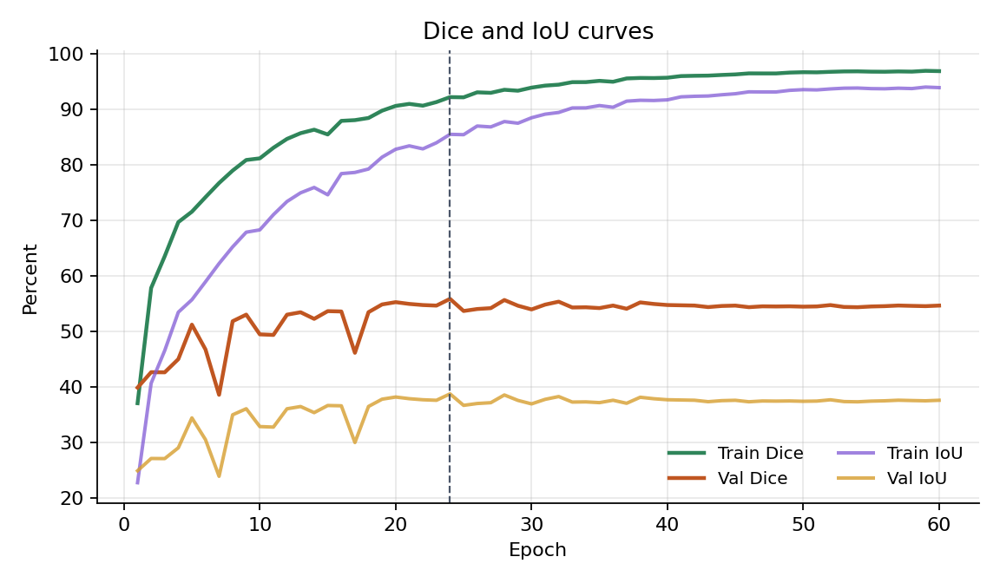
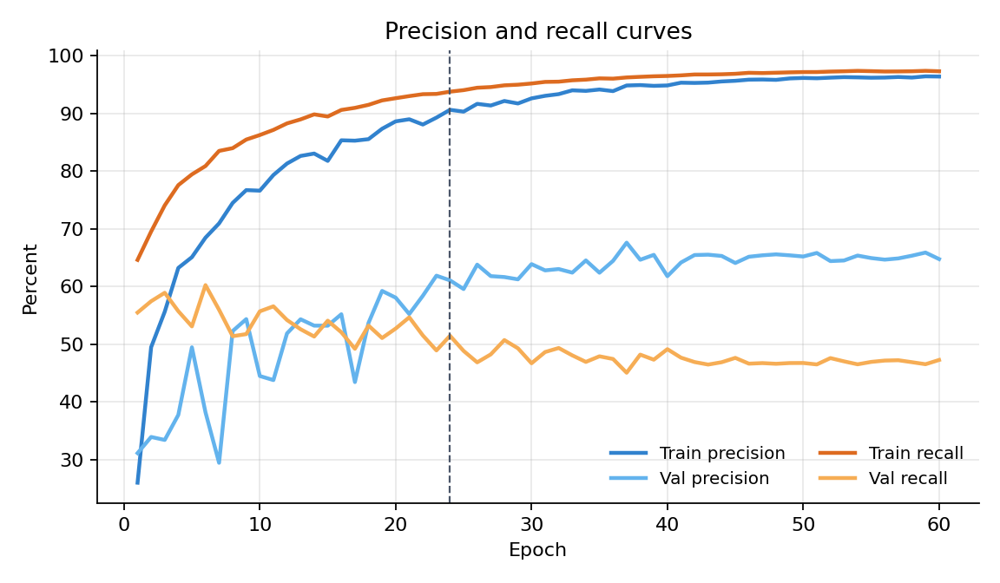
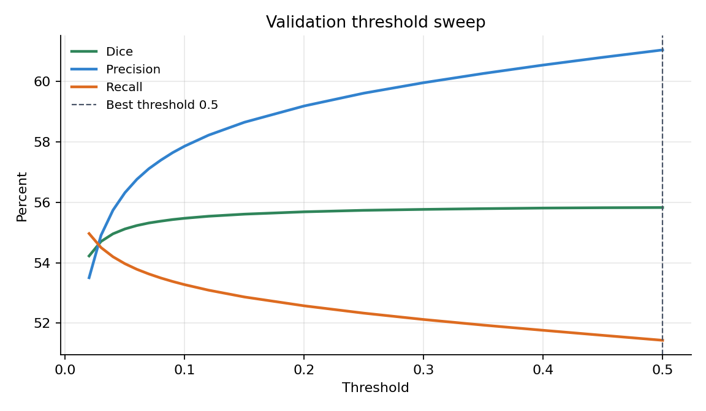
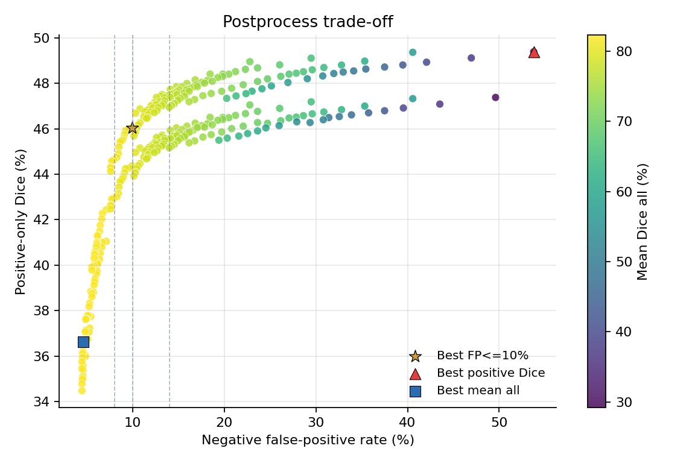

# SIIM-ACR Enterprise U-Net++ EfficientNet-B3 512 v2 实验报告

## 1. 实验目的

本实验在 SIIM-ACR Pneumothorax Segmentation 验证集上评估 `U-Net++ + EfficientNet-B3 encoder` 的 512 输入尺寸单模型配置。目标是观察相较 ResNet34/ResNet50 系列和既有 ensemble 企业候选，EfficientNet-B3 是否能在 positive-only Dice、阴性误报率和 mean Dice all 之间形成更好的企业落地折中。

本报告仅基于验证集结果进行分析，尚未包含独立 test 集评估，因此不能表述为最终泛化性能。

## 2. 实验配置

实验输出目录：

```text
outputs/experiments/enterprise_unetpp_effb3_512_v2/20260525_090041
```

主要配置来自 `config.json`：

| 配置项 | 数值 |
|---|---:|
| 数据集 | SIIM-ACR Pneumothorax Segmentation |
| 模型 | U-Net++ |
| Encoder | timm-efficientnet-b3 |
| Encoder 预训练 | ImageNet |
| 输入尺寸 | 512 x 512 |
| 输入通道 | 3 |
| 训练轮数 | 60 |
| Batch size | 24 |
| 初始学习率 | 0.0002 |
| Weight decay | 0.0005 |
| Loss | BCE + Dice |
| BCE 权重 | 0.20 |
| Dice 权重 | 0.80 |
| BCE `pos_weight` | 3.0 |
| 默认二值化阈值 | 0.50 |
| Balanced sampling | 是 |
| 正样本采样比例 | 0.45 |
| 随机种子 | 42 |
| 设备 | CUDA |
| AMP | 开启 |

本实验显式提高了正样本采样比例和 BCE 正类权重，并提高 Dice loss 权重，属于偏 recall/positive Dice 的单模型企业候选探索。

## 3. 训练结果

训练日志来自 `logs/metrics.csv`。模型在第 24 轮取得最佳验证集 Dice。之后训练集 Dice 继续上升，但验证集 Dice 没有继续提高，说明后期存在过拟合和验证集预测变保守的趋势。

关键 epoch 指标如下：

| Epoch | Train Dice | Train Precision | Train Recall | Val Dice | Val IoU | Val Precision | Val Recall | Val Loss |
|---:|---:|---:|---:|---:|---:|---:|---:|---:|
| 1 | 0.3704 | 0.2597 | 0.6459 | 0.3985 | 0.2488 | 0.3110 | 0.5546 | 0.7326 |
| 2 | 0.5780 | 0.4946 | 0.6951 | 0.4263 | 0.2709 | 0.3389 | 0.5743 | 0.7158 |
| 3 | 0.6351 | 0.5560 | 0.7404 | 0.4261 | 0.2707 | 0.3338 | 0.5889 | 0.7142 |
| 20 | 0.9057 | 0.8861 | 0.9262 | 0.5524 | 0.3816 | 0.5804 | 0.5269 | 0.7212 |
| 24 | 0.9216 | 0.9061 | 0.9376 | 0.5583 | 0.3872 | 0.6104 | 0.5144 | 0.7253 |
| 28 | 0.9348 | 0.9214 | 0.9485 | 0.5562 | 0.3853 | 0.6162 | 0.5069 | 0.7285 |
| 38 | 0.9561 | 0.9490 | 0.9633 | 0.5519 | 0.3812 | 0.6461 | 0.4817 | 0.7330 |
| 60 | 0.9684 | 0.9638 | 0.9729 | 0.5462 | 0.3757 | 0.6473 | 0.4724 | 0.7360 |

最佳验证集结果：

| 指标 | 数值 |
|---|---:|
| Best epoch | 24 |
| Train loss | 0.4741 |
| Train Dice | 0.9216 |
| Train IoU | 0.8545 |
| Train Precision | 0.9061 |
| Train Recall | 0.9376 |
| Val loss | 0.7253 |
| Val Dice | 0.5583 |
| Val IoU | 0.3872 |
| Val Precision | 0.6104 |
| Val Recall | 0.5144 |
| Val Specificity | 0.9990 |

最后一轮结果：

| 指标 | 数值 |
|---|---:|
| Epoch | 60 |
| Train loss | 0.4521 |
| Train Dice | 0.9684 |
| Train IoU | 0.9387 |
| Train Precision | 0.9638 |
| Train Recall | 0.9729 |
| Val loss | 0.7360 |
| Val Dice | 0.5462 |
| Val IoU | 0.3757 |
| Val Precision | 0.6473 |
| Val Recall | 0.4724 |
| Val Specificity | 0.9992 |

从最佳 epoch 到最后一轮，训练集 Dice 从 0.9216 提升到 0.9684，但验证集 Dice 从 0.5583 降到 0.5462，验证集 Recall 从 0.5144 降到 0.4724。后续若继续训练同类模型，应优先使用 early stopping 或按验证集综合指标选择 checkpoint。

## 4. Threshold Sweep 结果

`threshold_sweep_val.csv` 记录了对 best checkpoint 的验证集阈值扫描。按全局像素级 Dice 排序，最佳阈值为 0.50：

| Threshold | Dice | IoU | Precision | Recall | Specificity |
|---:|---:|---:|---:|---:|---:|
| 0.50 | 0.5583 | 0.3872 | 0.6105 | 0.5143 | 0.9990 |
| 0.45 | 0.5582 | 0.3872 | 0.6080 | 0.5159 | 0.9990 |
| 0.40 | 0.5581 | 0.3871 | 0.6055 | 0.5176 | 0.9990 |
| 0.35 | 0.5579 | 0.3869 | 0.6027 | 0.5193 | 0.9990 |
| 0.30 | 0.5577 | 0.3866 | 0.5996 | 0.5212 | 0.9990 |
| 0.25 | 0.5573 | 0.3863 | 0.5962 | 0.5233 | 0.9989 |
| 0.20 | 0.5569 | 0.3859 | 0.5919 | 0.5257 | 0.9989 |
| 0.10 | 0.5547 | 0.3838 | 0.5786 | 0.5327 | 0.9988 |

阈值扫描曲线较平滑，低阈值可以略微提高像素级 Recall，但全局 Dice 下降。该结果说明训练默认阈值 0.50 已接近全局像素级最优，但样本级企业后处理仍需要单独选择阈值和连通域面积过滤。

## 5. 后处理参数搜索结果

后处理搜索结果来自 `postprocess_sweep_val.csv`。验证集包含 2135 张图像，其中阳性 476 张，阴性 1659 张。

| 设置 | Threshold | Min component area | Keep largest | Positive Dice | Positive IoU | Negative FP rate | False positive negative | Mean Dice all | 结论 |
|---|---:|---:|---:|---:|---:|---:|---:|---:|---|
| Best positive Dice | 0.02 | 0 | False | 0.4938 | 0.3802 | 53.77% | 892 / 1659 | 0.2965 | 正样本最高，但误报不可接受 |
| FP <= 14% 最佳 positive | 0.04 | 300 | False | 0.4751 | 0.3690 | 13.20% | 219 / 1659 | 0.7804 | recall-first / balanced 候选 |
| FP <= 10% 最佳 positive | 0.04 | 500 | False | 0.4604 | 0.3594 | 9.95% | 165 / 1659 | 0.8024 | 当前企业平衡候选 |
| FP <= 8% 最佳 positive | 0.30 | 500 | False | 0.4464 | 0.3482 | 7.96% | 132 / 1659 | 0.8147 | 低误报候选 |
| Best mean Dice all | 0.20 | 1000 | False | 0.3664 | 0.2896 | 4.58% | 76 / 1659 | 0.8231 | 过于保守，不适合作为主分割候选 |

### 5.1 Best positive Dice

`threshold=0.02, min_component_area=0` 时 positive-only Dice 达到 0.4938，是本实验中最高的阳性样本分割结果。但该配置的 negative FP rate 为 53.77%，阴性样本误报过高，不能作为企业落地候选。

### 5.2 企业平衡候选

`threshold=0.04, min_component_area=500` 时 positive-only Dice 为 0.4604，negative FP rate 为 9.95%，mean Dice all 为 0.8024。该配置在接近 10% 阴性误报约束下保留了较高 positive-only Dice，适合作为当前单模型企业平衡候选。

### 5.3 低误报候选

`threshold=0.30, min_component_area=500` 时 negative FP rate 降至 7.96%，positive-only Dice 仍有 0.4464，mean Dice all 为 0.8147。该配置适合更重视误报控制的场景，但会牺牲一部分阳性样本分割能力。

### 5.4 Best mean-all 配置

`threshold=0.20, min_component_area=1000` 时 mean Dice all 最高，达到 0.8231，negative FP rate 为 4.58%。但 positive-only Dice 只有 0.3664，说明该配置主要依靠大量阴性样本真阴性拉高 mean Dice all，明显过于保守，不应作为主分割候选。

## 6. 与现有候选对比

| 模型与设置 | Positive Dice | Negative FP rate | Mean Dice all | 判断 |
|---|---:|---:|---:|---|
| 旧 Unet++-ResNet34 baseline：thr=0.08, area=150 | 0.3980 | 13.92% | 0.7576 | 旧单模型主线 baseline |
| Ensemble R34+R50 main：thr=0.25, area=500 | 0.4365 | 12.18% | 0.7798 | 早期融合平衡候选 |
| Enterprise v1 Candidate A：thr=0.25, area=200 | 0.4822 | 14.04% | 0.7754 | recall-first 候选 |
| Enterprise v1 Candidate B：thr=0.35, area=200 | 0.4509 | 9.89% | 0.8008 | 旧企业平衡候选 |
| Enterprise v1 Candidate C：thr=0.30, area=500 | 0.4255 | 7.78% | 0.8115 | 旧低误报候选 |
| EfficientNet-B3 512 recall-first：thr=0.04, area=300 | 0.4751 | 13.20% | 0.7804 | 单模型 recall-first 候选 |
| EfficientNet-B3 512 balanced：thr=0.04, area=500 | 0.4604 | 9.95% | 0.8024 | 当前推荐企业平衡候选 |
| EfficientNet-B3 512 low-FP：thr=0.30, area=500 | 0.4464 | 7.96% | 0.8147 | 当前推荐低误报候选 |

EfficientNet-B3 512 单模型的优势非常明确：在接近 10% 阴性误报率时，positive-only Dice 达到 0.4604，略高于 Enterprise v1 Candidate B 的 0.4509，mean Dice all 也略高。低误报配置下，positive-only Dice 0.4464 也高于 Enterprise v1 Candidate C 的 0.4255，同时 negative FP rate 接近。

不过，Enterprise v1 Candidate A 的 positive-only Dice 仍更高，为 0.4822，但它的 negative FP rate 也更高，为 14.04%。因此本实验不能完全替代 recall-first 候选，但可以更新企业平衡候选和低误报候选。

## 7. 结论

`enterprise_unetpp_effb3_512_v2` 是目前最有价值的单模型企业候选之一。训练期最佳 Val Dice 为 0.5583，明显高于此前多数组合中的单模型结果。

从后处理结果看，推荐保留三档配置：

| Candidate | 定位 | Threshold | Min component area | Positive Dice | Negative FP rate | Mean Dice all |
|---|---|---:|---:|---:|---:|---:|
| A | recall-first / balanced | 0.04 | 300 | 0.4751 | 13.20% | 0.7804 |
| B | enterprise balanced | 0.04 | 500 | 0.4604 | 9.95% | 0.8024 |
| C | low false-positive | 0.30 | 500 | 0.4464 | 7.96% | 0.8147 |

当前建议将 Candidate B 作为新的企业平衡候选，将 Candidate C 作为新的低误报候选；Candidate A 可作为正样本优先场景的单模型对照。所有结论仍只来自验证集，进入 test 集评估前应先固定候选配置。

## 8. 后续建议

1. 优先对 Candidate B 和 Candidate C 生成验证集预测可视化，复查误报和漏检形态。
2. 将 EfficientNet-B3 512 加入后续 ensemble 候选，但需要避免低阈值配置带来的过高阴性误报。
3. 对 `threshold=0.04, area=300/500` 的漏检样本做单独清单，重点检查小气胸、边缘细长区域和低对比度样本。
4. 若继续训练 EfficientNet 系列，可尝试 early stopping、保存多 checkpoint 并按后处理综合指标选点，而不只按全局 Val Dice 选点。
5. 进入独立 test 集评估前，应固定 Candidate B/C 的阈值和面积过滤，避免用 test 集继续调参。

## 图表解读

训练 loss 曲线用于观察收敛速度和验证集 loss 是否后期回升。



Dice/IoU 曲线已统一为百分比，便于观察训练集与验证集之间的泛化差距。



Precision/Recall 曲线用于判断模型后期是否变得更保守。



阈值扫描曲线将 Dice、Precision 和 Recall 统一到百分比尺度下，辅助选择验证集阈值。



后处理 trade-off 图以阴性误报率为横轴、positive-only Dice 为纵轴，颜色表示 mean Dice all，适合判断候选配置是否只是用误报换取正样本 Dice。


