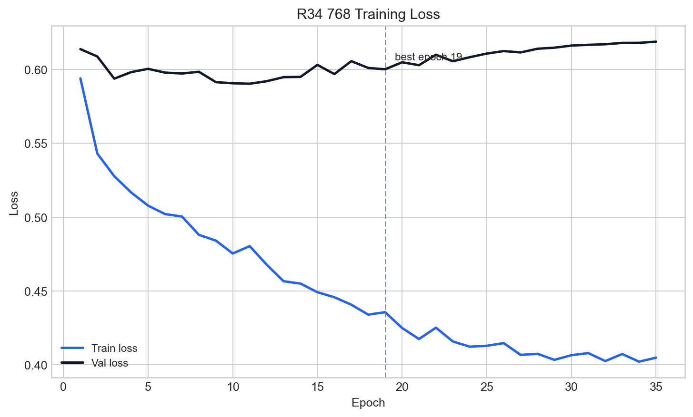
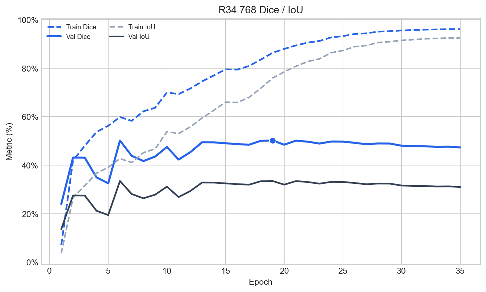
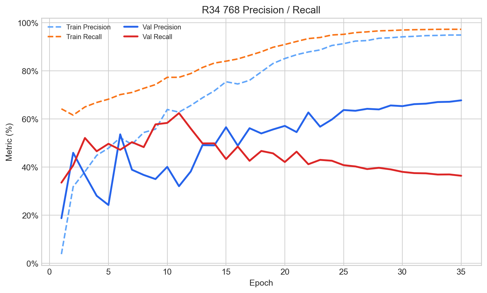
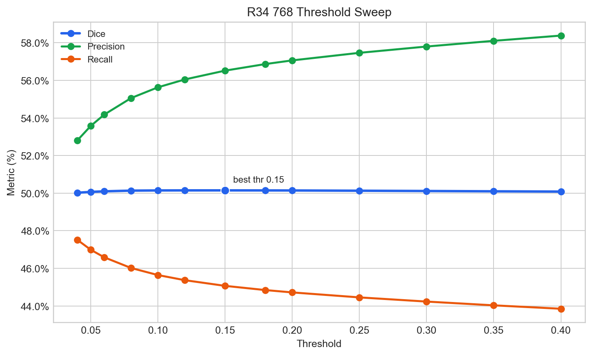
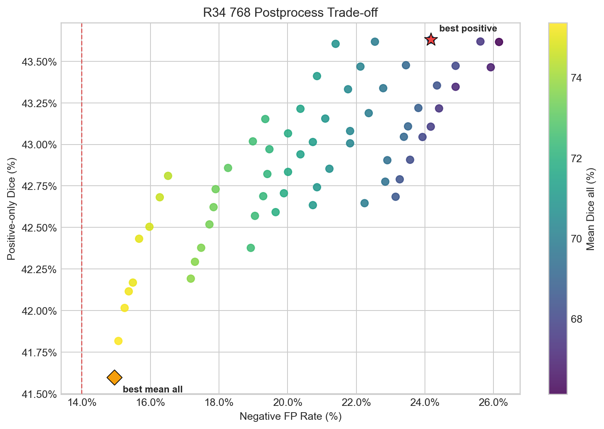

# SIIM-ACR Enterprise U-Net++ ResNet34 768 实验报告

## 1. 实验目的

本实验在 SIIM-ACR Pneumothorax Segmentation 验证集上评估 768 输入尺寸的 `U-Net++ ResNet34`。目标是观察在保持企业候选训练策略的基础上，提高输入分辨率是否能改善小气胸区域识别、positive-only Dice 以及后续多模型融合表现。

本报告仅基于验证集结果进行分析，尚未包含独立 test 集评估，因此不能表述为最终泛化性能。

## 2. 实验配置

实验输出目录：

```text
outputs/experiments/enterprise_unetpp_resnet34_768_v1/20260521_115828
```

主要配置来自 `config.json`：

| 配置项 | 数值 |
|---|---:|
| 数据集 | SIIM-ACR Pneumothorax Segmentation |
| 模型 | U-Net++ |
| Encoder | ResNet34 |
| Encoder 预训练 | ImageNet |
| 输入尺寸 | 768 x 768 |
| 输入通道 | 3 |
| 训练轮数 | 35 |
| Batch size | 8 |
| 初始学习率 | 0.0002 |
| Weight decay | 0.0005 |
| Loss | BCE + Dice |
| BCE 权重 | 0.35 |
| Dice 权重 | 0.65 |
| BCE `pos_weight` | 2.0 |
| 默认二值化阈值 | 0.10 |
| Balanced sampling | 是 |
| 正样本采样比例 | 0.40 |
| 随机种子 | 42 |
| 设备 | CUDA |
| AMP | 开启 |

本实验的后处理和阈值扫描最初保存在 `outputs/experiments/enterprise_improve_v2/sweeps/`，当前已复制到本实验目录：

```text
logs/threshold_sweep_val.csv
logs/postprocess_sweep_val.csv
```

## 3. 训练结果

训练日志来自 `logs/metrics.csv`。模型在第 19 轮取得最佳验证集 Dice，之后训练集 Dice 继续上升，但验证集 Dice 和 Recall 下降，说明后期训练主要增加训练集拟合，并未改善验证集泛化。

关键 epoch 指标如下：

| Epoch | Train Dice | Train Precision | Train Recall | Val Dice | Val IoU | Val Precision | Val Recall | Val Loss |
|---:|---:|---:|---:|---:|---:|---:|---:|---:|
| 1 | 0.0708 | 0.0375 | 0.6419 | 0.2399 | 0.1363 | 0.1868 | 0.3349 | 0.6138 |
| 2 | 0.4191 | 0.3177 | 0.6156 | 0.4313 | 0.2750 | 0.4590 | 0.4067 | 0.6089 |
| 6 | 0.5984 | 0.5219 | 0.7011 | 0.5015 | 0.3347 | 0.5357 | 0.4714 | 0.5979 |
| 10 | 0.6997 | 0.6391 | 0.7730 | 0.4748 | 0.3113 | 0.4004 | 0.5833 | 0.5907 |
| 19 | 0.8631 | 0.8306 | 0.8981 | 0.5016 | 0.3347 | 0.5562 | 0.4567 | 0.6002 |
| 25 | 0.9320 | 0.9130 | 0.9518 | 0.4971 | 0.3307 | 0.6369 | 0.4076 | 0.6108 |
| 35 | 0.9607 | 0.9490 | 0.9727 | 0.4731 | 0.3098 | 0.6772 | 0.3635 | 0.6189 |

最佳验证集结果：

| 指标 | 数值 |
|---|---:|
| Best epoch | 19 |
| Train loss | 0.4355 |
| Train Dice | 0.8631 |
| Train IoU | 0.7591 |
| Train Precision | 0.8306 |
| Train Recall | 0.8981 |
| Val loss | 0.6002 |
| Val Dice | 0.5016 |
| Val IoU | 0.3347 |
| Val Precision | 0.5562 |
| Val Recall | 0.4567 |
| Val Specificity | 0.9989 |

最后一轮结果：

| 指标 | 数值 |
|---|---:|
| Epoch | 35 |
| Train loss | 0.4047 |
| Train Dice | 0.9607 |
| Train IoU | 0.9244 |
| Train Precision | 0.9490 |
| Train Recall | 0.9727 |
| Val loss | 0.6189 |
| Val Dice | 0.4731 |
| Val IoU | 0.3098 |
| Val Precision | 0.6772 |
| Val Recall | 0.3635 |
| Val Specificity | 0.9995 |

从最佳 epoch 到最后一轮，训练集 Dice 从 0.8631 提升到 0.9607，但验证集 Dice 从 0.5016 降到 0.4731，验证集 Recall 从 0.4567 降到 0.3635。该趋势说明 768 ResNet34 仍需要 early stopping 或更强泛化约束。

## 4. Threshold Sweep 结果

`logs/threshold_sweep_val.csv` 记录了对 `best_model.pth` 的验证集阈值扫描。按全局像素级 Dice 排序，最佳阈值为 0.15：

| Threshold | Dice | IoU | Precision | Recall | Specificity |
|---:|---:|---:|---:|---:|---:|
| 0.15 | 0.5015 | 0.3346 | 0.5652 | 0.4507 | 0.9990 |
| 0.12 | 0.5015 | 0.3346 | 0.5605 | 0.4537 | 0.9989 |
| 0.18 | 0.5014 | 0.3346 | 0.5687 | 0.4484 | 0.9990 |
| 0.10 | 0.5014 | 0.3346 | 0.5563 | 0.4564 | 0.9989 |
| 0.20 | 0.5014 | 0.3346 | 0.5706 | 0.4472 | 0.9990 |
| 0.08 | 0.5013 | 0.3345 | 0.5506 | 0.4602 | 0.9989 |

阈值从 0.08 到 0.20 的 Dice 差异很小，说明全局像素级 Dice 对阈值不敏感。但该指标无法充分体现阴性样本误报，因此仍需要后处理扫描。

## 5. 后处理参数搜索结果

后处理搜索结果来自 `logs/postprocess_sweep_val.csv`。验证集包含 2135 张图像，其中阳性 476 张，阴性 1659 张。

| 设置 | Threshold | Min component area | Keep largest | Positive Dice | Positive IoU | Negative FP rate | False positive negative | Mean Dice all | 结论 |
|---|---:|---:|---:|---:|---:|---:|---:|---:|---|
| Best positive Dice | 0.08 | 100 | False | 0.4363 | 0.3289 | 24.17% | 401 / 1659 | 0.6865 | 正样本 Dice 较高，但误报过高 |
| Best under FP <= 20% | 0.08 | 300 | False | 0.4315 | 0.3260 | 19.35% | 321 / 1659 | 0.7229 | 误报仍偏高 |
| Best under FP <= 15% / best mean-all | 0.35 | 500 | False | 0.4160 | 0.3159 | 14.95% | 248 / 1659 | 0.7536 | 最保守可用点，但仍不优于企业候选 |

### 5.1 Best positive Dice

`threshold=0.08, min_component_area=100` 时 positive-only Dice 达到 0.4363，高于旧单模型 Unet++-ResNet34 后处理 baseline 的 0.3980。该结果说明 768 输入尺寸对正样本区域分割有一定帮助。

但该配置的 negative FP rate 为 24.17%，1659 张阴性图像中有 401 张出现假阳性，误报明显过高，不适合作为企业候选。

### 5.2 误报控制配置

当前扫描中最低误报配置为 `threshold=0.35, min_component_area=500`，negative FP rate 为 14.95%，positive-only Dice 为 0.4160，mean Dice all 为 0.7536。

该点相较 best-positive 配置显著降低误报，但仍略高于旧 Unet++-ResNet34 baseline 的 13.92% negative FP rate，且 mean Dice all 低于旧 baseline 的 0.7576。因此，ResNet34 768 不建议作为独立主模型。

## 6. 与现有候选对比

| 模型与设置 | Positive Dice | Negative FP rate | Mean Dice all | 判断 |
|---|---:|---:|---:|---|
| 旧 Unet++-ResNet34 baseline：thr=0.08, area=150 | 0.3980 | 13.92% | 0.7576 | 当前单模型主线 baseline |
| ResNet34 768 best positive：thr=0.08, area=100 | 0.4363 | 24.17% | 0.6865 | 正样本 Dice 提升，但误报过高 |
| ResNet34 768 low-FP：thr=0.35, area=500 | 0.4160 | 14.95% | 0.7536 | 误报接近旧 baseline，但 mean Dice all 未超过 |
| Enterprise v1 Candidate B | 0.4509 | 9.89% | 0.8008 | 当前更优企业平衡候选 |

单模型角度看，ResNet34 768 对 positive-only Dice 有帮助，但仍没有形成比旧单模型和企业融合候选更好的误报/召回折中。

## 7. 结论

`enterprise_unetpp_resnet34_768_v1` 证明提高输入尺寸可以提升部分正样本分割能力：best-positive 后处理配置下 positive-only Dice 达到 0.4363。但该提升依赖较高误报，negative FP rate 达到 24.17%。

在更保守的低误报配置下，positive-only Dice 为 0.4160，negative FP rate 为 14.95%，仍不足以替代旧单模型 baseline 或 `enterprise_improve_v1` 的企业候选。因此，本实验不作为独立主模型，保留为 768 输入尺寸和后续多分辨率融合探索的对照。

## 8. 后续建议

1. 对 768 ResNet34 采用 early stopping，避免 20 epoch 后验证集持续回落。
2. 若继续使用 768 模型参与 ensemble，应考虑按训练尺寸推理后再融合概率图，而不是直接在 512 评估尺寸下混合。
3. 重点复查 best-positive 配置下的阴性误报样本，判断误报是否集中在胸膜线、肺尖或边缘高对比区域。
4. 尝试从 512 主模型 fine-tune 到 768，比较是否比从头训练更稳定。
5. 模型选择仍应同时报告 positive-only Dice、negative FP rate 和 mean Dice all，避免只按全局 Dice 选择。

## 图表解读

训练 loss 曲线用于观察收敛速度和验证集 loss 是否后期回升。



Dice/IoU 曲线已统一为百分比，便于观察训练集与验证集之间的泛化差距。



Precision/Recall 曲线用于判断模型后期是否变得更保守。



阈值扫描曲线将 Dice、Precision 和 Recall 统一到百分比尺度下，辅助选择验证集阈值。



后处理 trade-off 图以阴性误报率为横轴、positive-only Dice 为纵轴，适合判断候选配置是否只是用误报换取正样本 Dice。



