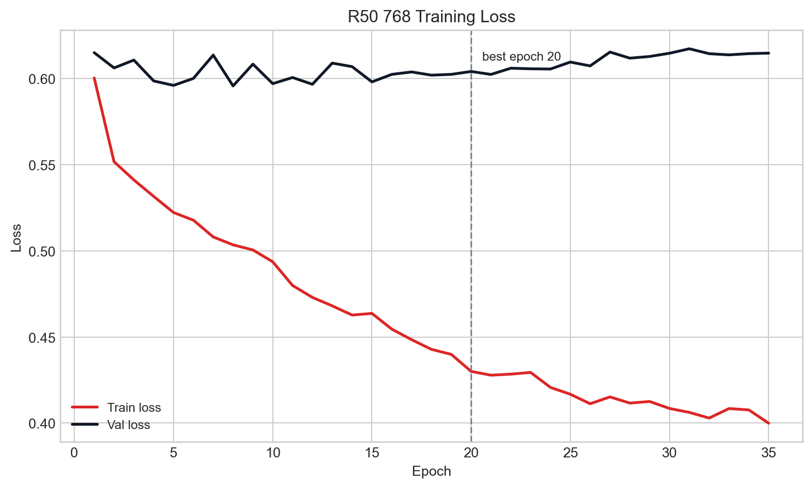
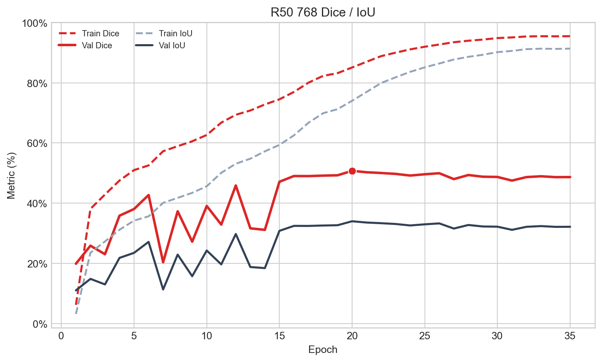
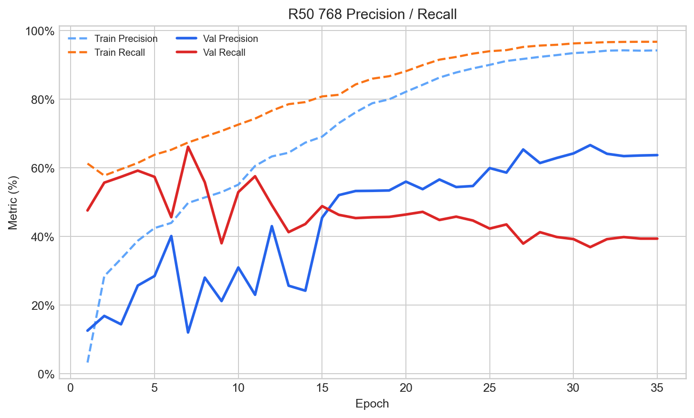
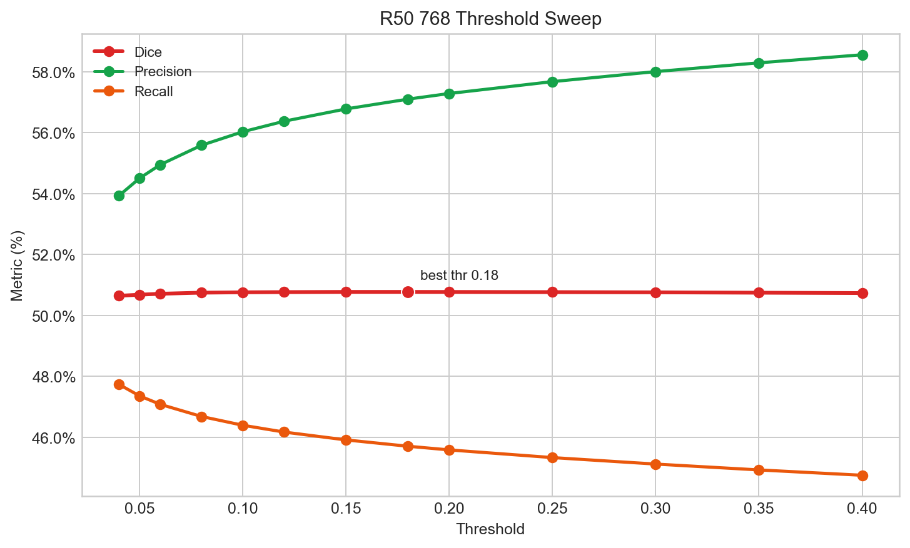
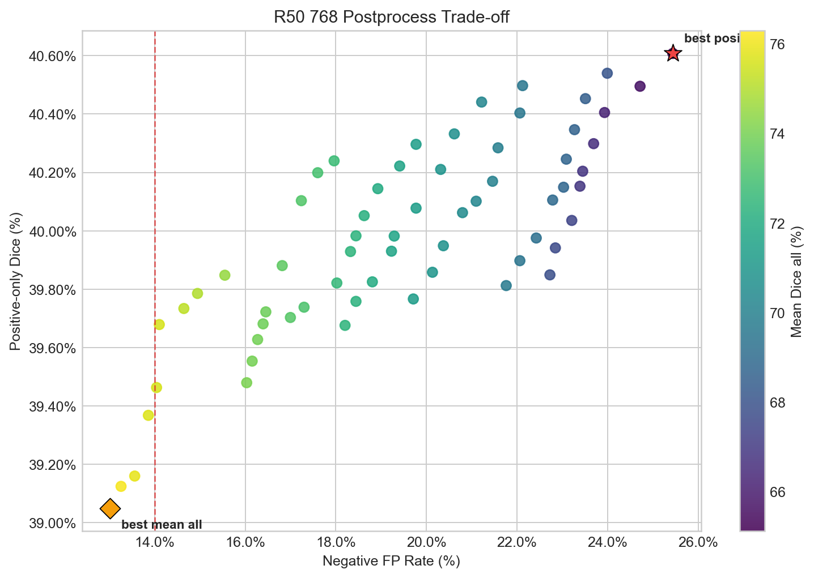

# SIIM-ACR Enterprise U-Net++ ResNet50 768 实验报告

## 1. 实验目的

本实验在 SIIM-ACR Pneumothorax Segmentation 验证集上评估 768 输入尺寸的 `U-Net++ ResNet50`。目标是在 ResNet34 768 基础上使用更强 encoder，观察是否能进一步提升全局 Dice、positive-only Dice 和企业场景下的误报/漏检折中。

本报告仅基于验证集结果进行分析，尚未包含独立 test 集评估，因此不能表述为最终泛化性能。

## 2. 实验配置

实验输出目录：

```text
outputs/experiments/enterprise_unetpp_resnet50_768_v1/20260521_145112
```

主要配置来自 `config.json`：

| 配置项 | 数值 |
|---|---:|
| 数据集 | SIIM-ACR Pneumothorax Segmentation |
| 模型 | U-Net++ |
| Encoder | ResNet50 |
| Encoder 预训练 | ImageNet |
| 输入尺寸 | 768 x 768 |
| 输入通道 | 3 |
| 训练轮数 | 35 |
| Batch size | 6 |
| 初始学习率 | 0.0002 |
| Weight decay | 0.0005 |
| Loss | BCE + Dice |
| BCE 权重 | 0.35 |
| Dice 权重 | 0.65 |
| BCE `pos_weight` | 2.0 |
| 默认二值化阈值 | 0.10 |
| Balanced sampling | 是 |
| 正样本采样比例 | 0.40 |
| 随机种子 | 42 |
| 设备 | CUDA |
| AMP | 开启 |

本实验的后处理和阈值扫描最初保存在 `outputs/experiments/enterprise_improve_v2/sweeps/`，当前已复制到本实验目录：

```text
logs/threshold_sweep_val.csv
logs/postprocess_sweep_val.csv
```

## 3. 训练结果

训练日志来自 `logs/metrics.csv`。模型在第 20 轮取得最佳验证集 Dice。第 20 轮后，训练集 Dice 继续上升，但验证集 Dice 和 Recall 下降，说明后期训练开始偏向训练集拟合和更保守的验证集预测。

关键 epoch 指标如下：

| Epoch | Train Dice | Train Precision | Train Recall | Val Dice | Val IoU | Val Precision | Val Recall | Val Loss |
|---:|---:|---:|---:|---:|---:|---:|---:|---:|
| 1 | 0.0625 | 0.0329 | 0.6126 | 0.1990 | 0.1105 | 0.1258 | 0.4761 | 0.6149 |
| 2 | 0.3812 | 0.2845 | 0.5777 | 0.2590 | 0.1487 | 0.1687 | 0.5570 | 0.6061 |
| 6 | 0.5255 | 0.4398 | 0.6528 | 0.4272 | 0.2716 | 0.4014 | 0.4564 | 0.6000 |
| 10 | 0.6266 | 0.5511 | 0.7261 | 0.3909 | 0.2430 | 0.3098 | 0.5295 | 0.5970 |
| 19 | 0.8320 | 0.7996 | 0.8671 | 0.4928 | 0.3269 | 0.5342 | 0.4573 | 0.6023 |
| 20 | 0.8507 | 0.8218 | 0.8817 | 0.5076 | 0.3401 | 0.5599 | 0.4641 | 0.6040 |
| 25 | 0.9196 | 0.9002 | 0.9400 | 0.4961 | 0.3299 | 0.5995 | 0.4232 | 0.6095 |
| 35 | 0.9547 | 0.9423 | 0.9674 | 0.4869 | 0.3217 | 0.6372 | 0.3939 | 0.6147 |

最佳验证集结果：

| 指标 | 数值 |
|---|---:|
| Best epoch | 20 |
| Train loss | 0.4300 |
| Train Dice | 0.8507 |
| Train IoU | 0.7402 |
| Train Precision | 0.8218 |
| Train Recall | 0.8817 |
| Val loss | 0.6040 |
| Val Dice | 0.5076 |
| Val IoU | 0.3401 |
| Val Precision | 0.5599 |
| Val Recall | 0.4641 |
| Val Specificity | 0.9989 |

最后一轮结果：

| 指标 | 数值 |
|---|---:|
| Epoch | 35 |
| Train loss | 0.4000 |
| Train Dice | 0.9547 |
| Train IoU | 0.9134 |
| Train Precision | 0.9423 |
| Train Recall | 0.9674 |
| Val loss | 0.6147 |
| Val Dice | 0.4869 |
| Val IoU | 0.3217 |
| Val Precision | 0.6372 |
| Val Recall | 0.3939 |
| Val Specificity | 0.9993 |

从最佳 epoch 到最后一轮，训练集 Dice 从 0.8507 提升到 0.9547，但验证集 Dice 从 0.5076 降到 0.4869，验证集 Recall 从 0.4641 降到 0.3939。该结果与 ResNet34 768 一致，说明 768 配置下仍需要更严格的早停或正则化。

## 4. Threshold Sweep 结果

`logs/threshold_sweep_val.csv` 记录了对 `best_model.pth` 的验证集阈值扫描。按全局像素级 Dice 排序，最佳阈值为 0.18：

| Threshold | Dice | IoU | Precision | Recall | Specificity |
|---:|---:|---:|---:|---:|---:|
| 0.18 | 0.5077 | 0.3402 | 0.5710 | 0.4571 | 0.9990 |
| 0.15 | 0.5077 | 0.3402 | 0.5678 | 0.4592 | 0.9989 |
| 0.20 | 0.5077 | 0.3402 | 0.5728 | 0.4559 | 0.9990 |
| 0.12 | 0.5077 | 0.3402 | 0.5637 | 0.4618 | 0.9989 |
| 0.25 | 0.5077 | 0.3402 | 0.5767 | 0.4534 | 0.9990 |
| 0.10 | 0.5076 | 0.3401 | 0.5603 | 0.4640 | 0.9989 |

ResNet50 768 的 threshold sweep 最佳 Dice 为 0.5077，略高于 ResNet34 768 的 0.5015。但二者都没有超过旧 512 Unet++-ResNet34 baseline 的 threshold sweep 最佳 Dice 0.5198。

## 5. 后处理参数搜索结果

后处理搜索结果来自 `logs/postprocess_sweep_val.csv`。验证集包含 2135 张图像，其中阳性 476 张，阴性 1659 张。

| 设置 | Threshold | Min component area | Keep largest | Positive Dice | Positive IoU | Negative FP rate | False positive negative | Mean Dice all | 结论 |
|---|---:|---:|---:|---:|---:|---:|---:|---:|---|
| Best positive Dice | 0.08 | 0 | False | 0.4061 | 0.3081 | 25.44% | 422 / 1659 | 0.6512 | 正样本 Dice 不高，误报过高 |
| Best under FP <= 20% | 0.08 | 200 | False | 0.4030 | 0.3066 | 19.77% | 328 / 1659 | 0.7133 | 误报仍偏高 |
| Best under FP <= 14% | 0.20 | 500 | False | 0.3937 | 0.3010 | 13.86% | 230 / 1659 | 0.7571 | 误报接近旧 baseline，但正样本 Dice 不足 |
| Best mean-all / lowest FP | 0.35 | 500 | False | 0.3905 | 0.2986 | 13.02% | 216 / 1659 | 0.7629 | 整体平均最高，但阳性分割偏弱 |

### 5.1 Best positive Dice

`threshold=0.08, min_component_area=0` 时 positive-only Dice 为 0.4061，negative FP rate 为 25.44%。该配置没有达到 ResNet34 768 best-positive 的 0.4363，且误报更高，因此不适合作为独立候选。

### 5.2 误报控制配置

`threshold=0.35, min_component_area=500` 时 negative FP rate 降到 13.02%，mean Dice all 达到 0.7629，是本实验后处理扫描中的 best mean-all 和最低误报配置。

但该点 positive-only Dice 只有 0.3905，低于旧 Unet++-ResNet34 baseline 的 0.3980，也低于 ResNet34 768 的低误报配置 0.4160。说明 ResNet50 768 虽然全局像素级 Dice 略高，但在样本级后处理后没有形成更好的阳性分割收益。

## 6. 与现有候选对比

| 模型与设置 | Positive Dice | Negative FP rate | Mean Dice all | 判断 |
|---|---:|---:|---:|---|
| 旧 Unet++-ResNet34 baseline：thr=0.08, area=150 | 0.3980 | 13.92% | 0.7576 | 当前单模型主线 baseline |
| ResNet34 768 best positive：thr=0.08, area=100 | 0.4363 | 24.17% | 0.6865 | 正样本提升明显，但误报高 |
| ResNet34 768 low-FP：thr=0.35, area=500 | 0.4160 | 14.95% | 0.7536 | 低误报下正样本优于 R50 768 |
| ResNet50 768 best positive：thr=0.08, area=0 | 0.4061 | 25.44% | 0.6512 | 正样本 Dice 不足，误报高 |
| ResNet50 768 low-FP：thr=0.35, area=500 | 0.3905 | 13.02% | 0.7629 | 误报低，但正样本弱于旧 baseline |
| Enterprise v1 Candidate B | 0.4509 | 9.89% | 0.8008 | 当前更优企业平衡候选 |

ResNet50 768 的主要价值是降低低误报配置下的 negative FP rate，并提高 mean Dice all；主要问题是 positive-only Dice 偏低，没有达到企业候选需要的阳性分割能力。

## 7. 结论

`enterprise_unetpp_resnet50_768_v1` 的训练期最佳 Val Dice 为 0.5076，略高于 ResNet34 768 的 0.5016。但经过后处理扫描后，ResNet50 768 没有形成更好的企业候选。

在 best-positive 配置下，它的 positive-only Dice 只有 0.4061，且 negative FP rate 达到 25.44%；在低误报配置下，negative FP rate 可降至 13.02%，mean Dice all 达到 0.7629，但 positive-only Dice 降到 0.3905，低于旧单模型 baseline。

因此，本实验不作为独立主模型。它可以保留为多分辨率 ensemble 的候选成员或低误报对照，但不能替代 `enterprise_improve_v1` 的企业平衡候选。

## 8. 后续建议

1. 不建议单独采用 ResNet50 768 的低误报配置作为企业主候选，因为 positive-only Dice 低于旧 baseline。
2. 若继续探索 ResNet50 768，应优先处理正样本学习不足问题，而不是只依赖更强 encoder。
3. 可尝试从 512 ResNet50 或 4 模型融合中表现较好的 checkpoint fine-tune 到 768。
4. 对比 ResNet34 768 与 ResNet50 768 的低 Dice 阳性样本，判断 ResNet50 是否更容易漏掉小病灶或细长胸膜边缘区域。
5. 如果继续做 ensemble，应使用 weighted ensemble 或子集选择，避免 ResNet50 768 的保守预测稀释高召回模型。

## 图表解读

训练 loss 曲线用于观察收敛速度和验证集 loss 是否后期回升。



Dice/IoU 曲线已统一为百分比，便于观察训练集与验证集之间的泛化差距。



Precision/Recall 曲线用于判断模型后期是否变得更保守。



阈值扫描曲线将 Dice、Precision 和 Recall 统一到百分比尺度下，辅助选择验证集阈值。



后处理 trade-off 图以阴性误报率为横轴、positive-only Dice 为纵轴，适合判断候选配置是否只是用误报换取正样本 Dice。



