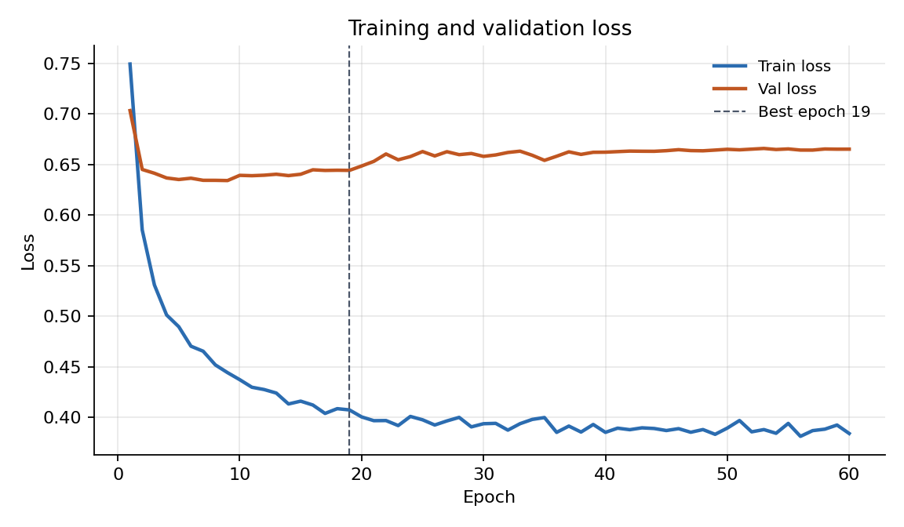
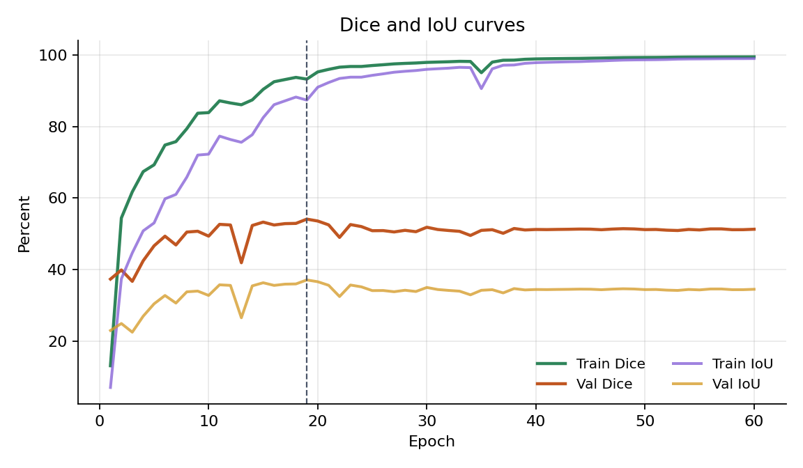
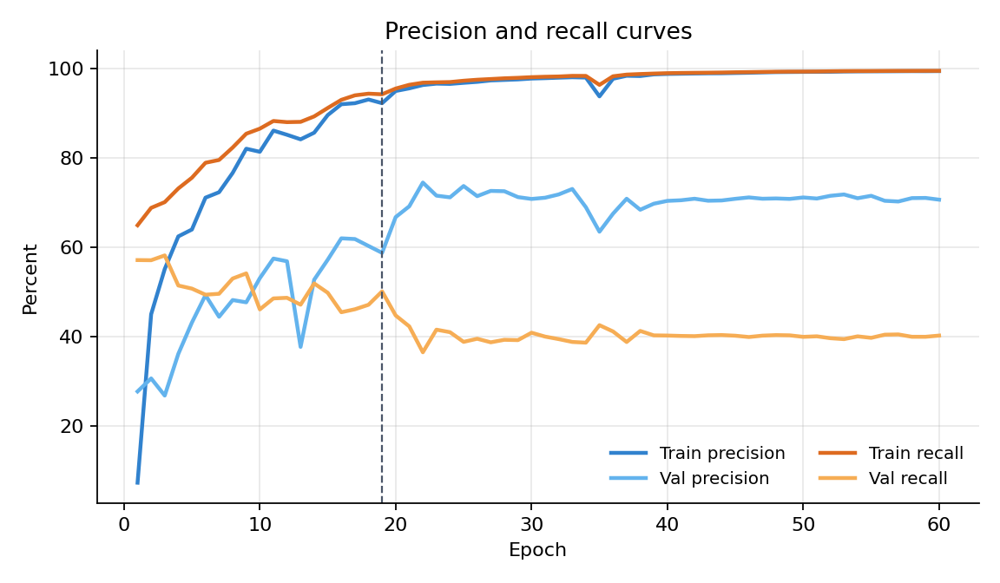
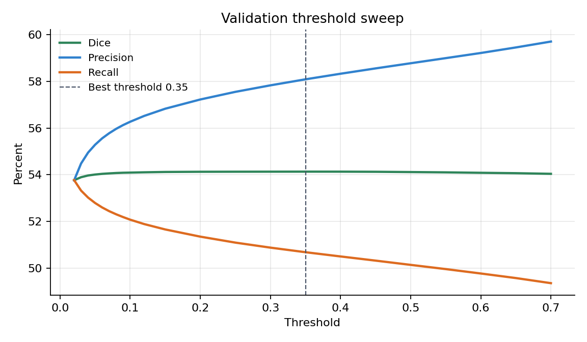
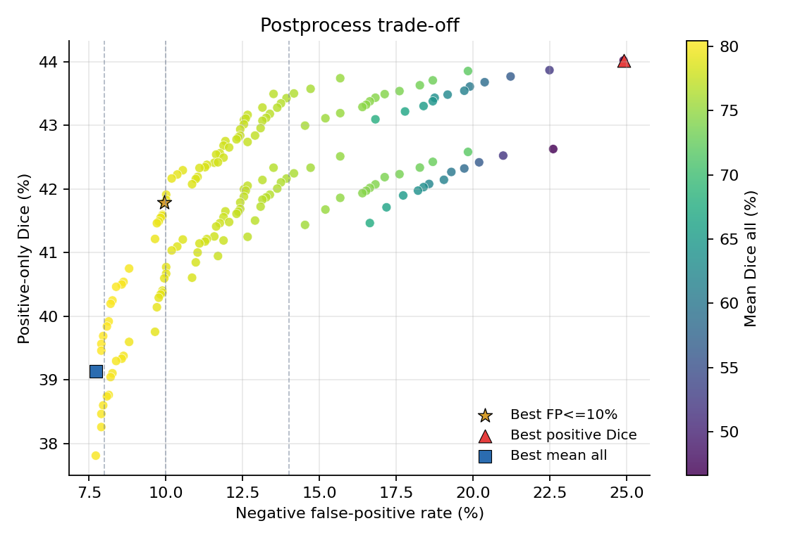

# SIIM-ACR Enterprise U-Net++ SE-ResNeXt50 512 v2 实验报告

## 1. 实验目的

本实验在 SIIM-ACR Pneumothorax Segmentation 验证集上评估 `U-Net++ + SE-ResNeXt50 encoder` 的 512 输入尺寸企业候选配置。目标是检验更强的 SE-ResNeXt encoder 是否能在 U-Net++ 框架下提升 positive-only Dice，并与 EfficientNet-B3 512、ResNet 系列和 ensemble 候选进行横向比较。

本报告仅基于验证集结果进行分析，尚未包含独立 test 集评估，因此不能表述为最终泛化性能。

## 2. 实验配置

实验输出目录：

```text
outputs/experiments/enterprise_unetpp_seresnext50_512_v2/20260525_125544
```

主要配置来自 `config.json`：

| 配置项 | 数值 |
|---|---:|
| 数据集 | SIIM-ACR Pneumothorax Segmentation |
| 模型 | U-Net++ |
| Encoder | se_resnext50_32x4d |
| Encoder 预训练 | ImageNet |
| 输入尺寸 | 512 x 512 |
| 输入通道 | 3 |
| 训练轮数 | 60 |
| Batch size | 24 |
| 初始学习率 | 0.0002 |
| Weight decay | 0.0003 |
| Loss | BCE + Dice |
| BCE 权重 | 0.30 |
| Dice 权重 | 0.70 |
| BCE `pos_weight` | 2.0 |
| 默认二值化阈值 | 0.50 |
| Balanced sampling | 是 |
| 正样本采样比例 | 0.45 |
| 随机种子 | 42 |
| 设备 | CUDA |
| AMP | 开启 |

## 3. 训练结果

训练日志来自 `logs/metrics.csv`。模型在第 19 轮取得最佳验证集 Dice。第 19 轮之后，训练集 Dice 持续上升到接近 0.995，但验证集 Dice 和 Recall 均未同步提升，存在明显过拟合。

关键 epoch 指标如下：

| Epoch | Train Dice | Train Precision | Train Recall | Val Dice | Val IoU | Val Precision | Val Recall | Val Loss |
|---:|---:|---:|---:|---:|---:|---:|---:|---:|
| 1 | 0.1309 | 0.0728 | 0.6494 | 0.3733 | 0.2295 | 0.2771 | 0.5715 | 0.7033 |
| 2 | 0.5443 | 0.4501 | 0.6884 | 0.3988 | 0.2491 | 0.3064 | 0.5711 | 0.6451 |
| 3 | 0.6173 | 0.5513 | 0.7013 | 0.3670 | 0.2247 | 0.2680 | 0.5819 | 0.6414 |
| 15 | 0.9042 | 0.8963 | 0.9122 | 0.5327 | 0.3631 | 0.5724 | 0.4982 | 0.6404 |
| 19 | 0.9328 | 0.9230 | 0.9429 | 0.5411 | 0.3709 | 0.5876 | 0.5014 | 0.6442 |
| 20 | 0.9530 | 0.9503 | 0.9557 | 0.5358 | 0.3660 | 0.6678 | 0.4474 | 0.6485 |
| 23 | 0.9682 | 0.9667 | 0.9697 | 0.5259 | 0.3567 | 0.7158 | 0.4156 | 0.6547 |
| 60 | 0.9951 | 0.9948 | 0.9954 | 0.5128 | 0.3448 | 0.7068 | 0.4024 | 0.6652 |

最佳验证集结果：

| 指标 | 数值 |
|---|---:|
| Best epoch | 19 |
| Train loss | 0.4073 |
| Train Dice | 0.9328 |
| Train IoU | 0.8741 |
| Train Precision | 0.9230 |
| Train Recall | 0.9429 |
| Val loss | 0.6442 |
| Val Dice | 0.5411 |
| Val IoU | 0.3709 |
| Val Precision | 0.5876 |
| Val Recall | 0.5014 |
| Val Specificity | 0.9989 |

最后一轮结果：

| 指标 | 数值 |
|---|---:|
| Epoch | 60 |
| Train loss | 0.3840 |
| Train Dice | 0.9951 |
| Train IoU | 0.9903 |
| Train Precision | 0.9948 |
| Train Recall | 0.9954 |
| Val loss | 0.6652 |
| Val Dice | 0.5128 |
| Val IoU | 0.3448 |
| Val Precision | 0.7068 |
| Val Recall | 0.4024 |
| Val Specificity | 0.9995 |

从最佳 epoch 到最后一轮，验证集 Recall 从 0.5014 降到 0.4024，说明模型后期明显转向更保守的预测。

## 4. Threshold Sweep 结果

`threshold_sweep_val.csv` 记录了对 best checkpoint 的验证集阈值扫描。按全局像素级 Dice 排序，最佳阈值为 0.35：

| Threshold | Dice | IoU | Precision | Recall | Specificity |
|---:|---:|---:|---:|---:|---:|
| 0.35 | 0.5413 | 0.3711 | 0.5809 | 0.5068 | 0.9989 |
| 0.40 | 0.5413 | 0.3711 | 0.5833 | 0.5050 | 0.9989 |
| 0.30 | 0.5413 | 0.3711 | 0.5783 | 0.5088 | 0.9989 |
| 0.25 | 0.5413 | 0.3711 | 0.5755 | 0.5109 | 0.9989 |
| 0.20 | 0.5413 | 0.3711 | 0.5723 | 0.5135 | 0.9988 |
| 0.45 | 0.5413 | 0.3711 | 0.5856 | 0.5032 | 0.9989 |
| 0.50 | 0.5412 | 0.3710 | 0.5878 | 0.5014 | 0.9989 |

Threshold sweep 最佳 Dice 为 0.5413，几乎等同于默认阈值结果。该模型的全局像素级 Dice 对阈值不敏感。

## 5. 后处理参数搜索结果

后处理搜索结果来自 `postprocess_sweep_val.csv`。验证集包含 2135 张图像，其中阳性 476 张，阴性 1659 张。

| 设置 | Threshold | Min component area | Keep largest | Positive Dice | Positive IoU | Negative FP rate | False positive negative | Mean Dice all | 结论 |
|---|---:|---:|---:|---:|---:|---:|---:|---:|---|
| Best positive Dice | 0.02 | 0 | False | 0.4402 | 0.3350 | 24.89% | 413 / 1659 | 0.4691 | 正样本最高，但误报过高 |
| FP <= 14% 最佳 positive | 0.02 | 150 | False | 0.4349 | 0.3324 | 13.50% | 224 / 1659 | 0.7691 | recall 取向候选 |
| FP <= 10% 最佳 positive | 0.07 | 300 | False | 0.4178 | 0.3207 | 9.95% | 165 / 1659 | 0.7929 | 误报可控，但 positive Dice 偏低 |
| Best mean Dice all | 0.20 | 500 | False | 0.3913 | 0.3025 | 7.72% | 128 / 1659 | 0.8043 | 低误报但较保守 |

### 5.1 Best positive Dice

`threshold=0.02, min_component_area=0` 时 positive-only Dice 为 0.4402，negative FP rate 为 24.89%。该配置比 DeepLabV3+ ResNet50 的 best-positive 略高，但误报仍然过高，不能作为企业落地候选。

### 5.2 误报约束下的表现

在 `negative_fp_rate <= 14%` 约束下，最佳 positive-only Dice 为 0.4349；在 `negative_fp_rate <= 10%` 约束下，最佳 positive-only Dice 为 0.4178。该结果优于 DeepLabV3+ ResNet50，但低于 EfficientNet-B3 512 的企业平衡配置。

### 5.3 Best mean-all 配置

`threshold=0.20, min_component_area=500` 时 mean Dice all 为 0.8043，negative FP rate 为 7.72%，positive-only Dice 为 0.3913。该配置偏保守，适合作为低误报横向对照，但正样本分割明显不足。

## 6. 与现有候选对比

| 模型与设置 | Positive Dice | Negative FP rate | Mean Dice all | 判断 |
|---|---:|---:|---:|---|
| EfficientNet-B3 512 Candidate B：thr=0.04, area=500 | 0.4604 | 9.95% | 0.8024 | 当前企业平衡候选 |
| EfficientNet-B3 512 Candidate C：thr=0.30, area=500 | 0.4464 | 7.96% | 0.8147 | 当前低误报候选 |
| SE-ResNeXt50 512 FP<=14%：thr=0.02, area=150 | 0.4349 | 13.50% | 0.7691 | 正样本低于 EfficientNet-B3，误报更高 |
| SE-ResNeXt50 512 FP<=10%：thr=0.07, area=300 | 0.4178 | 9.95% | 0.7929 | 误报相近，但 positive Dice 明显偏低 |
| SE-ResNeXt50 512 best mean-all：thr=0.20, area=500 | 0.3913 | 7.72% | 0.8043 | 低误报但过于保守 |

SE-ResNeXt50 512 的综合表现优于 DeepLabV3+ ResNet50 512，但没有超过 EfficientNet-B3 512。它可以保留为强 encoder 横向对照或后续 ensemble 候选成员，但不应替换当前主候选。

## 7. 结论

`enterprise_unetpp_seresnext50_512_v2` 的训练期最佳 Val Dice 为 0.5411，threshold sweep 最佳 Dice 为 0.5413。后处理后，在接近 10% 阴性误报约束下，positive-only Dice 为 0.4178；在接近 14% 阴性误报约束下，positive-only Dice 为 0.4349。

该模型没有形成比 EfficientNet-B3 512 更好的企业候选。主要问题是：低阈值配置误报偏高；加强连通域过滤后，positive-only Dice 下降明显。

## 8. 后续建议

1. 本实验保留为 U-Net++ 强 encoder 横向对照，不替换 EfficientNet-B3 512 Candidate B/C。
2. 若后续做 ensemble，可评估 SE-ResNeXt50 是否提供与 EfficientNet-B3 互补的错误模式。
3. 由于训练后期过拟合明显，若继续训练该 encoder，应更早停止，或使用按后处理综合指标挑选 checkpoint 的策略。

## 图表解读

训练 loss 曲线用于观察收敛速度和验证集 loss 是否后期回升。



Dice/IoU 曲线已统一为百分比，便于观察训练集与验证集之间的泛化差距。



Precision/Recall 曲线用于判断模型后期是否变得更保守。



阈值扫描曲线将 Dice、Precision 和 Recall 统一到百分比尺度下，辅助选择验证集阈值。



后处理 trade-off 图以阴性误报率为横轴、positive-only Dice 为纵轴，颜色表示 mean Dice all，适合判断候选配置是否只是用误报换取正样本 Dice。


