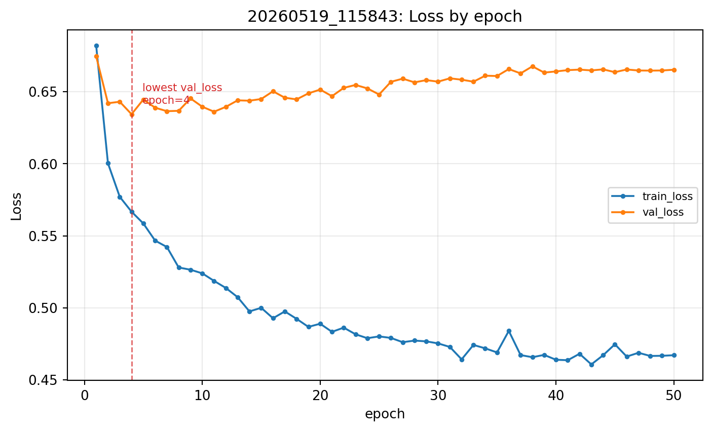
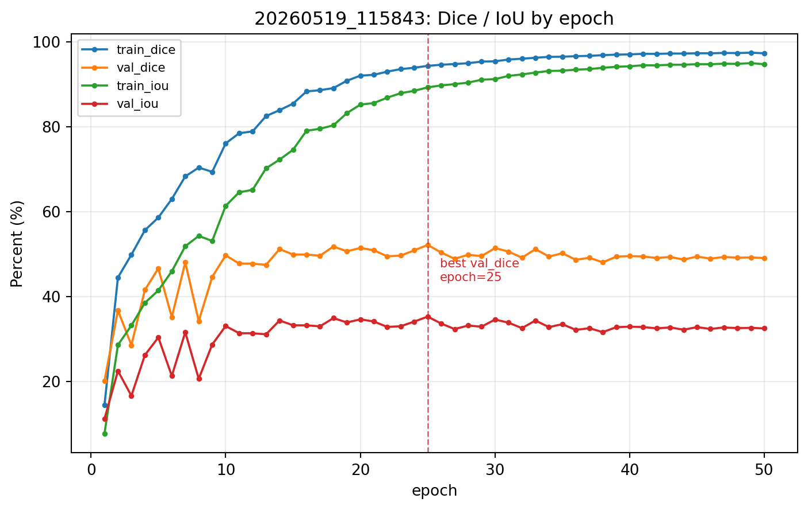
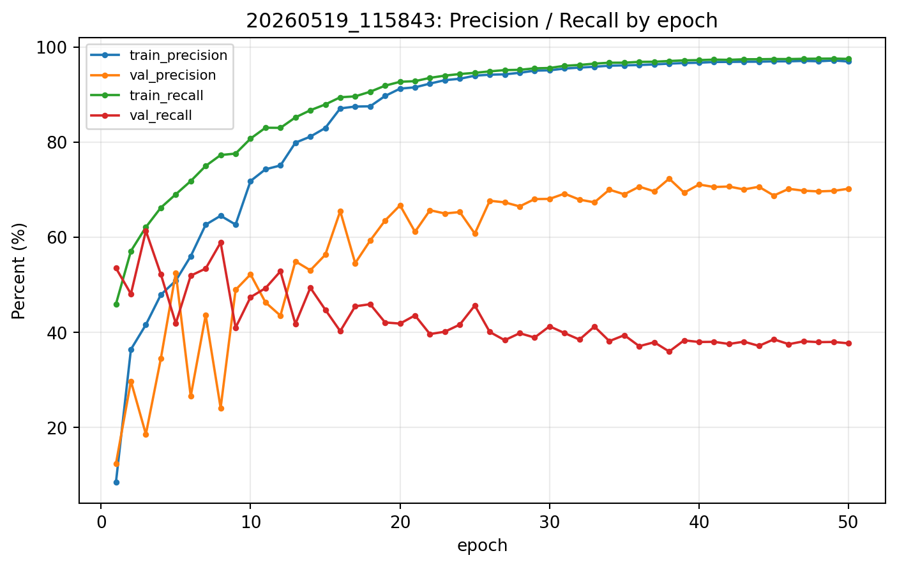
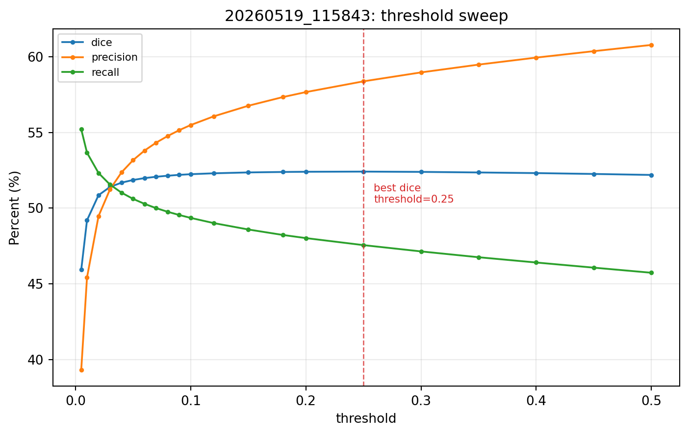
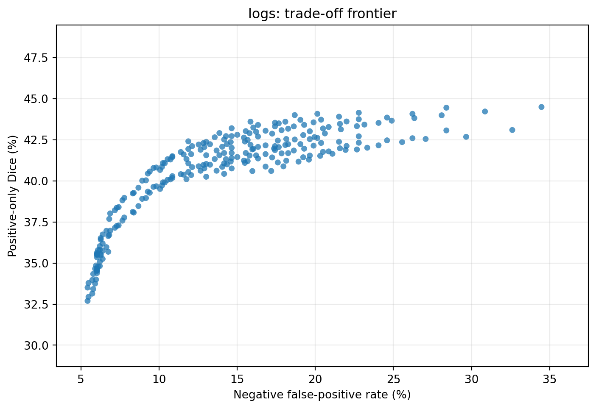

# SIIM-ACR DeepLabV3+-ResNet34 实验报告

## 1. 实验目的

本实验在 SIIM-ACR Pneumothorax Segmentation 数据集上评估基于 `segmentation_models_pytorch` 的 DeepLabV3+-ResNet34 分割模型，作为 Unet++-ResNet34 之外的横向对比模型。实验目标是观察 DeepLabV3+ 的全局像素级分割表现、阈值敏感性以及简单连通域后处理后的误报/漏检权衡。

本报告仅基于验证集结果进行分析。当前实验未包含独立 test 集评估，因此以下结果不能表述为最终泛化性能。

## 2. 实验配置

实验输出目录：

```text
outputs/experiments/siim_acr_deeplabv3plus_resnet34_v1/20260519_115843
```

主要配置来自 `config.json`：

| 配置项 | 数值 |
|---|---:|
| 数据集 | SIIM-ACR Pneumothorax Segmentation |
| 模型 | DeepLabV3+ |
| Encoder | ResNet34 |
| Encoder 预训练 | ImageNet |
| 输入尺寸 | 512 x 512 |
| 输入通道 | 3 |
| 训练轮数 | 50 |
| Batch size | 32 |
| 初始学习率 | 0.0003 |
| Weight decay | 0.0003 |
| Loss | BCE + Dice |
| BCE 权重 | 0.3 |
| Dice 权重 | 0.7 |
| BCE `pos_weight` | 2.0 |
| 默认二值化阈值 | 0.50 |
| Balanced sampling | 是 |
| 正样本采样比例 | 0.35 |
| 随机种子 | 42 |
| 设备 | CUDA |
| AMP | 开启 |

本实验使用的训练、阈值扫描和后处理搜索入口与 SMP 系列实验一致：

```text
scripts/train/train_siim_smp.py
scripts/evaluate/threshold_sweep_siim_smp.py
scripts/evaluate/postprocess_sweep_siim_smp.py
src/cxr_lesionseg/models/smp_models.py
```

## 3. 训练结果

训练日志来自 `logs/metrics.csv`。DeepLabV3+ 在训练早期快速收敛，验证集 Dice 在第 25 轮达到最高值 `0.5218`。第 25 轮后，训练集 Dice 继续升高，但验证集 Dice 逐步下降，说明训练后期同样出现过拟合。

关键 epoch 指标如下：

| Epoch | Train Dice | Val Dice | Val IoU | Val Precision | Val Recall |
|---:|---:|---:|---:|---:|---:|
| 1 | 0.1443 | 0.2019 | 0.1123 | 0.1244 | 0.5355 |
| 14 | 0.8389 | 0.5119 | 0.3440 | 0.5309 | 0.4942 |
| 18 | 0.8909 | 0.5180 | 0.3495 | 0.5933 | 0.4596 |
| 20 | 0.9201 | 0.5147 | 0.3465 | 0.6675 | 0.4188 |
| 25 | 0.9432 | 0.5218 | 0.3530 | 0.6081 | 0.4569 |
| 30 | 0.9539 | 0.5143 | 0.3462 | 0.6811 | 0.4131 |
| 50 | 0.9727 | 0.4909 | 0.3253 | 0.7025 | 0.3772 |

最佳验证集结果：

| 指标 | 数值 |
|---|---:|
| Best epoch | 25 |
| Train loss | 0.4802 |
| Train Dice | 0.9432 |
| Train IoU | 0.8925 |
| Train Precision | 0.9402 |
| Train Recall | 0.9462 |
| Val loss | 0.6481 |
| Val Dice | 0.5218 |
| Val IoU | 0.3530 |
| Val Precision | 0.6081 |
| Val Recall | 0.4569 |
| Val Specificity | 0.9991 |

最终第 50 轮结果：

| 指标 | 数值 |
|---|---:|
| Train loss | 0.4671 |
| Train Dice | 0.9727 |
| Train IoU | 0.9469 |
| Train Precision | 0.9700 |
| Train Recall | 0.9755 |
| Val loss | 0.6653 |
| Val Dice | 0.4909 |
| Val IoU | 0.3253 |
| Val Precision | 0.7025 |
| Val Recall | 0.3772 |
| Val Specificity | 0.9995 |

从最佳 epoch 与末轮结果对比可以看到，训练集 Dice 从 0.9432 升至 0.9727，但验证集 Dice 从 0.5218 下降至 0.4909，验证集 Recall 从 0.4569 下降至 0.3772。该现象说明继续训练主要提升了训练集拟合程度，并未带来验证集收益。

## 4. Threshold sweep 结果

为分析二值化阈值对分割性能的影响，本实验在验证集上对 `checkpoints/best_model.pth` 进行了 threshold sweep，结果保存在 `logs/threshold_sweep_val.csv`。

在已评估阈值中，`threshold=0.25` 取得最高全局像素级 Dice：

| Threshold | Dice | IoU | Precision | Recall | Specificity |
|---:|---:|---:|---:|---:|---:|
| 0.25 | 0.5241 | 0.3551 | 0.5837 | 0.4755 | 0.9990 |
| 0.20 | 0.5240 | 0.3550 | 0.5766 | 0.4802 | 0.9989 |
| 0.30 | 0.5239 | 0.3549 | 0.5896 | 0.4714 | 0.9990 |
| 0.15 | 0.5236 | 0.3546 | 0.5676 | 0.4859 | 0.9989 |
| 0.50 | 0.5219 | 0.3531 | 0.6078 | 0.4573 | 0.9991 |

与默认阈值 `0.50` 相比，最佳阈值 `0.25` 将 Dice 从 0.5219 提升至 0.5241，Recall 从 0.4573 提升至 0.4755，但 Precision 从 0.6078 降至 0.5837。整体提升幅度较小，说明 DeepLabV3+ 的验证集全局 Dice 对阈值变化相对稳定，阈值选择主要改变 Precision/Recall 权衡。

## 5. 后处理参数搜索结果

为进一步分析简单连通域后处理对验证集表现的影响，本实验使用 `postprocess_sweep_siim_smp.py` 搜索了 `threshold`、`min_component_area` 和 `keep_largest_component` 的组合，结果保存在：

```text
logs/postprocess_sweep_val.csv
```

若按 `mean_dice_all` 排序，最佳组合为：

| 参数 | 数值 |
|---|---:|
| Threshold | 0.18 |
| Min component area | 800 |
| Keep largest component | False |

对应验证集结果如下：

| 指标 | 数值 |
|---|---:|
| Mean Dice all | 0.8098 |
| Mean Dice positive | 0.3652 |
| Mean Dice negative | 0.9373 |
| Mean IoU positive | 0.2857 |
| False positive negative | 104 / 1659 |
| Negative FP rate | 6.27% |

该结果显示，较强的连通域面积约束能够显著减少阴性样本误报，使整体 Dice 和负样本 Dice 得到提升。但该配置下 `mean_dice_positive` 只有 0.3652，低于 U-Net++ 后处理 baseline 的 0.3980，说明误报控制的提升伴随了阳性样本分割性能下降。

若按 `mean_dice_positive` 排序，DeepLabV3+ 的最高正样本 Dice 出现在较低阈值且无连通域面积过滤的配置：

| 参数 | 数值 |
|---|---:|
| Threshold | 0.03 |
| Min component area | 0 |
| Keep largest component | False |

对应验证集结果如下：

| 指标 | 数值 |
|---|---:|
| Mean Dice all | 0.4435 |
| Mean Dice positive | 0.4450 |
| Mean Dice negative | 0.4430 |
| Mean IoU positive | 0.3372 |
| False positive negative | 572 / 1659 |
| Negative FP rate | 34.48% |

该配置虽然提高了正样本 Dice，但阴性样本误报明显增加，整体 Dice 下降到 0.4435。因此，DeepLabV3+ 在后处理参数上存在明显的正样本召回与阴性误报控制冲突。

## 6. 与 Unet++-ResNet34 的横向对比

与 `siim_acr_unetpp_resnet34_v1` 相比，DeepLabV3+ 在全局像素级 Dice 上取得了较稳定的结果。DeepLabV3+ 的最佳训练期验证 Dice 为 0.5218，threshold sweep 后最佳全局 Dice 为 0.5241；U-Net++ 的对应结果为训练期最佳验证 Dice 0.5146，threshold sweep 后最佳全局 Dice 0.5198。

但是在后处理约束下，DeepLabV3+ 的正样本 Dice 和误报控制没有同时优于 U-Net++：

| 模型与配置 | Mean Dice all | Mean Dice positive | Negative FP rate | False positive negative |
|---|---:|---:|---:|---:|
| U-Net++ 后处理 baseline：threshold=0.08, area=150 | 0.7576 | 0.3980 | 13.92% | 231 / 1659 |
| DeepLabV3+ 按整体 Dice 最优：threshold=0.18, area=800 | 0.8098 | 0.3652 | 6.27% | 104 / 1659 |
| DeepLabV3+ 按正样本 Dice 最优：threshold=0.03, area=0 | 0.4435 | 0.4450 | 34.48% | 572 / 1659 |

这说明 DeepLabV3+ 可以通过强后处理获得更低的阴性误报率和更高的整体 Dice，但代价是正样本 Dice 明显下降；如果追求更高正样本 Dice，则阴性样本误报显著增加。相比之下，U-Net++ 后处理 baseline 在正样本 Dice 与阴性误报之间更均衡。

## 7. 结论

本实验完成了 DeepLabV3+-ResNet34 在 SIIM-ACR 气胸分割任务上的训练、阈值选择和简单后处理分析。DeepLabV3+ 在全局像素级 Dice 上取得了较稳定的结果，最佳训练期验证 Dice 为 0.5218，阈值扫描后最佳 Dice 为 0.5241，略高于 U-Net++ 的对应全局 Dice。

然而，在后处理约束下，DeepLabV3+ 的正样本 Dice 和误报控制均未明显优于 U-Net++。强后处理可以有效降低阴性样本误报，但会削弱阳性样本分割；弱后处理可以提高正样本 Dice，但阴性样本误报过高。因此，本实验将 DeepLabV3+ 作为横向对比模型保留，后续主结果仍以 U-Net++ 作为较优基线。

## 8. 后续建议

1. 保留 DeepLabV3+ 作为 SMP 系列横向对比模型，用于说明不同分割架构在同一训练配置下的表现差异。
2. 后续模型选择不应只看全局像素级 Dice，应同时报告 `mean_dice_positive`、阴性假阳性率和整体 Dice。
3. 若继续优化 DeepLabV3+，建议重点尝试更温和的后处理参数区间，避免 `min_component_area` 过大导致小病灶被删除。
4. 对 DeepLabV3+ 的高误报阴性样本和低 Dice 阳性样本进行可视化回看，确认误差主要来自模型结构、阈值设置还是后处理策略。
5. 后续主线实验优先围绕 U-Net++ 改进数据增强、损失函数和正样本召回能力。

## 图表解读

训练 loss 曲线用于观察收敛速度和验证集 loss 是否后期回升。



Dice/IoU 曲线已统一为百分比，便于观察训练集与验证集之间的泛化差距。



Precision/Recall 曲线用于判断模型是偏保守还是偏召回。



阈值扫描曲线将 Dice、Precision 和 Recall 统一到百分比尺度下，辅助选择验证集阈值。



后处理 trade-off 图以阴性误报率为横轴、positive-only Dice 为纵轴，适合判断候选配置是否只是用误报换召回。


