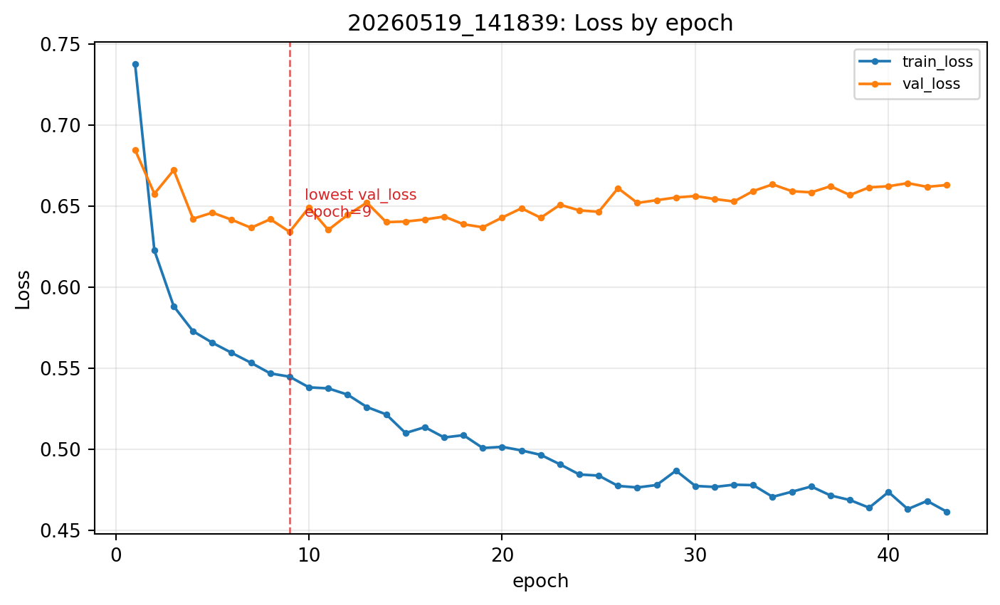
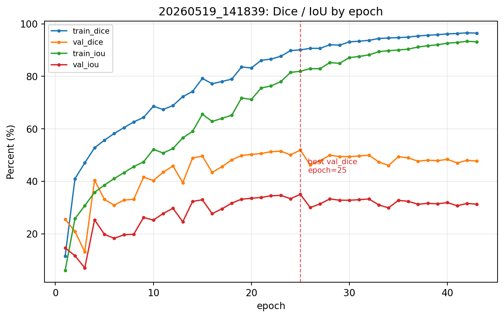
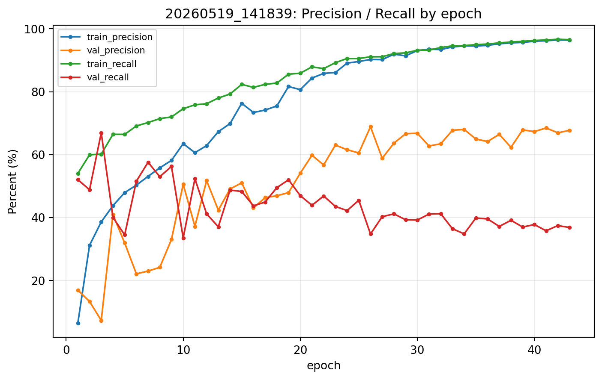
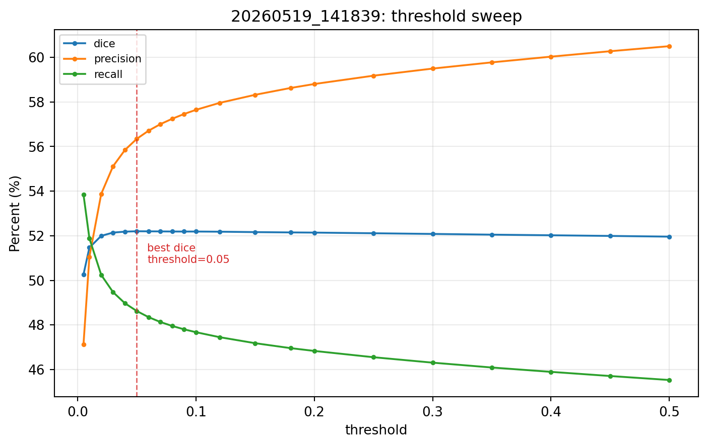
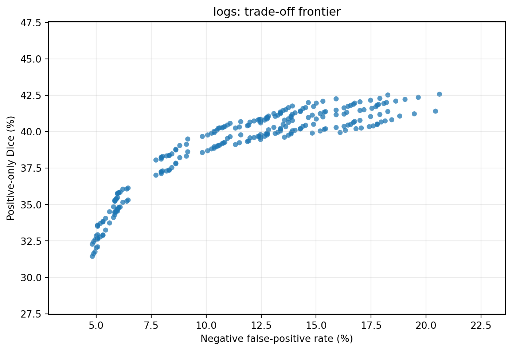

# SIIM-ACR SMP U-Net-ResNet34 实验报告

## 1. 实验目的

本实验在 SIIM-ACR Pneumothorax Segmentation 数据集上评估基于 `segmentation_models_pytorch` 的 U-Net-ResNet34 分割模型。该实验与 Unet++-ResNet34、DeepLabV3+-ResNet34 使用相同的 ResNet34 encoder 和相近训练配置，用于横向比较不同 SMP 分割架构在气胸分割任务上的表现。

本报告仅基于验证集结果进行分析。当前实验未包含独立 test 集评估，因此以下结果不能表述为最终泛化性能。

## 2. 实验配置

实验输出目录：

```text
outputs/experiments/siim_acr_smp_unet_resnet34_v1/20260519_141839
```

主要配置来自 `config.json`：

| 配置项 | 数值 |
|---|---:|
| 数据集 | SIIM-ACR Pneumothorax Segmentation |
| 模型 | SMP U-Net |
| Encoder | ResNet34 |
| Encoder 预训练 | ImageNet |
| 输入尺寸 | 512 x 512 |
| 输入通道 | 3 |
| 配置训练轮数 | 50 |
| `metrics.csv` 已记录轮数 | 43 |
| Batch size | 32 |
| 初始学习率 | 0.0003 |
| Weight decay | 0.0003 |
| Loss | BCE + Dice |
| BCE 权重 | 0.3 |
| Dice 权重 | 0.7 |
| BCE `pos_weight` | 2.0 |
| 默认二值化阈值 | 0.50 |
| Balanced sampling | 是 |
| 正样本采样比例 | 0.35 |
| 随机种子 | 42 |
| 设备 | CUDA |
| AMP | 开启 |

本实验使用的训练、阈值扫描和后处理搜索入口与 SMP 系列实验一致：

```text
scripts/train/train_siim_smp.py
scripts/evaluate/threshold_sweep_siim_smp.py
scripts/evaluate/postprocess_sweep_siim_smp.py
src/cxr_lesionseg/models/smp_models.py
```

## 3. 训练结果

训练日志来自 `logs/metrics.csv`。当前日志记录到第 43 轮。模型在前 20 轮内快速收敛，验证集 Dice 在第 25 轮达到最高值 `0.5195`。第 25 轮后，训练集 Dice 继续升高，但验证集 Dice 逐步下降，说明训练后期出现过拟合。

关键 epoch 指标如下：

| Epoch | Train Dice | Val Dice | Val IoU | Val Precision | Val Recall |
|---:|---:|---:|---:|---:|---:|
| 1 | 0.1159 | 0.2561 | 0.1468 | 0.1698 | 0.5207 |
| 20 | 0.8318 | 0.5030 | 0.3360 | 0.5411 | 0.4699 |
| 21 | 0.8609 | 0.5063 | 0.3390 | 0.5980 | 0.4390 |
| 22 | 0.8658 | 0.5133 | 0.3452 | 0.5673 | 0.4686 |
| 23 | 0.8764 | 0.5151 | 0.3469 | 0.6304 | 0.4355 |
| 25 | 0.9008 | 0.5195 | 0.3509 | 0.6053 | 0.4551 |
| 41 | 0.9632 | 0.4703 | 0.3074 | 0.6849 | 0.3581 |
| 43 | 0.9646 | 0.4773 | 0.3135 | 0.6773 | 0.3685 |

最佳验证集结果：

| 指标 | 数值 |
|---|---:|
| Best epoch | 25 |
| Train loss | 0.4838 |
| Train Dice | 0.9008 |
| Train IoU | 0.8195 |
| Train Precision | 0.8960 |
| Train Recall | 0.9056 |
| Val loss | 0.6465 |
| Val Dice | 0.5195 |
| Val IoU | 0.3509 |
| Val Precision | 0.6053 |
| Val Recall | 0.4551 |
| Val Specificity | 0.9991 |

当前日志末轮第 43 轮结果：

| 指标 | 数值 |
|---|---:|
| Train loss | 0.4616 |
| Train Dice | 0.9646 |
| Train IoU | 0.9316 |
| Train Precision | 0.9638 |
| Train Recall | 0.9653 |
| Val loss | 0.6630 |
| Val Dice | 0.4773 |
| Val IoU | 0.3135 |
| Val Precision | 0.6773 |
| Val Recall | 0.3685 |
| Val Specificity | 0.9995 |

从最佳 epoch 与第 43 轮结果对比可以看到，训练集 Dice 从 0.9008 升至 0.9646，但验证集 Dice 从 0.5195 下降至 0.4773，验证集 Recall 从 0.4551 下降至 0.3685。该现象说明继续训练主要提升了训练集拟合程度，并未带来验证集收益。

## 4. Threshold sweep 结果

为分析二值化阈值对分割性能的影响，本实验在验证集上对 `checkpoints/best_model.pth` 进行了 threshold sweep，结果保存在 `logs/threshold_sweep_val.csv`。

在已评估阈值中，`threshold=0.05` 取得最高全局像素级 Dice：

| Threshold | Dice | IoU | Precision | Recall | Specificity |
|---:|---:|---:|---:|---:|---:|
| 0.05 | 0.5220 | 0.3532 | 0.5634 | 0.4863 | 0.9989 |
| 0.06 | 0.5220 | 0.3532 | 0.5671 | 0.4835 | 0.9989 |
| 0.07 | 0.5219 | 0.3531 | 0.5700 | 0.4813 | 0.9989 |
| 0.08 | 0.5219 | 0.3531 | 0.5724 | 0.4795 | 0.9989 |
| 0.50 | 0.5196 | 0.3510 | 0.6050 | 0.4553 | 0.9991 |

与默认阈值 `0.50` 相比，最佳阈值 `0.05` 将 Dice 从 0.5196 提升至 0.5220，Recall 从 0.4553 提升至 0.4863，但 Precision 从 0.6050 降至 0.5634。整体提升幅度较小，说明阈值调整主要改善召回，但不能显著突破模型本身的分割能力。

## 5. 后处理参数搜索结果

为进一步分析简单连通域后处理对验证集表现的影响，本实验使用 `postprocess_sweep_siim_smp.py` 搜索了 `threshold`、`min_component_area` 和 `keep_largest_component` 的组合，结果保存在：

```text
logs/postprocess_sweep_val.csv
```

若按 `mean_dice_all` 排序，最佳组合为：

| 参数 | 数值 |
|---|---:|
| Threshold | 0.09 |
| Min component area | 1000 |
| Keep largest component | False |

对应验证集结果如下：

| 指标 | 数值 |
|---|---:|
| Mean Dice all | 0.8126 |
| Mean Dice positive | 0.3359 |
| Mean Dice negative | 0.9494 |
| Mean IoU positive | 0.2625 |
| False positive negative | 84 / 1659 |
| Negative FP rate | 5.06% |

该结果显示，较强的连通域面积约束可以显著降低阴性样本误报，使整体 Dice 和负样本 Dice 得到提升。但该配置下 `mean_dice_positive` 只有 0.3359，说明大量小面积或边界不连续的阳性预测被后处理删除，阳性样本分割能力受到明显削弱。

若按 `mean_dice_positive` 排序，最高正样本 Dice 出现在较低阈值且无连通域面积过滤的配置：

| 参数 | 数值 |
|---|---:|
| Threshold | 0.03 |
| Min component area | 0 |
| Keep largest component | False |

对应验证集结果如下：

| 指标 | 数值 |
|---|---:|
| Mean Dice all | 0.6743 |
| Mean Dice positive | 0.4258 |
| Mean Dice negative | 0.7456 |
| Mean IoU positive | 0.3233 |
| False positive negative | 342 / 1659 |
| Negative FP rate | 20.61% |

该配置可提高正样本 Dice，但阴性样本误报明显增加，整体 Dice 低于强后处理配置。因此，SMP U-Net-ResNet34 在后处理参数上同样存在正样本召回与阴性误报控制之间的权衡。

## 6. 与其他 SMP 模型的横向对比

与 Unet++-ResNet34 和 DeepLabV3+-ResNet34 相比，SMP U-Net-ResNet34 的全局像素级 Dice 接近，但没有形成明确优势：

| 模型 | 训练期最佳 Val Dice | Threshold sweep 最佳 Dice |
|---|---:|---:|
| U-Net-ResNet34 | 0.5195 | 0.5220 |
| Unet++-ResNet34 | 0.5146 | 0.5198 |
| DeepLabV3+-ResNet34 | 0.5218 | 0.5241 |

在后处理约束下，SMP U-Net-ResNet34 若按整体 Dice 选择参数，可以取得较低的阴性假阳性率，但正样本 Dice 降至 0.3359；若按正样本 Dice 选择参数，阴性假阳性率升至 20.61%。因此，该模型同样没有在正样本 Dice 与误报控制之间取得优于 U-Net++ 的综合平衡。

| 模型与配置 | Mean Dice all | Mean Dice positive | Negative FP rate | False positive negative |
|---|---:|---:|---:|---:|
| U-Net++ 后处理 baseline：threshold=0.08, area=150 | 0.7576 | 0.3980 | 13.92% | 231 / 1659 |
| SMP U-Net 按整体 Dice 最优：threshold=0.09, area=1000 | 0.8126 | 0.3359 | 5.06% | 84 / 1659 |
| SMP U-Net 按正样本 Dice 最优：threshold=0.03, area=0 | 0.6743 | 0.4258 | 20.61% | 342 / 1659 |

该对比说明，SMP U-Net-ResNet34 的全局 Dice 与其他 SMP 模型接近，但后处理后的表现仍受正样本漏检和阴性误报权衡限制。强后处理让模型更保守，弱后处理提升正样本 Dice 但误报偏高。

## 7. 结论

本实验完成了 SMP U-Net-ResNet34 在 SIIM-ACR 气胸分割任务上的训练、阈值选择和简单后处理分析。模型在训练期最佳验证 Dice 为 0.5195，阈值扫描后最佳全局 Dice 为 0.5220，与 Unet++-ResNet34 和 DeepLabV3+-ResNet34 处于相近水平。

然而，在后处理约束下，SMP U-Net-ResNet34 没有明显优于 U-Net++。较强后处理可以降低阴性样本误报并提高整体 Dice，但正样本 Dice 下降明显；较弱后处理可以提高正样本 Dice，但阴性样本误报较多。因此，本实验更适合作为 ResNet34 encoder 下普通 U-Net 架构的横向对照，后续主结果仍建议以 U-Net++ 作为较优基线。

## 8. 后续建议

1. 保留 SMP U-Net-ResNet34 作为普通 U-Net 架构对照，用于区分 encoder 提升和 decoder 结构差异带来的影响。
2. 后续对比表中同时报告全局 Dice、positive-only Dice、阴性假阳性率和后处理参数，避免单一整体指标导致选择偏差。
3. 若继续优化该模型，优先尝试更温和的 `min_component_area` 区间，避免强后处理删除小病灶。
4. 对低阈值高正样本 Dice 配置下的阴性误报样本进行可视化回看，判断误报是否集中在肺尖、胸膜线或高对比边缘区域。
5. 后续主线实验优先围绕 U-Net++ 改进损失函数、数据增强和困难阳性样本召回。

## 图表解读

训练 loss 曲线用于观察收敛速度和验证集 loss 是否后期回升。



Dice/IoU 曲线已统一为百分比，便于观察训练集与验证集之间的泛化差距。



Precision/Recall 曲线用于判断模型是偏保守还是偏召回。



阈值扫描曲线将 Dice、Precision 和 Recall 统一到百分比尺度下，辅助选择验证集阈值。



后处理 trade-off 图以阴性误报率为横轴、positive-only Dice 为纵轴，适合判断候选配置是否只是用误报换召回。


