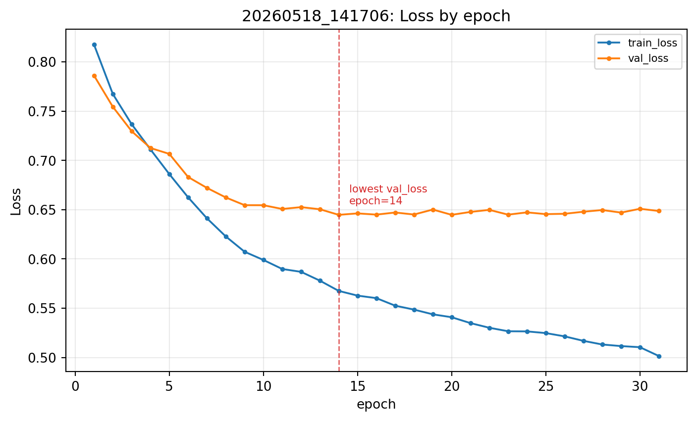
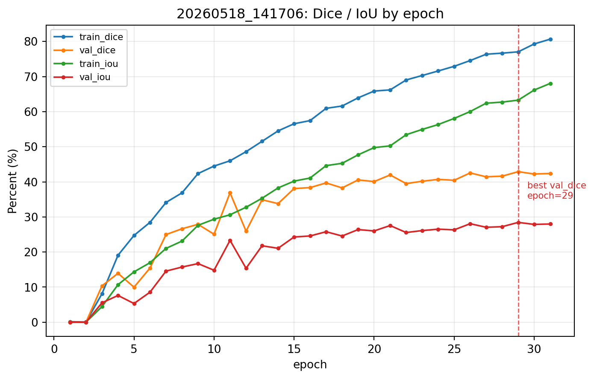
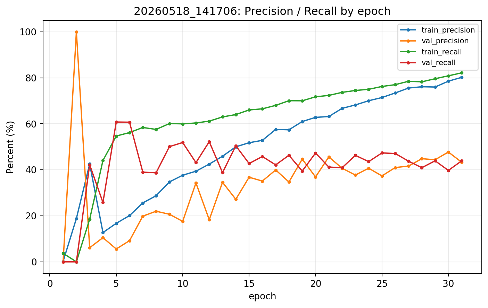

# SIIM-ACR U-Net Baseline v3 实验报告

## 实验概览

- 实验名称：`siim_acr_unet_baseline_v3`
- 运行目录：`outputs/experiments/siim_acr_unet_baseline_v3/20260518_141706`
- 数据集：SIIM-ACR Pneumothorax Segmentation
- 任务：气胸二值分割
- 模型：基础 U-Net
- 输入：单通道 512 x 512 胸片
- 训练设备：CUDA
- AMP：启用
- 随机种子：42

该实验是在 v2 基础上的稳健性调整版本。主要改动是降低正样本重采样比例、降低 BCE `pos_weight`，并提高 Dice loss 权重，目标是缓解 v2 中训练集 Dice 快速冲高和训练/验证差距扩大的问题。

## 数据划分

| split | 数量 |
| --- | ---: |
| train | 8540 |
| val | 2135 |
| test | 1377 |

训练/验证集合的图像级 mask 分布：

| has_mask | 数量 |
| --- | ---: |
| 0 | 8296 |
| 1 | 2379 |

## 训练配置

配置文件：`outputs/experiments/siim_acr_unet_baseline_v3/20260518_141706/config.json`

| 参数 | 值 |
| --- | --- |
| image_size | 512 |
| in_channels | 1 |
| base_channels | 32 |
| configured_epochs | 50 |
| recorded_epochs | 31 |
| batch_size | 32 |
| num_workers | 8 |
| lr | 0.0003 |
| weight_decay | 0.0003 |
| loss | BCE + Dice |
| bce_weight | 0.3 |
| dice_weight | 0.7 |
| threshold | 0.5 |
| balanced_sampling | true |
| positive_sample_ratio | 0.35 |
| pos_weight | 2.0 |

说明：`config.json` 中计划训练 50 个 epoch，但 `metrics.csv` 实际记录到第 31 个 epoch。本报告以已有日志中的 31 个 epoch 为准。

## 最佳结果

验证集最佳 Dice 出现在第 29 个 epoch。

| 指标 | 值 |
| --- | ---: |
| val_loss | 0.6471 |
| val_dice | 0.4289 |
| val_iou | 0.2844 |
| val_precision | 0.4439 |
| val_recall | 0.4392 |
| val_specificity | 0.9986 |

对应训练指标：

| 指标 | 值 |
| --- | ---: |
| train_loss | 0.5115 |
| train_dice | 0.7705 |
| train_iou | 0.6328 |
| train_precision | 0.7600 |
| train_recall | 0.7961 |
| train_specificity | 0.9990 |

## 最后一轮结果

第 31 个 epoch 的验证指标如下：

| 指标 | 值 |
| --- | ---: |
| val_loss | 0.6487 |
| val_dice | 0.4238 |
| val_iou | 0.2798 |
| val_precision | 0.4332 |
| val_recall | 0.4390 |
| val_specificity | 0.9985 |

第 31 个 epoch 的训练 Dice 为 0.8066，仍高于验证 Dice 0.4238，但相比 v2 第 42 个 epoch 的训练 Dice 0.9633，训练集指标没有继续快速冲高，过拟合现象有所缓解。

## 与前序实验对比

| 实验 | 关键设置 | 最佳 epoch | 最佳 val Dice | 最佳 val IoU | val precision | val recall | 对应 train Dice |
| --- | --- | ---: | ---: | ---: | ---: | ---: | ---: |
| `siim_acr_unet_baseline` | baseline | 20 | 0.3632 | 0.2300 | 0.3484 | 0.4162 | - |
| `siim_acr_unet_baseline_v2_bs32` | positive_sample_ratio=0.50, pos_weight=5.0, BCE/Dice=0.5/0.5 | 26 | 0.4250 | 0.2822 | 0.4346 | 0.4408 | 0.8893 |
| `siim_acr_unet_baseline_v3` | positive_sample_ratio=0.35, pos_weight=2.0, BCE/Dice=0.3/0.7 | 29 | 0.4289 | 0.2844 | 0.4439 | 0.4392 | 0.7705 |

相较 v2，v3 的最佳验证 Dice 从 0.4250 提升到 0.4289，提升约 0.0039；最佳验证 IoU 从 0.2822 提升到 0.2844，提升约 0.0022。该提升幅度很小，说明当前普通 U-Net 架构在该数据集上的主要瓶颈并未被明显突破。

更有价值的变化在训练稳定性上：v3 降低正样本采样强度和 `pos_weight` 后，训练集 Dice 在最佳验证点为 0.7705，明显低于 v2 最佳验证点对应的 0.8893。末轮训练 Dice 也只有 0.8066，没有出现 v2 后期训练 Dice 快速升到 0.9633、验证 Dice 反而回落的强烈过拟合表现。

## 训练过程观察

- 第 1-2 个 epoch 的验证 Dice 仍接近 0，模型早期仍容易偏向空 mask 或极保守预测。
- 第 3 个 epoch 起验证 Dice 有明显回升，说明降低 `pos_weight` 后并未阻断前景学习。
- 第 29 个 epoch 达到最佳验证 Dice 0.4289，随后第 30-31 个 epoch 小幅回落到 0.4223 和 0.4238。
- 第 31 个 epoch 的训练 Dice 为 0.8066，验证 Dice 为 0.4238，仍存在训练/验证差距，但比 v2 后期差距更小。
- 最佳点的 precision 为 0.4439、recall 为 0.4392，二者较接近，说明 v3 在阈值 0.5 下没有明显向高 precision 或高 recall 单侧偏移。

## 产物

- 最佳模型：`outputs/experiments/siim_acr_unet_baseline_v3/20260518_141706/checkpoints/best_model.pth`
- 最后模型：`outputs/experiments/siim_acr_unet_baseline_v3/20260518_141706/checkpoints/last_model.pth`
- 指标日志：`outputs/experiments/siim_acr_unet_baseline_v3/20260518_141706/logs/metrics.csv`

## 结论

V3 通过降低正样本重采样比例、降低 `pos_weight` 并调整损失权重，使训练过程相比 V2 更稳定，训练集 Dice 没有继续快速冲高，过拟合现象有所缓解。然而，验证集 Dice 仅从约 0.425 提升到 0.429，提升幅度有限，说明普通 U-Net 在该数据集上的瓶颈并未被明显突破。

后续优化重点不应继续堆叠训练轮数，而应优先引入验证集阈值搜索、负样本误检分析，以及图像级分类辅助分支，以增强模型对正常/异常胸片的整体判别能力。完成验证集阈值选择和错误分析前，不建议直接声称 test 集泛化性能。

建议下一步：

- 基于 v3 best checkpoint 做验证集 threshold sweep，重点观察 Dice、precision、recall 和 negative FP rate 的权衡。
- 对负样本误检做可视化分析，区分肺尖/胸膜边缘响应、肺野外响应、低置信度散点和疑似标注噪声。
- 尝试加入图像级分类辅助分支，让模型同时学习是否存在气胸，提高正常/异常胸片的整体判别能力。
- 保留早停策略，以验证 Dice 或综合指标为主保存最佳模型，避免继续堆叠训练轮数。
- 在验证集阈值和错误分析固定后，再进行独立 test 集评估。

本报告只基于训练和验证日志生成，尚未包含独立 test 集评估。

## 图表解读

训练 loss 曲线用于观察收敛速度和验证集 loss 是否后期回升。

Dice/IoU 曲线已统一为百分比，便于观察训练集与验证集之间的泛化差距。

Precision/Recall 曲线用于判断模型是偏保守还是偏召回。

