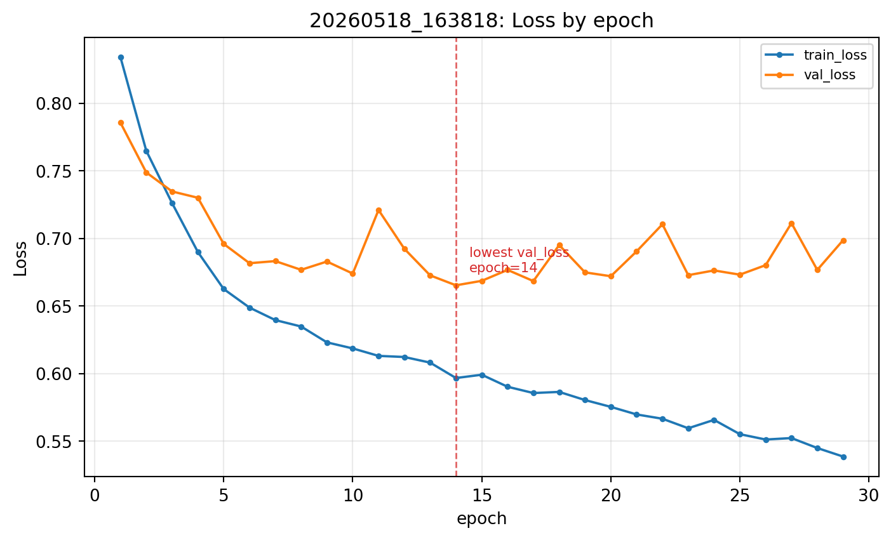
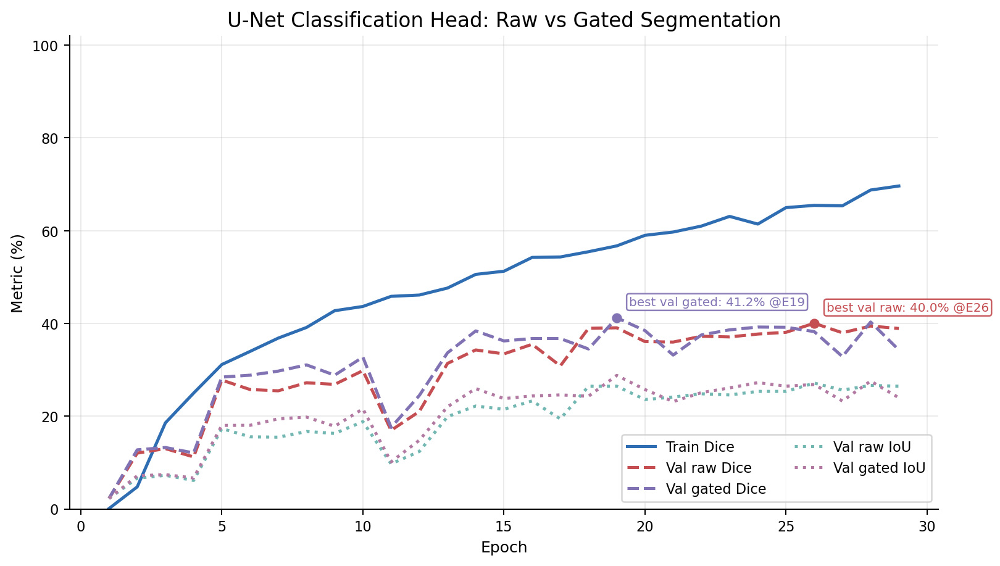
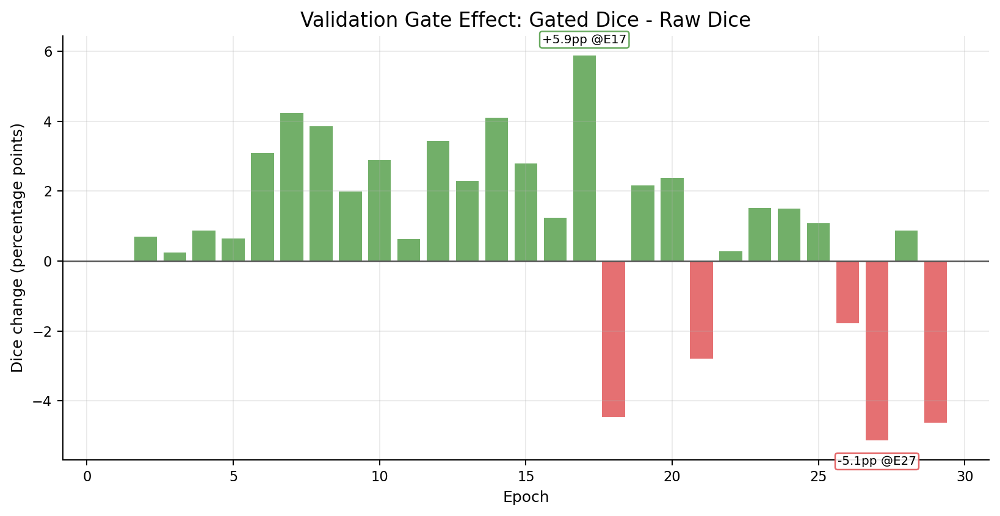
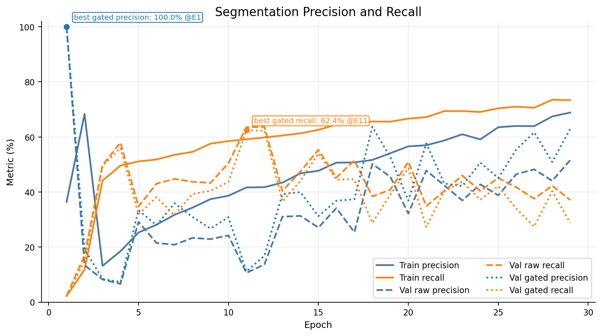
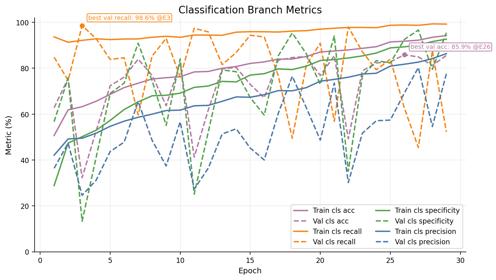

# SIIM-ACR U-Net + Classification Head 实验报告

## 实验概览

- 实验名称：`siim_acr_unet_cls_v2`
- 运行目录：`outputs/experiments/siim_acr_unet_cls_v2/20260518_163818`
- 数据集：SIIM-ACR Pneumothorax Segmentation
- 任务：气胸二值分割，同时加入图像级气胸分类辅助任务
- 模型：U-Net + image-level classification head
- 输入：单通道 512 x 512 胸片
- 训练设备：CUDA
- AMP：启用
- 随机种子：42

该实验在 v3 训练策略基础上加入图像级分类头。训练时总损失为分割损失加分类损失，验证时同时记录原始分割输出指标和通过分类头进行图像级 gate 后的分割指标。目标是让模型学习正常/异常胸片的整体判别能力，从而减少负样本误检。

## 数据划分

| split | 数量 |
| --- | ---: |
| train | 8540 |
| val | 2135 |
| test | 1377 |

训练/验证集合的图像级 mask 分布：

| has_mask | 数量 |
| --- | ---: |
| 0 | 8296 |
| 1 | 2379 |

## 训练配置

配置文件：`outputs/experiments/siim_acr_unet_cls_v2/20260518_163818/config.json`

| 参数 | 值 |
| --- | --- |
| image_size | 512 |
| in_channels | 1 |
| base_channels | 32 |
| cls_dropout | 0.2 |
| configured_epochs | 80 |
| recorded_epochs | 29 |
| batch_size | 16 |
| num_workers | 8 |
| lr | 0.0003 |
| weight_decay | 0.0003 |
| loss | BCE + Dice + classification BCE |
| bce_weight | 0.3 |
| dice_weight | 0.7 |
| pos_weight | 2.0 |
| cls_weight | 0.05 |
| cls_pos_weight | 2.0 |
| threshold | 0.5 |
| cls_threshold | 0.3 |
| balanced_sampling | true |
| positive_sample_ratio | 0.35 |

说明：`config.json` 中计划训练 80 个 epoch，但 `metrics.csv` 实际记录到第 29 个 epoch。本报告以已有日志中的 29 个 epoch 为准。

## 最佳 Raw 分割结果

不使用分类 gate 时，验证集最佳 raw Dice 出现在第 26 个 epoch。

| 指标 | 值 |
| --- | ---: |
| val_loss | 0.6803 |
| val_seg_loss | 0.6477 |
| val_cls_loss | 0.6533 |
| val_raw_dice | 0.4002 |
| val_raw_iou | 0.2712 |
| val_raw_precision | 0.4645 |
| val_raw_recall | 0.4172 |
| val_raw_specificity | 0.9990 |
| val_gated_dice | 0.3823 |
| val_cls_acc | 0.8585 |
| val_cls_precision | 0.6915 |
| val_cls_recall | 0.6267 |
| val_cls_specificity | 0.9250 |

对应训练指标：

| 指标 | 值 |
| --- | ---: |
| train_loss | 0.5513 |
| train_seg_loss | 0.5401 |
| train_cls_loss | 0.2237 |
| train_dice | 0.6544 |
| train_iou | 0.5008 |
| train_cls_acc | 0.9177 |
| train_cls_recall | 0.9882 |
| train_cls_specificity | 0.8931 |

## 最佳 Gated 分割结果

使用分类头进行 gate 后，验证集最佳 gated Dice 出现在第 19 个 epoch。

| 指标 | 值 |
| --- | ---: |
| val_loss | 0.6750 |
| val_seg_loss | 0.6507 |
| val_cls_loss | 0.4860 |
| val_raw_dice | 0.3905 |
| val_raw_iou | 0.2645 |
| val_raw_precision | 0.4550 |
| val_raw_recall | 0.4083 |
| val_gated_dice | 0.4120 |
| val_gated_iou | 0.2879 |
| val_gated_precision | 0.5267 |
| val_gated_recall | 0.3904 |
| val_gated_specificity | 0.9992 |
| val_cls_acc | 0.8506 |
| val_cls_precision | 0.6282 |
| val_cls_recall | 0.8132 |
| val_cls_specificity | 0.8632 |

第 19 个 epoch 中，classification gate 将 Dice 从 raw 0.3905 提升到 gated 0.4120，说明分类头在部分 epoch 可以减少一部分负样本误检，并通过提高 precision 改善 gated Dice。但该收益不稳定，且最佳 gated Dice 仍低于 v3 baseline。

## 最后一轮结果

第 29 个 epoch 的验证指标如下：

| 指标 | 值 |
| --- | ---: |
| val_loss | 0.6988 |
| val_seg_loss | 0.6552 |
| val_cls_loss | 0.8721 |
| val_raw_dice | 0.3889 |
| val_raw_iou | 0.2645 |
| val_raw_precision | 0.5156 |
| val_raw_recall | 0.3708 |
| val_raw_specificity | 0.9993 |
| val_gated_dice | 0.3428 |
| val_gated_iou | 0.2397 |
| val_gated_precision | 0.6295 |
| val_gated_recall | 0.2872 |
| val_gated_specificity | 0.9996 |
| val_cls_acc | 0.8557 |
| val_cls_precision | 0.7756 |
| val_cls_recall | 0.5226 |
| val_cls_specificity | 0.9543 |

最后一轮中 gated precision 进一步提高，但 gated recall 明显下降到 0.2872，导致 gated Dice 降至 0.3428。分类 gate 变得更保守后，漏检风险增大。

## 与 V3 Baseline 对比

| 实验 | 关键设置 | 最佳 epoch | 最佳 val Dice | val IoU | val precision | val recall |
| --- | --- | ---: | ---: | ---: | ---: | ---: |
| `siim_acr_unet_baseline_v3` | U-Net, positive_sample_ratio=0.35, pos_weight=2.0, BCE/Dice=0.3/0.7 | 29 | 0.4289 | 0.2844 | 0.4439 | 0.4392 |
| `siim_acr_unet_cls_v2` raw | U-Net + classification head，不使用 gate | 26 | 0.4002 | 0.2712 | 0.4645 | 0.4172 |
| `siim_acr_unet_cls_v2` gated | U-Net + classification head，cls_threshold=0.3 gate | 19 | 0.4120 | 0.2879 | 0.5267 | 0.3904 |

相较 v3 baseline，分类头实验的最佳 raw Dice 低 0.0287，最佳 gated Dice 低 0.0169。gated 版本的 precision 高于 v3，但 recall 低于 v3，说明分类 gate 对一部分误检有抑制作用，但也带来了更多阳性漏检。

## 训练过程观察

- 分类头没有稳定提升验证集 Dice。最佳 gated Dice 出现在第 19 个 epoch，但后续并未持续改善。
- 第 19 个 epoch 中 gated Dice 高于 raw Dice，说明 gate 在局部阶段有效；第 26 个 epoch raw Dice 达到本实验最高时，gated Dice 反而低于 raw Dice。
- 后期分类头 specificity 提高、recall 降低，模型对阳性图像的保留更保守，导致 gated recall 和 gated Dice 下降。
- 训练集分类指标较高，例如第 29 个 epoch 的 train cls acc 为 0.9422、train cls recall 为 0.9922，但验证集 cls recall 仅 0.5226，说明分类辅助任务本身也存在泛化问题。
- 当前简单分类辅助头没有明显突破普通 U-Net 的验证 Dice 瓶颈。

## 产物

- 最佳 raw 模型：`outputs/experiments/siim_acr_unet_cls_v2/20260518_163818/checkpoints/best_raw_model.pth`
- 最佳 gated 模型：`outputs/experiments/siim_acr_unet_cls_v2/20260518_163818/checkpoints/best_gated_model.pth`
- 最后模型：`outputs/experiments/siim_acr_unet_cls_v2/20260518_163818/checkpoints/last_model.pth`
- 指标日志：`outputs/experiments/siim_acr_unet_cls_v2/20260518_163818/logs/metrics.csv`

## 结论

U-Net + classification head 未能稳定提升验证集 Dice。虽然分类门控在部分 epoch 提高了 gated Dice，例如第 19 个 epoch 从 raw 0.3905 提升到 gated 0.4120，但整体最佳结果仍低于 V3 baseline 的 0.4289，说明简单分类辅助头对当前任务帮助有限。

当前实验表明，单纯增加一个图像级分类头并用固定阈值 gate 分割输出，容易在 precision 和 recall 之间产生新的偏移：它可以抑制一部分负样本误检，但也可能误伤阳性样本，造成漏检。后续如果继续探索图像级辅助信息，应优先改进分类分支的泛化能力和 gate 策略，而不是直接依赖固定 `cls_threshold=0.3`。

建议下一步：

- 对分类头实验做验证集可视化，分别查看 gated 改善、gated 变差、false positive 和 false negative 样本。
- 对 `cls_threshold` 做扫描，观察分类 gate 对 Dice、precision、recall 和 negative FP rate 的影响。
- 尝试更弱或更晚介入的 gate 策略，例如仅在分类置信度极低时清空 mask。
- 若继续使用辅助分类任务，应考虑更强的 encoder 表征、预训练权重或多任务损失调度。
- 在验证集错误分析完成前，不建议基于该实验进入独立 test 集评估。

本报告只基于训练和验证日志生成，尚未包含独立 test 集评估。

## 图表解读

分类头实验同时记录 raw segmentation、gated segmentation 和图像级分类分支，因此图表需要按这些字段分别解读。下列曲线均来自 `20260518_163818/logs/metrics.csv`，不再使用普通 U-Net 分割实验的通用验证 Dice/Precision 模板。

训练 loss 曲线用于观察多任务训练的收敛过程。训练 loss 持续下降，但验证 loss 后期没有同步改善，说明继续训练主要提升训练集拟合程度，并未稳定带来验证集收益。

raw 与 gated segmentation 曲线用于比较分类 gate 前后的验证集表现。第 19 轮 gated Dice 达到本实验最高值，但第 26 轮 raw Dice 更高时，gate 反而降低了 Dice，说明固定 `cls_threshold=0.3` 的收益只在部分 epoch 成立。

gate 净收益曲线展示 `val_gated_dice - val_raw_dice`。正值表示 gate 改善当前 epoch 的 Dice，负值表示 gate 造成额外损失。该曲线可以更直观看出 gate 的不稳定性：它能在局部阶段减少误检，但也会在后期加重漏检。

Precision/Recall 曲线用于判断分割输出的保守程度。gated precision 通常高于 raw precision，但 gated recall 下降更明显，这与报告结论一致：classification gate 抑制了一部分误检，同时带来了更多阳性漏检。

分类分支指标曲线显示训练集分类 recall 和 specificity 持续较高，但验证集 recall 后期下降。分类分支的泛化波动会直接影响 gate 决策，因此当前固定 gate 策略不能作为稳定提升 Dice 的依据。

