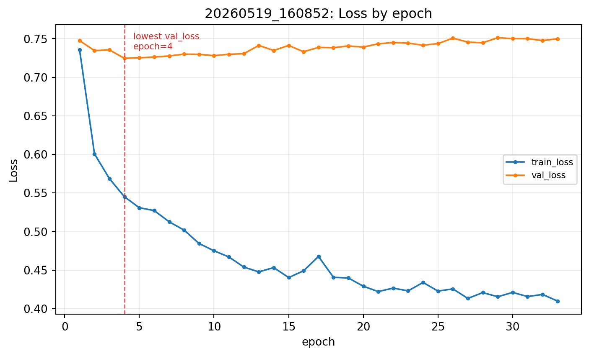
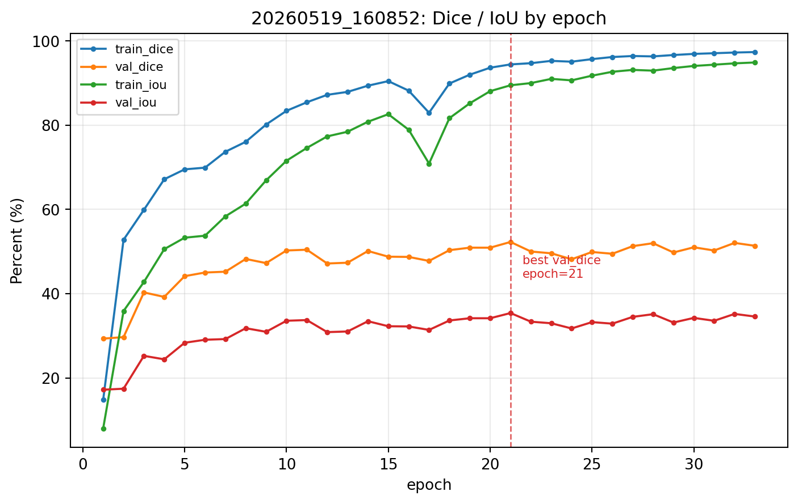
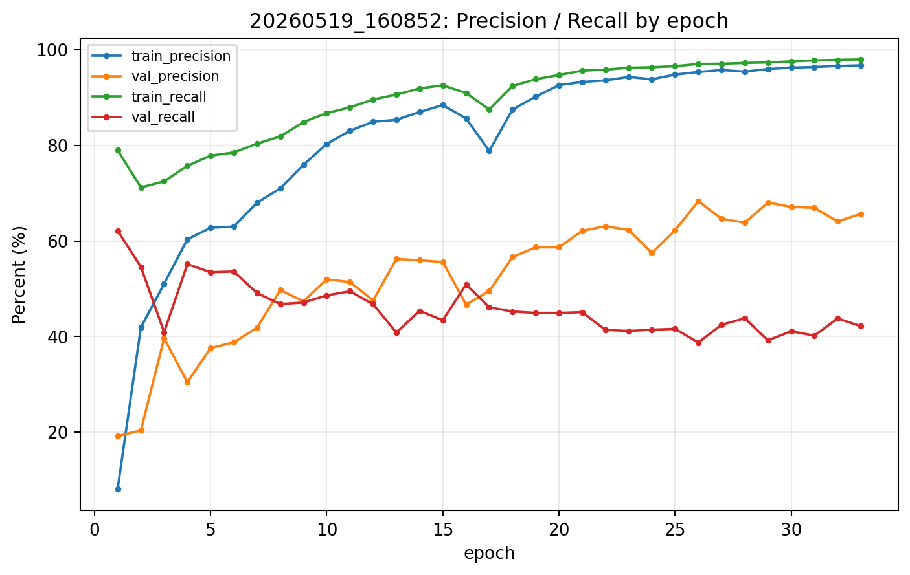
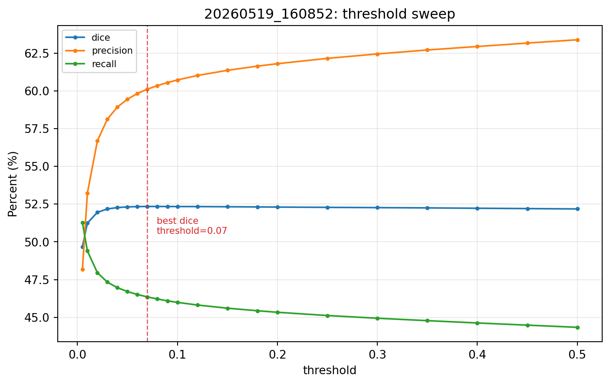
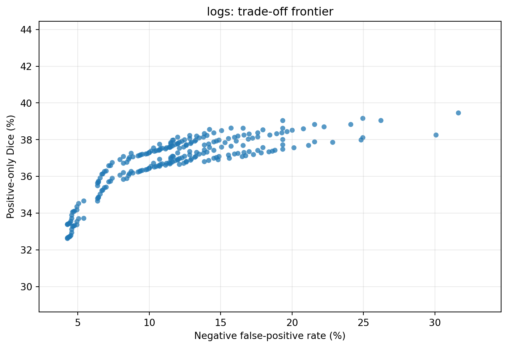

# SIIM-ACR Unet++-ResNet34 Recall V2 实验报告

## 1. 实验目的

本实验在 SIIM-ACR Pneumothorax Segmentation 数据集上继续评估 `Unet++-ResNet34`，重点尝试提高阳性样本召回和 positive-only Dice。相较普通 Unet++-ResNet34，本实验提高了正样本采样比例和 BCE 正类权重，并调整了分割损失权重，目标是观察更偏召回的训练配置能否改善气胸阳性样本分割。

本报告仅基于验证集结果进行分析。当前实验未包含独立 test 集评估，因此以下结果不能表述为最终泛化性能。

## 2. 实验配置

实验输出目录：

```text
outputs/experiments/siim_acr_unetpp_resnet34_recall_v2/20260519_160852
```

主要配置来自 `config.json`：

| 配置项 | 数值 |
|---|---:|
| 数据集 | SIIM-ACR Pneumothorax Segmentation |
| 模型 | Unet++ |
| Encoder | ResNet34 |
| Encoder 预训练 | ImageNet |
| 输入尺寸 | 512 x 512 |
| 输入通道 | 3 |
| 计划训练轮数 | 70 |
| 日志记录轮数 | 33 |
| Batch size | 32 |
| 初始学习率 | 0.0002 |
| Weight decay | 0.0003 |
| Loss | BCE + Dice |
| BCE 权重 | 0.2 |
| Dice 权重 | 0.8 |
| BCE `pos_weight` | 3.0 |
| 默认二值化阈值 | 0.25 |
| Balanced sampling | 是 |
| 正样本采样比例 | 0.50 |
| 随机种子 | 42 |
| 设备 | CUDA |
| AMP | 开启 |

与旧 Unet++ 主线相比，本实验的主要变化是更强调阳性样本：`positive_sample_ratio` 从 0.35 提高到 0.50，`pos_weight` 从 2.0 提高到 3.0，Dice loss 权重从 0.7 提高到 0.8。

说明：`config.json` 中计划训练 70 个 epoch，但 `logs/metrics.csv` 实际记录到第 33 个 epoch。本报告以已有 33 个 epoch 日志为准。

## 3. 训练产物

本实验目录包含以下核心产物：

```text
config.json
logs/metrics.csv
logs/threshold_sweep_val.csv
logs/postprocess_sweep_val.csv
checkpoints/best_model.pth
```

从 checkpoint 元信息看，`best_model.pth` 保存于第 21 轮，`best_score=0.522853`，对应训练期验证集 `val_dice` 最佳值。目录中存在 `checkpoints/last_model.pth.filepart`，该文件不是完整 checkpoint，本报告不使用该文件。

## 4. 训练结果

训练日志来自 `logs/metrics.csv`。模型在前 10 轮快速收敛，第 21 轮达到最高训练期验证 Dice。第 21 轮后，训练集 Dice 继续升高，但验证集 Dice 和 Recall 没有同步提升，出现过拟合迹象。

关键 epoch 指标如下：

| Epoch | Train Dice | Train Precision | Train Recall | Val Dice | Val IoU | Val Precision | Val Recall | Val Specificity | Val Loss |
|---:|---:|---:|---:|---:|---:|---:|---:|---:|---:|
| 1 | 0.1478 | 0.0815 | 0.7900 | 0.2933 | 0.1718 | 0.1919 | 0.6217 | 0.9921 | 0.7474 |
| 5 | 0.6953 | 0.6280 | 0.7789 | 0.4416 | 0.2834 | 0.3761 | 0.5348 | 0.9973 | 0.7251 |
| 10 | 0.8344 | 0.8033 | 0.8679 | 0.5026 | 0.3357 | 0.5199 | 0.4864 | 0.9986 | 0.7279 |
| 15 | 0.9049 | 0.8847 | 0.9261 | 0.4879 | 0.3226 | 0.5563 | 0.4344 | 0.9990 | 0.7411 |
| 21 | 0.9446 | 0.9329 | 0.9566 | 0.5229 | 0.3540 | 0.6215 | 0.4512 | 0.9992 | 0.7433 |
| 28 | 0.9636 | 0.9547 | 0.9728 | 0.5199 | 0.3513 | 0.6386 | 0.4384 | 0.9993 | 0.7446 |
| 33 | 0.9740 | 0.9677 | 0.9802 | 0.5137 | 0.3457 | 0.6570 | 0.4218 | 0.9993 | 0.7498 |

最佳训练期验证结果：

| 指标 | 数值 |
|---|---:|
| Best epoch | 21 |
| Train loss | 0.4221 |
| Train Dice | 0.9446 |
| Train IoU | 0.8950 |
| Train Precision | 0.9329 |
| Train Recall | 0.9566 |
| Train Specificity | 0.9995 |
| Val loss | 0.7433 |
| Val Dice | 0.5229 |
| Val IoU | 0.3540 |
| Val Precision | 0.6215 |
| Val Recall | 0.4512 |
| Val Specificity | 0.9992 |

最后一轮结果：

| 指标 | 数值 |
|---|---:|
| Epoch | 33 |
| Train loss | 0.4099 |
| Train Dice | 0.9740 |
| Train IoU | 0.9492 |
| Train Precision | 0.9677 |
| Train Recall | 0.9802 |
| Val loss | 0.7498 |
| Val Dice | 0.5137 |
| Val IoU | 0.3457 |
| Val Precision | 0.6570 |
| Val Recall | 0.4218 |
| Val Specificity | 0.9993 |

从第 21 轮到第 33 轮，训练集 Dice 从 0.9446 升至 0.9740，但验证集 Dice 从 0.5229 降至 0.5137，验证集 Recall 从 0.4512 降至 0.4218。该趋势说明后续训练主要提升了训练集拟合，并未改善验证集阳性召回。

## 5. Threshold Sweep 结果

`logs/threshold_sweep_val.csv` 记录了对 `best_model.pth` 的验证集阈值扫描。按全局像素级 Dice 排序，最佳阈值为 0.07：

| Threshold | Dice | IoU | Precision | Recall | Specificity |
|---:|---:|---:|---:|---:|---:|
| 0.07 | 0.5234 | 0.3545 | 0.6011 | 0.4636 | 0.9991 |
| 0.08 | 0.5234 | 0.3545 | 0.6034 | 0.4622 | 0.9991 |
| 0.09 | 0.5234 | 0.3545 | 0.6054 | 0.4610 | 0.9991 |
| 0.10 | 0.5234 | 0.3545 | 0.6072 | 0.4599 | 0.9991 |
| 0.12 | 0.5234 | 0.3544 | 0.6102 | 0.4582 | 0.9991 |
| 0.05 | 0.5231 | 0.3542 | 0.5944 | 0.4671 | 0.9990 |

阈值扫描显示，全局像素级 Dice 在 0.05 到 0.12 之间变化很小，最高 Dice 约为 0.5234。降低阈值可以提高 Recall，但同时降低 Precision。由于 SIIM-ACR 验证集中阴性样本较多，仅看全局像素级 Dice 不足以判断模型是否真正改善阳性样本分割，因此需要结合后处理后的 positive-only Dice 和负样本误报率分析。

## 6. 后处理参数搜索结果

后处理搜索结果来自 `logs/postprocess_sweep_val.csv`。本实验重点关注三类设置：最佳正样本 Dice、较均衡设置、低误报设置。

| 设置 | Threshold | Min component area | Keep largest | Positive Dice | Positive IoU | Negative FP rate | False positive negative | Mean Dice all | 结论 |
|---|---:|---:|---:|---:|---:|---:|---:|---:|---|
| Best positive Dice | 0.02 | 0 | False | 0.3946 | 0.3018 | 31.65% | 525 / 1659 | 0.4393 | 正样本 Dice 未超过旧模型，且负样本误报过高，不采用 |
| Best balanced setting | 0.02 | 200 | False | 0.3856 | 0.2971 | 14.23% | 236 / 1659 | 0.7525 | 误报率接近旧模型，但正样本 Dice 明显下降，不作为主模型 |
| Best low-FP setting | 0.05 | 200 | False | 0.3797 | 0.2932 | 11.63% | 193 / 1659 | 0.7713 | 可作为低误报对照，但分割能力下降 |

### 6.1 Best positive Dice

在 `threshold=0.02, min_component_area=0` 下，本实验获得最高 positive-only Dice：

| 指标 | 数值 |
|---|---:|
| Positive Dice | 0.3946 |
| Positive IoU | 0.3018 |
| Negative FP rate | 31.65% |
| False positive negative | 525 / 1659 |
| Mean Dice all | 0.4393 |

该设置为了提高正样本召回使用了很低阈值且不做连通域过滤，但 positive-only Dice 仍未超过旧 Unet++ 后处理 baseline 的 0.3980，同时阴性样本误报率升至 31.65%。因此该设置不采用。

### 6.2 Best balanced setting

在 `threshold=0.02, min_component_area=200` 下，负样本误报率下降到接近旧模型的水平：

| 指标 | 数值 |
|---|---:|
| Positive Dice | 0.3856 |
| Positive IoU | 0.2971 |
| Negative FP rate | 14.23% |
| False positive negative | 236 / 1659 |
| Mean Dice all | 0.7525 |

该设置的阴性误报率接近旧 Unet++ 后处理 baseline 的 13.92%，但 positive-only Dice 从旧模型的 0.3980 下降到 0.3856，说明误报控制没有带来阳性分割收益。因此该设置不作为主模型。

### 6.3 Best low-FP setting

在 `threshold=0.05, min_component_area=200` 下，本实验可获得更低的阴性样本误报：

| 指标 | 数值 |
|---|---:|
| Positive Dice | 0.3797 |
| Positive IoU | 0.2932 |
| Negative FP rate | 11.63% |
| False positive negative | 193 / 1659 |
| Mean Dice all | 0.7713 |

该设置比旧模型的负样本误报率更低，但 positive-only Dice 进一步下降到 0.3797。它可以作为低误报对照配置保留，但不代表模型分割能力提升。

## 7. 与旧 Unet++ 模型对比

旧 Unet++-ResNet34 后处理 baseline 使用 `threshold=0.08, min_component_area=150, keep_largest_component=False`，验证集结果为 positive-only Dice 0.3980、negative FP rate 13.92%、mean Dice all 0.7576。

与该旧模型相比：

| 模型与设置 | Positive Dice | Negative FP rate | Mean Dice all | 判断 |
|---|---:|---:|---:|---|
| 旧 Unet++ baseline | 0.3980 | 13.92% | 0.7576 | 当前主线参考 |
| Recall V2 best positive | 0.3946 | 31.65% | 0.4393 | 正样本未提升，误报过高 |
| Recall V2 balanced | 0.3856 | 14.23% | 0.7525 | 误报接近，但正样本下降 |
| Recall V2 low-FP | 0.3797 | 11.63% | 0.7713 | 误报更低，但分割能力下降 |

Recall V2 的训练期全局验证 Dice 可达到 0.5229，threshold sweep 后全局 Dice 可达到 0.5234，表面上略高于旧 Unet++ 训练期 Dice。但从后处理后的 positive-only Dice 看，本实验没有超过旧模型。尤其在最强调正样本 Dice 的配置下，阴性样本误报率达到 31.65%，不满足可用的误报控制要求。

## 8. 结论

本实验没有达到预期的 recall-oriented 改进目标。提高 `positive_sample_ratio`、`pos_weight` 和 Dice loss 权重后，训练期全局验证 Dice 略有提升，但后处理后的 positive-only Dice 未超过旧 Unet++ 模型。

最终判断如下：

1. `threshold=0.02, min_component_area=0` 是本实验 positive-only Dice 最高设置，positive Dice 为 0.3946，但 negative FP rate 达到 31.65%，不采用。
2. `threshold=0.02, min_component_area=200` 是较均衡设置，negative FP rate 为 14.23%，接近旧模型，但 positive Dice 只有 0.3856，不作为主模型。
3. `threshold=0.05, min_component_area=200` 可作为低误报对照，negative FP rate 为 11.63%，mean Dice all 为 0.7713，但 positive Dice 降至 0.3797，说明分割能力下降。

因此，`siim_acr_unetpp_resnet34_recall_v2` 不采用为主模型。该实验可保留为“提高正样本采样与正类权重未能改善 positive-only Dice”的负结果记录。

## 9. 后续建议

1. 不继续沿用当前 Recall V2 配置作为主线训练设置。
2. 若继续优化阳性样本分割，应优先从数据增强、困难阳性样本回看、loss 设计和伪阳性控制入手，而不是继续单纯提高采样正样本比例或 BCE `pos_weight`。
3. 后续报告应继续同时记录 positive-only Dice、negative FP rate 和 mean Dice all，避免只看全局像素级 Dice。
4. 对低 Dice 阳性样本和高误报阴性样本做可视化复查，判断性能瓶颈是模型召回不足、标注边界困难，还是低阈值带来的背景误检。
5. 如果需要低误报对照模型，可以保留 `threshold=0.05, min_component_area=200`，但应明确其 positive-only Dice 低于旧模型。

## 图表解读

训练 loss 曲线用于观察收敛速度和验证集 loss 是否后期回升。



Dice/IoU 曲线已统一为百分比，便于观察训练集与验证集之间的泛化差距。



Precision/Recall 曲线用于判断模型是偏保守还是偏召回。



阈值扫描曲线将 Dice、Precision 和 Recall 统一到百分比尺度下，辅助选择验证集阈值。



后处理 trade-off 图以阴性误报率为横轴、positive-only Dice 为纵轴，适合判断候选配置是否只是用误报换召回。


