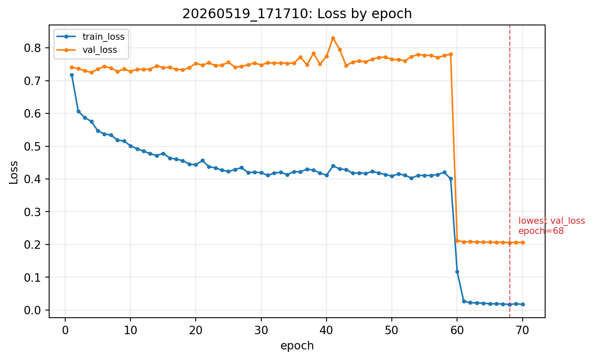
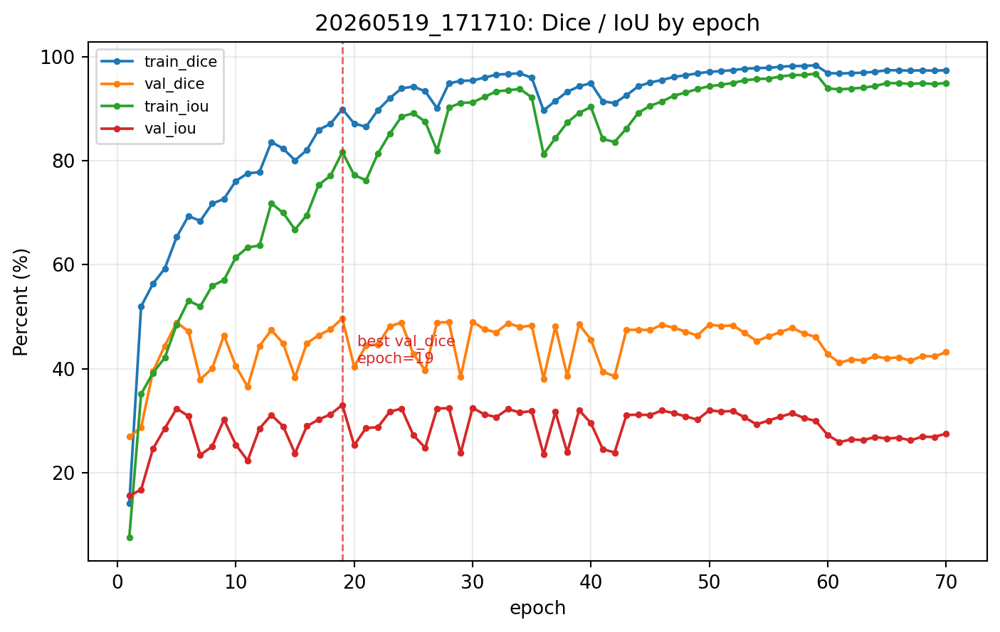
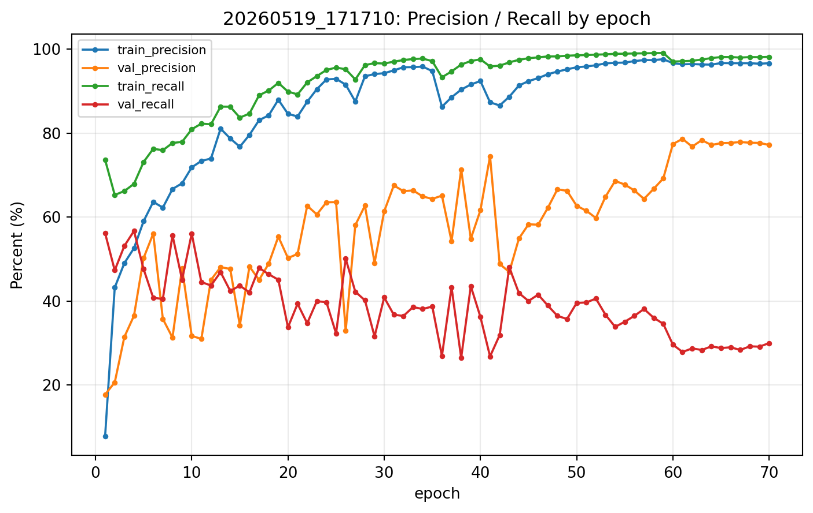
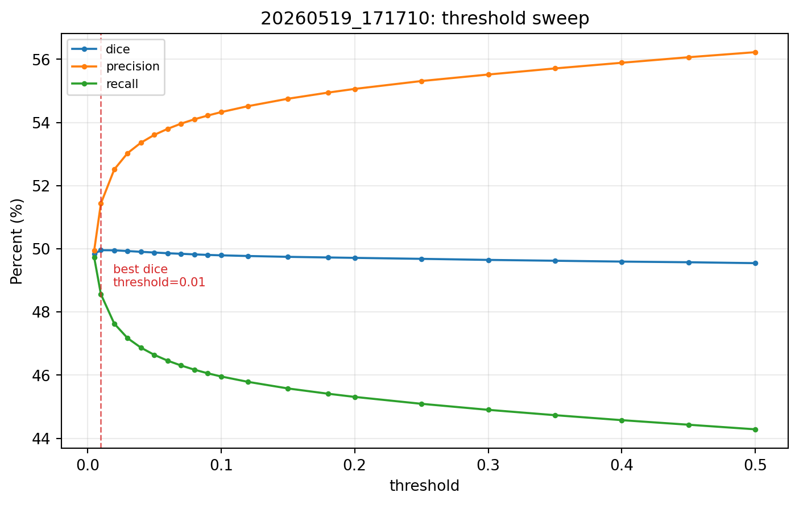
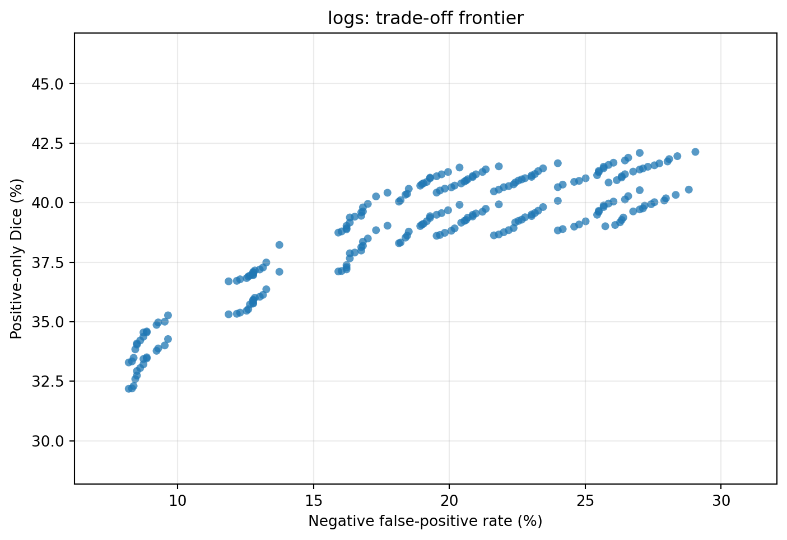

# SIIM-ACR Unet++-ResNet50 Recall V1 实验报告

## 1. 实验目的

本实验在 SIIM-ACR Pneumothorax Segmentation 数据集上评估 `Unet++-ResNet50` 的 recall-oriented 配置。实验目标是在 ResNet34 recall 方案基础上换用更强的 ResNet50 encoder，观察更大模型是否能提升气胸阳性样本分割能力，尤其是 positive-only Dice。

本报告仅基于验证集结果进行分析。当前实验未包含独立 test 集评估，因此以下结果不能表述为最终泛化性能。

## 2. 实验配置

实验输出目录：

```text
outputs/experiments/siim_acr_unetpp_resnet50_recall_v1/20260519_171710
```

主要配置来自 `config.json`：

| 配置项 | 数值 |
|---|---:|
| 数据集 | SIIM-ACR Pneumothorax Segmentation |
| 模型 | Unet++ |
| Encoder | ResNet50 |
| Encoder 预训练 | ImageNet |
| 输入尺寸 | 512 x 512 |
| 输入通道 | 3 |
| 训练轮数 | 70 |
| Batch size | 16 |
| 初始学习率 | 0.0002 |
| Weight decay | 0.0003 |
| Loss | BCE + Dice |
| BCE 权重 | 0.2 |
| Dice 权重 | 0.8 |
| BCE `pos_weight` | 3.0 |
| 默认二值化阈值 | 0.25 |
| Balanced sampling | 是 |
| 正样本采样比例 | 0.50 |
| 随机种子 | 42 |
| 设备 | CUDA |
| AMP | 开启 |

与 ResNet34 recall v2 相比，本实验主要变化是 encoder 从 ResNet34 替换为 ResNet50。由于模型显存占用增加，batch size 从 32 降至 16。其余 recall-oriented 设置保持一致：`positive_sample_ratio=0.50`、`pos_weight=3.0`、BCE/Dice 权重为 0.2/0.8。

## 3. 训练产物

本实验目录包含以下核心产物：

```text
config.json
logs/metrics.csv
logs/threshold_sweep_val.csv
logs/postprocess_sweep_val.csv
checkpoints/best_model.pth
checkpoints/last_model.pth
```

从 checkpoint 元信息看，`best_model.pth` 保存于第 19 轮，`best_score=0.496650`，对应训练期验证集 `val_dice` 最佳值。

## 4. 训练结果

训练日志来自 `logs/metrics.csv`。模型完整记录 70 个 epoch。第 19 轮取得最高训练期验证 Dice，之后训练集 Dice 继续升高，但验证集 Dice 未能改善。训练后期模型变得更保守，验证集 Precision 升高而 Recall 明显下降。

关键 epoch 指标如下：

| Epoch | Train Dice | Train Precision | Train Recall | Val Dice | Val IoU | Val Precision | Val Recall | Val Specificity | Val Loss |
|---:|---:|---:|---:|---:|---:|---:|---:|---:|---:|
| 1 | 0.1410 | 0.0780 | 0.7361 | 0.2693 | 0.1556 | 0.1771 | 0.5614 | 0.9921 | 0.7412 |
| 5 | 0.6531 | 0.5901 | 0.7312 | 0.4887 | 0.3234 | 0.5023 | 0.4758 | 0.9986 | 0.7351 |
| 10 | 0.7610 | 0.7183 | 0.8090 | 0.4049 | 0.2538 | 0.3168 | 0.5607 | 0.9964 | 0.7283 |
| 19 | 0.8990 | 0.8794 | 0.9195 | 0.4967 | 0.3304 | 0.5531 | 0.4506 | 0.9989 | 0.7393 |
| 30 | 0.9540 | 0.9426 | 0.9656 | 0.4903 | 0.3248 | 0.6135 | 0.4084 | 0.9992 | 0.7478 |
| 50 | 0.9708 | 0.9567 | 0.9853 | 0.4848 | 0.3199 | 0.6267 | 0.3953 | 0.9993 | 0.7647 |
| 60 | 0.9685 | 0.9666 | 0.9704 | 0.4281 | 0.2724 | 0.7738 | 0.2959 | 0.9997 | 0.2120 |
| 70 | 0.9739 | 0.9664 | 0.9816 | 0.4317 | 0.2753 | 0.7717 | 0.2997 | 0.9997 | 0.2065 |

最佳训练期验证结果：

| 指标 | 数值 |
|---|---:|
| Best epoch | 19 |
| Train loss | 0.4451 |
| Train Dice | 0.8990 |
| Train IoU | 0.8166 |
| Train Precision | 0.8794 |
| Train Recall | 0.9195 |
| Train Specificity | 0.9992 |
| Val loss | 0.7393 |
| Val Dice | 0.4967 |
| Val IoU | 0.3304 |
| Val Precision | 0.5531 |
| Val Recall | 0.4506 |
| Val Specificity | 0.9989 |

最后一轮结果：

| 指标 | 数值 |
|---|---:|
| Epoch | 70 |
| Train loss | 0.0176 |
| Train Dice | 0.9739 |
| Train IoU | 0.9492 |
| Train Precision | 0.9664 |
| Train Recall | 0.9816 |
| Val loss | 0.2065 |
| Val Dice | 0.4317 |
| Val IoU | 0.2753 |
| Val Precision | 0.7717 |
| Val Recall | 0.2997 |
| Val Specificity | 0.9997 |

从第 19 轮到第 70 轮，训练集 Dice 从 0.8990 升至 0.9739，但验证集 Dice 从 0.4967 降至 0.4317，验证集 Recall 从 0.4506 降至 0.2997。该趋势说明继续训练主要提高了训练集拟合和验证集预测保守性，没有改善阳性召回。

## 5. Threshold Sweep 结果

`logs/threshold_sweep_val.csv` 记录了对 `best_model.pth` 的验证集阈值扫描。按全局像素级 Dice 排序，最佳阈值为 0.01：

| Threshold | Dice | IoU | Precision | Recall | Specificity |
|---:|---:|---:|---:|---:|---:|
| 0.01 | 0.4996 | 0.3330 | 0.5143 | 0.4856 | 0.9986 |
| 0.02 | 0.4995 | 0.3329 | 0.5251 | 0.4763 | 0.9987 |
| 0.03 | 0.4993 | 0.3327 | 0.5303 | 0.4717 | 0.9987 |
| 0.04 | 0.4991 | 0.3325 | 0.5336 | 0.4687 | 0.9988 |
| 0.05 | 0.4988 | 0.3323 | 0.5361 | 0.4664 | 0.9988 |
| 0.06 | 0.4986 | 0.3321 | 0.5380 | 0.4646 | 0.9988 |

阈值扫描后，全局像素级 Dice 从训练期最佳 0.4967 提升到 0.4996，但仍低于 ResNet34 recall v2 的 threshold sweep 结果 0.5234，也低于普通 Unet++-ResNet34 的 threshold sweep 结果 0.5198。降低阈值主要提高 Recall，同时带来更多误报，因此需要结合后处理分析。

## 6. 后处理参数搜索结果

后处理搜索结果来自 `logs/postprocess_sweep_val.csv`。本实验重点关注两类设置：最佳正样本 Dice 和误报可控的均衡设置。

| 设置 | Threshold | Min component area | Keep largest | Positive Dice | Positive IoU | Negative FP rate | False positive negative | Mean Dice all | 结论 |
|---|---:|---:|---:|---:|---:|---:|---:|---:|---|
| Best positive Dice | 0.02 | 0 | False | 0.4213 | 0.3168 | 29.05% | 482 / 1659 | 0.6092 | 正样本分割有所提升，但阴性误报过高，不适合作为最终模型 |
| Best balanced setting | 0.02 | 500 | False | 0.3822 | 0.2922 | 13.74% | 228 / 1659 | 0.7555 | 误报率可控，但正样本 Dice 低于 U-Net++ ResNet34 baseline |

### 6.1 Best positive Dice

在 `threshold=0.02, min_component_area=0` 下，本实验获得最高 positive-only Dice：

| 指标 | 数值 |
|---|---:|
| Positive Dice | 0.4213 |
| Positive IoU | 0.3168 |
| Negative FP rate | 29.05% |
| False positive negative | 482 / 1659 |
| Mean Dice all | 0.6092 |

该设置下 positive-only Dice 高于旧 Unet++-ResNet34 后处理 baseline 的 0.3980，也高于 ResNet34 recall v2 的 best positive Dice 0.3946，说明 ResNet50 在低阈值、弱后处理条件下确实提高了正样本分割能力。但阴性样本误报率达到 29.05%，1659 个阴性验证样本中有 482 个出现假阳性，因此不适合作为最终模型。

### 6.2 Best balanced setting

在 `threshold=0.02, min_component_area=500` 下，负样本误报率下降到可控范围：

| 指标 | 数值 |
|---|---:|
| Positive Dice | 0.3822 |
| Positive IoU | 0.2922 |
| Negative FP rate | 13.74% |
| False positive negative | 228 / 1659 |
| Mean Dice all | 0.7555 |

该设置的 negative FP rate 为 13.74%，接近旧 Unet++-ResNet34 后处理 baseline 的 13.92%。但 positive-only Dice 只有 0.3822，低于旧 baseline 的 0.3980。说明强连通域过滤虽然能压低误报，但会删除一部分真实阳性区域，导致正样本分割收益消失。

## 7. 与 ResNet34 Baseline 对比

旧 Unet++-ResNet34 后处理 baseline 使用 `threshold=0.08, min_component_area=150, keep_largest_component=False`，验证集结果为 positive-only Dice 0.3980、negative FP rate 13.92%、mean Dice all 0.7576。

与该旧模型和 ResNet34 recall v2 相比：

| 模型与设置 | Positive Dice | Negative FP rate | Mean Dice all | 判断 |
|---|---:|---:|---:|---|
| 旧 Unet++-ResNet34 baseline | 0.3980 | 13.92% | 0.7576 | 当前主线参考 |
| ResNet34 recall v2 best positive | 0.3946 | 31.65% | 0.4393 | 正样本未提升，误报过高 |
| ResNet34 recall v2 balanced | 0.3856 | 14.23% | 0.7525 | 误报接近，正样本下降 |
| ResNet50 recall v1 best positive | 0.4213 | 29.05% | 0.6092 | 正样本提升，但误报过高 |
| ResNet50 recall v1 balanced | 0.3822 | 13.74% | 0.7555 | 误报可控，正样本低于 baseline |

ResNet50 recall v1 与 ResNet34 recall v2 的差异比较清楚：ResNet50 能在极低阈值、无面积过滤时取得更高 positive-only Dice，但这种收益伴随高阴性误报；一旦加入足够强的面积过滤来控制误报，positive-only Dice 会下降到低于旧 ResNet34 baseline。

## 8. 结论

本实验说明，更强的 ResNet50 encoder 在 recall-oriented 配置下可以提高低阈值条件下的正样本分割能力。`threshold=0.02, min_component_area=0` 时 positive-only Dice 达到 0.4213，高于旧 Unet++-ResNet34 baseline。

但该提升不可直接采用，因为对应 negative FP rate 为 29.05%，阴性误报过高，不适合作为最终模型。若使用 `threshold=0.02, min_component_area=500` 控制误报，negative FP rate 可降至 13.74%，但 positive-only Dice 下降到 0.3822，低于旧 U-Net++ ResNet34 baseline。

因此，`siim_acr_unetpp_resnet50_recall_v1` 不作为最终主模型。该实验可保留为一个重要观察：ResNet50 能提高阳性召回潜力，但当前后处理无法同时保留正样本 Dice 提升并控制阴性误报。

## 9. 后续建议

1. 不采用当前 ResNet50 recall v1 的 balanced setting 作为主模型，因为其 positive-only Dice 低于旧 ResNet34 baseline。
2. 如果继续探索 ResNet50，重点不应只调阈值和连通域面积，而应改进误报抑制机制，例如引入更可靠的图像级分类筛选或更细致的困难阴性样本训练。
3. 对 `threshold=0.02, min_component_area=0` 的高 Dice 阳性样本和高误报阴性样本做可视化复查，判断 ResNet50 提升来自真实病灶定位，还是更大范围激活导致的副作用。
4. 后续模型选择仍应同时报告 positive-only Dice、negative FP rate 和 mean Dice all，不能只看全局像素级 Dice 或单独的 positive-only Dice。

## 图表解读

训练 loss 曲线用于观察收敛速度和验证集 loss 是否后期回升。



Dice/IoU 曲线已统一为百分比，便于观察训练集与验证集之间的泛化差距。



Precision/Recall 曲线用于判断模型是偏保守还是偏召回。



阈值扫描曲线将 Dice、Precision 和 Recall 统一到百分比尺度下，辅助选择验证集阈值。



后处理 trade-off 图以阴性误报率为横轴、positive-only Dice 为纵轴，适合判断候选配置是否只是用误报换召回。


